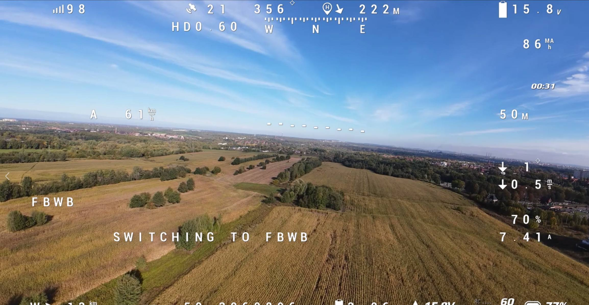
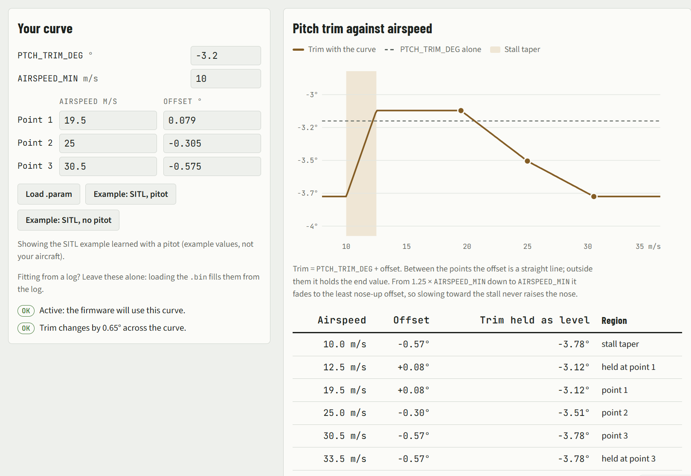
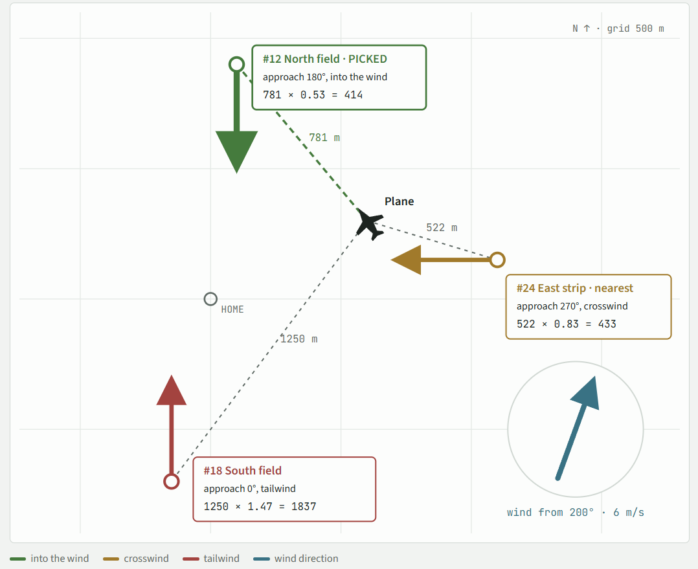
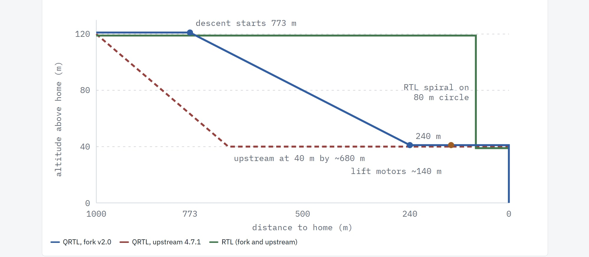
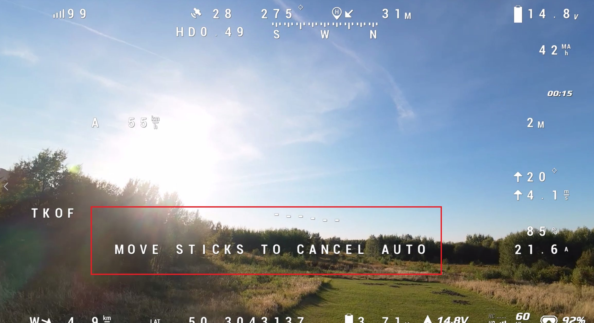
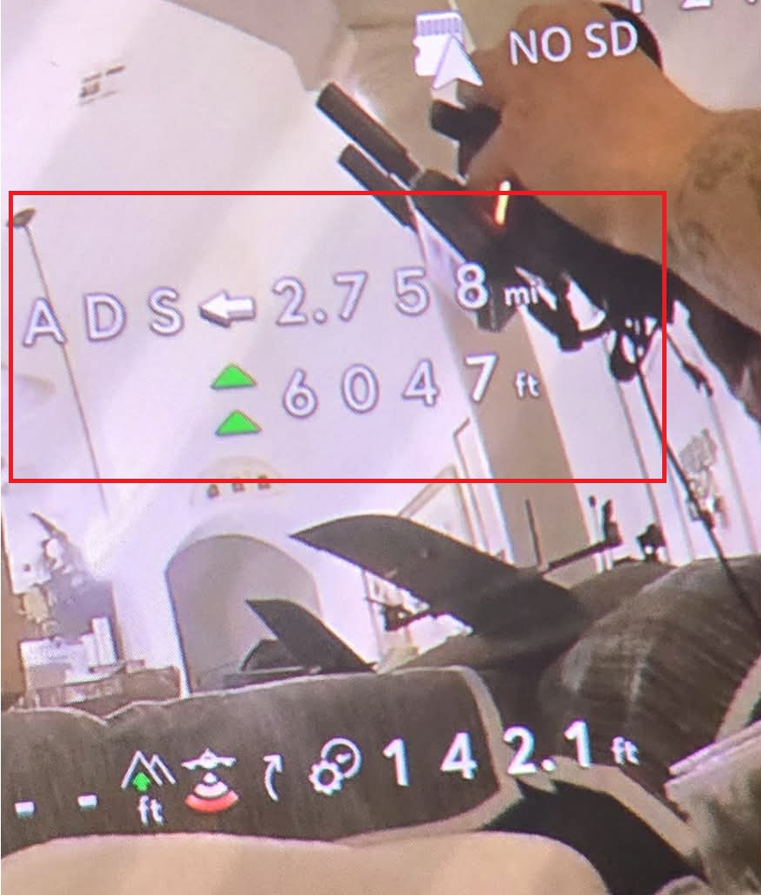
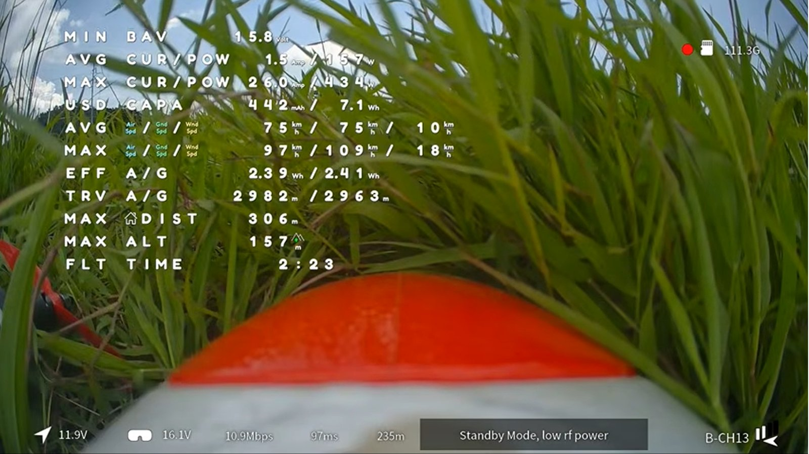
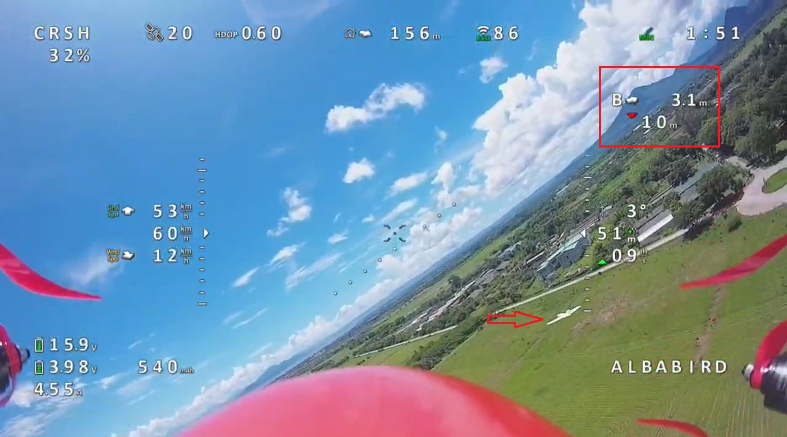
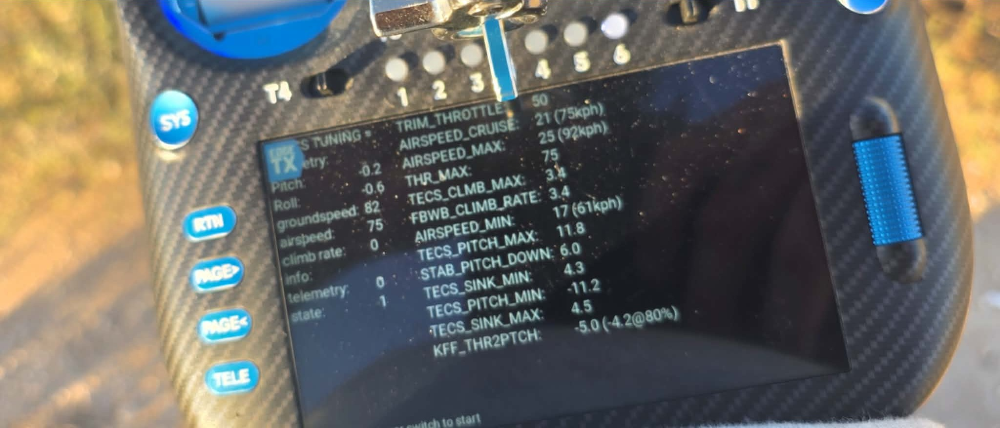

# ArduPlane Stratos

*Formerly **ArduPlane Custom**. Same firmware and release tracks; v2.1 is the first release under the new name.*

> 🛠️ **One firmware, two release tracks.** Every release is built from this
> branch for two groups of boards:
>
> | Track | Boards | What's compiled in |
> |---|---|---|
> | **`full-v*`** | F7 / H7, 2 MB flash | every hardware backend upstream ships, plus this fork's additions |
> | **`light-v*`** | 1 MB F4 | the same fork feature set, with rarely-used GPS / RC / battery / rangefinder / CAN backends stripped to fit |
>
> Both tracks carry the **identical fork feature set** and share one git hash;
> the light configuration switches on automatically for 1 MB boards (see
> [Building](#building)).
> **⬇ Download:** grab the newest build for your board from the
> [**Releases** page](https://github.com/erwinquilloy/ardupilot/releases)
> (every version, newest first — the current releases are `full-v2.0` and `light-v2.0`).

A curated fork of ArduPlane, rebased onto upstream **ArduPlane 4.7.2**
(tag `Plane-4.7.2`, commit `fb77356789`). This branch carries a set of
additions and behaviour changes on top of stock 4.7.2, mostly ported
from [shellixyz's classic 2022 fork](https://github.com/shellixyz/ardupilot)
and the maintained successor at [ArduCustom/ardupilot](https://github.com/ArduCustom/ardupilot),
plus a few additions originating in this fork.

> If you fly stock ArduPlane and don't recognise the param names in this
> document, you are on the wrong firmware — go to [ardupilot.org](https://ardupilot.org)
> instead.

> 📋 **Read first — your GCS won't describe this fork's parameters.**
> Mission Planner and QGroundControl ship the *upstream* parameter
> metadata, so every parameter this fork adds (and every fork-added bit
> on `FLIGHT_OPTIONS`, `RC_OPTIONS`, `OSD_OPTIONS`, …) shows up with a
> blank description, no value list, and no bitmask checkboxes. The
> parameter still works — your GCS just doesn't know what it is. Use
> this fork's own docs instead of guessing:
>
> - **[Full parameter reference](#full-parameter-reference)** — every
>   parameter this firmware exposes, with descriptions, units and ranges.
> - **[Bitmask calculator](#bitmask-calculator)** — tick the bits you
>   want and copy out the integer to paste into your GCS (or paste a
>   value back to see which bits are set).
>
> One set covers both release tracks.
>
> Those two, plus the transmitter-side scripts (**TECS tuning helper**,
> **Yaapu Course Hold pack**), are collected under
> **[Documentation and tooling](#documentation-and-tooling)**. The browser
> tools are also on one page:
> **[ArduPilot Tools](https://erwinquilloy.github.io/ardupilot-tools/)**.

---

## What's new in v2.1 (draft)

*Not released yet. The current releases are still `full-v2.0` / `light-v2.0`.
Everything below is on both tracks unless it says "full only".*

| Area | Change | Details |
|---|---|---|
| Name | **ArduPlane Custom is now ArduPlane Stratos.** The boot banner reads `ArduPlane V4.7.2 Stratos v2.1`; parameters, release tracks and branch names are unchanged | [Firmware version string](#firmware-version-string) |
| Base | **Rebased onto ArduPlane 4.7.2** (v2.0 was on 4.7.1). A bug-fix release: no parameter renames. Most visible fix: a flight controller mounted upside down or rotated (`AHRS_ORIENTATION` not 0) no longer waits minutes for "Roll/Pitch inconsistent" after power-up | [What ArduPlane 4.7.2 brought in](#what-arduplane-472-brought-in) |
| Flight | **Adaptive pitch trim** (`RCx_OPTION 254`, `PTCH_TRIM_SPD` / `PTCH_TRIM_OFS`): pitch trim scheduled on airspeed, learned in a few straight legs; `KFF_THR2PTCH` is ignored while the curve is active | [Adaptive pitch trim](#adaptive-pitch-trim--airspeed-schedule-learned-in-flight-rcx_option--254) |
| Flight | **Servo auto-trim also works in Course Hold**, under the same rules as FBWA: `SERVO_AUTO_TRIM 1` (once), `2` (continuous) or the `RCx_OPTION 200` switch. With 0 and the switch low, Course Hold never trims | [Auto-trim improvements](#auto-trim-improvements) |
| Flight | `FLIGHT_OPTIONS` bit 21 handover message starts with "Takeoff complete", so Yaapu voices it | [Bit 21](#flight_options-bit-21--end-takeoff-in-fbwb-instead-of-loitering) |
| VTOL | **`Q_FS_EKF_HOLD`** (off by default): after an EKF failsafe, refuse switching from a VTOL mode to a fixed-wing mode for N seconds, so a forward transition can't start on a bad height estimate | [Q_FS_EKF_HOLD](#q_fs_ekf_hold--no-forward-transition-right-after-an-ekf-failsafe-v21) |
| RC | **32 RC channels** (`RC_32CH_ENABLE`, off by default), `RC17_`–`RC32_OPTION` | [32 RC channels](#32-rc-channels-v21) |
| RC | **mLRS RC over MAVLink (`radio_rc_channels`) on every board**, light 1 MB F4 included; stock needs a 2 MB board. Channels 17–32 stay steady with mLRS 1.4.04's mixed 16/32-channel frames | [mLRS MAVLink RC](#mlrs-mavlink-rc-radio_rc_channels-on-every-board-v21) |
| Head tracking | **Head tracking from the VTX gimbal port** (`SERIALn_PROTOCOL 51`) for goggles that don't send it over MSP; one UART can also drive a CADDX gimbal; MSP head tracking wins when both arrive | [Gimbal-port head tracking](#head-tracking-from-the-vtx-gimbal-port-serialn_protocol-51) |
| Head tracking | Short or malformed MSP head-tracker frames are dropped | |
| OSD | **ADS-B traffic warning**: the `OSDx_ADSB` element flashes inside `OSD_W_ADSB_DIST` (and optionally `OSD_W_ADSB_ALT`). **Full only** | [Traffic warning](#traffic-warning-v21) |
| Radar | `RADAR_OSD_MODE 1` shows the nearest peer instead of cycling. A peer without a GPS fix (sending 0,0) is no longer drawn with a distance to 0,0 | [Radar OSD element](#osd-element) |
| Boards | **Four new tone-buzzer variants**: `AtomRCF405NAVI-Buzz`, `CoreWingF405WingV2-Buzz`, `CoreWingF405MiniV2-Buzz` (light) and `TBS_LUCID_H7_OEM-Buzz` (full) play the full pitched tunes on a passive buzzer wired to the LED pad, instead of the single-pitch beeps of the stock buzzer output. They give up only the LED pad's own output; the stock boards still ship alongside for anyone who wants it | [Tone-buzzer variants](#tone-buzzer-board-variant-speedybeef405wing-buzz) |
| Boards | **CoreWing F405 Wing V2 and Wing Mini V2** (`CoreWingF405WingV2`, `CoreWingF405WMiniV2`, light): new in ArduPlane 4.7.2, shipped on upstream's own board definitions | [CoreWing F405 Wing V2 / Wing Mini V2](#light-track--15-boards-all-1-mb-f4) |
| Boards | **`MatekF405-Wing-PWM10`** (light): `MatekF405-Wing-bdshot` with the `LED` pad back as PWM output 10 instead of relay 1 | [Light track](#light-track--15-boards-all-1-mb-f4) |

## Contents

An outline of everything this fork adds and where it is documented. Each line links to its section.

- **Getting started** — [What's new in v2.1 (draft)](#whats-new-in-v21-draft), [Why flash this instead of stock ArduPlane 4.7.2?](#why-flash-this-instead-of-stock-arduplane-472), [Building](#building), [Which file in the zip do I flash?](#which-file-in-the-zip-do-i-flash), [Release fleets (full-v2.1 / light-v2.1)](#release-fleets-full-v21--light-v21), [Tone-buzzer board variant (SpeedyBeeF405WING-Buzz)](#tone-buzzer-board-variant-speedybeef405wing-buzz)
- **[What this fork adds](#what-this-fork-adds)**
  - [Flight modes](#flight-modes)
    - [Course Hold (mode 26)](#course-hold-mode-26)
    - [Auto Trim (mode 27)](#auto-trim-mode-27)
    - [RC aux switch entries (Plane)](#rc-aux-switch-entries-plane)
    - [FLTMODE_EXT: 12-position mode switch](#fltmode_ext--12-position-fltmode_ch)
  - [Arming & takeoff](#arming--takeoff)
    - [Arm-switch safety: in-flight disarm cuts throttle](#arm-switch-safety--in-flight-disarm-cuts-throttle-doesnt-disarm)
    - [ARMING_MODE_SW: mode switch after arming](#arming_mode_sw--auto-mode-switch-after-arming)
    - [TKOFF_THR_IDLE: pre-launch idle throttle](#tkoff_thr_idle--pre-launch-idle-throttle)
    - [TKOFF_IDL_DELAY: pause before idle ramp](#tkoff_idl_delay--pause-before-idle-ramp)
    - [Pre-launch audio cues](#pre-launch-audio-cues)
    - [Pilot altitude control during TAKEOFF loiter](#pilot-altitude-control-during-takeoff-loiter)
    - [FLIGHT_OPTIONS bit 21: end TAKEOFF in FBWB](#flight_options-bit-21--end-takeoff-in-fbwb-instead-of-loitering)
  - [VTOL transition](#vtol-transition)
    - [FLIGHT_OPTIONS bit 18: end a VTOL transition in FBWB](#flight_options-bit-18--end-a-vtol-transition-in-fbwb-instead-of-fbwa)
    - [Q_FS_EKF_HOLD: no forward transition right after an EKF failsafe](#q_fs_ekf_hold--no-forward-transition-right-after-an-ekf-failsafe-v21)
  - [Pitch trim & tuning knob](#pitch-trim--tuning-knob)
    - [PTCH_TRIM_DEG is now knob-tunable](#ptch_trim_deg-is-now-knob-tunable)
    - [Adaptive pitch trim: airspeed schedule learned in flight (RCx_OPTION 254, v2.1)](#adaptive-pitch-trim--airspeed-schedule-learned-in-flight-rcx_option--254)
    - [Three switchable tuning sets (TUNE_PARAM / PARAM2 / PARAM3)](#three-switchable-tuning-sets--tune_param--param2--param3)
    - [Faster tuning selector timing](#faster-tuning-selector-timing)
    - [ATT log uses trim-corrected pitch target](#att-log-uses-trim-corrected-pitch-target)
  - [RTL & failsafe behaviour](#rtl--failsafe-behaviour)
    - [RTL_LVL_RLL_LMT: roll limit for the initial climb](#rtl_lvl_rll_lmt--separate-roll-limit-for-the-initial-climb)
    - [FLIGHT_OPTIONS bit 22: RTL climb first only in failsafe](#flight_options-bit-22--rtl_climb_first_only_in_fs)
    - [FLIGHT_OPTIONS bit 23: glide in auto-throttle modes](#flight_options-bit-23--allow_gliding_in_auto_thr_modes)
    - [FLIGHT_OPTIONS bit 12: FBWB-style loiter altitude (upstream)](#flight_options-bit-12--fbw-b-style-loiter-altitude-control-upstream)
    - [FLIGHT_OPTIONS bit 24: pilot altitude control in RTL](#flight_options-bit-24--rtl_manual_alt_control)
    - [RTL Autoland Commit (RCx_OPTION 251)](#rtl-autoland-commit-rcx_option-251--hold-at-home-commit-on-your-command)
    - [Lost-vehicle audio alarm during RC failsafe](#lost-vehicle-audio-alarm-during-rc-failsafe)
    - [Mission restart on AUTO if not flying](#mission-restart-on-auto-if-not-flying)
    - [LAND_WIND_BIAS: pick the upwind DO_LAND_START](#land_wind_bias--pick-the-upwind-do_land_start)
    - [LAND_WIND_DIST: cap how far the wind bias reaches](#land_wind_dist--why-cap-how-far-the-wind-bias-can-reach)
    - [LAND_WIND_STRICT: make the cap a hard fence](#land_wind_strict--why-make-the-cap-a-hard-fence)
    - [QRTL with RTL_ALTITUDE -1 (fixed in v2.0)](#qrtl-with-rtl_altitude--1-fixed-in-v20)
  - [Pilot control of loiter radius and direction (LOITER, RTL, TAKEOFF)](#pilot-control-of-loiter-radius-and-direction-loiter-rtl-takeoff)
  - [Emergency landing (RC failsafe)](#emergency-landing-rc-failsafe)
  - [Auto-trim improvements](#auto-trim-improvements)
  - [Move sticks to cancel auto launch](#move-sticks-to-cancel-auto-launch)
  - [Manual airspeed control in nav modes](#manual-airspeed-control-in-nav-modes)
  - [Throttle output deadzone](#throttle-output-deadzone)
  - [Throttle voltage compensation in MANUAL mode](#throttle-voltage-compensation-in-manual-mode)
  - [Revert to MANUAL after disarming](#revert-to-manual-after-disarming)
  - [Smarter RC relays](#smarter-rc-relays)
  - [32 RC channels (v2.1)](#32-rc-channels-v21)
  - [mLRS MAVLink RC on every board (v2.1)](#mlrs-mavlink-rc-radio_rc_channels-on-every-board-v21)
  - [Steering assist supports reverse driving](#steering-assist-supports-reverse-driving)
  - [MAVFTP reliability on low-RAM F4 boards](#mavftp-reliability-on-low-ram-f4-boards)
  - [EKF3 allocation failed on 1 MB F4](#ekf3-allocation-failed-on-1-mb-f4--allocation-order-and-the-fix)
  - [Serial port numbering matched to chip UART numbers](#serial-port-numbering-matched-to-chip-uart-numbers)
  - [is_flying heuristic: fixed thresholds](#is_flying-heuristic--fixed-thresholds)
  - [Stick mixing default](#stick-mixing-default)
  - [Aileron / elevator differential throws](#aileron--elevator-differential-throws)
  - [Throttle / flap → elevator PWM offset mixes](#throttle--flap--elevator-pwm-offset-mixes)
- **[Walksnail Headtracking via MSP and Serial Gimbal](#walksnail-headtracking-via-msp-and-serial-gimbal)** — [How it flows](#how-it-flows), [Setup](#setup), [Controls](#controls), [POI lock with head tracking](#poi-lock-with-head-tracking), [Notes](#notes), [Head tracking from the VTX gimbal port (v2.1)](#head-tracking-from-the-vtx-gimbal-port-serialn_protocol-51)
- **[OSD additions](#osd-additions)** — [New elements](#new-elements), [ADS-B traffic element (OSDx_ADSB)](#ads-b-traffic-element-osdx_adsb), [OSD options (OSD_OPTIONS bits)](#osd-options-osd_options-bits), [Tunables added](#tunables-added), [Display polish](#display-polish), [Setting up cell voltage on the OSD](#setting-up-cell-voltage-on-the-osd), [Stats grid](#stats-grid)
- **[Peer-aircraft radar (iNav Radar / FormationFlight)](#peer-aircraft-radar-inav-radar--formationflight)** — [Setup](#setup-1), [OSD element](#osd-element), [Build gating](#build-gating), [Peer callsigns on the radar OSD](#peer-callsigns-on-the-radar-osd), [Limitations / scope](#limitations--scope)
- **[Quadplane / VTOL](#quadplane--vtol)**
  - [Q_TRIM_PITCH is now knob-tunable](#q_trim_pitch-is-now-knob-tunable)
  - [VTOL AutoTrim (RCx_OPTION 182)](#vtol-autotrim--learn-the-hover-level-in-qhover-rcx_option--182)
  - [Q_M_FRTB_RATIO: tri-frame front/rear thrust balance](#q_m_frtb_ratio--tri-frame-frontrear-thrust-balance)
- **[Battery monitoring (AP_BattMonitor)](#battery-monitoring-ap_battmonitor)** — [New params](#new-params), [Behaviour changes](#behaviour-changes)
- **[Stats (AP_Stats)](#stats-ap_stats)**
- **[TECS / throttle](#tecs--throttle)** — [Default changes](#default-changes), [New params](#new-params-1), [Behaviour changes](#behaviour-changes-1)
- **[EKF / state estimator](#ekf--state-estimator)**
- **[Sensors](#sensors)** — [LightWare SF000/B rangefinder over I2C](#lightware-sf000b-rangefinder-over-i2c)
- **[Telemetry](#telemetry)** — [CRSF](#crsf), [MSP / DJI](#msp--dji), [FrSky SPort passthrough](#frsky-sport-passthrough), [Common](#common)
- **[Behaviour changes vs upstream — migration notes](#behaviour-changes-vs-upstream--migration-notes)** — [Upgrading from v1.1 (ArduPlane 4.6.3 base)](#upgrading-from-v11-arduplane-463-base)
- **[Deliberately not included](#deliberately-not-included)**
- **[Documentation and tooling](#documentation-and-tooling)**
  - [Full parameter reference](#full-parameter-reference)
  - [Bitmask calculator](#bitmask-calculator)
  - [TECS tuning helper (Ethos / EdgeTX)](#tecs-tuning-helper-ethos--edgetx)
  - [Yaapu Course Hold telemetry pack](#yaapu-course-hold-telemetry-pack)
- **[Branch / repository layout](#branch--repository-layout)**
- **[Credits](#credits)**

---

## Why flash this instead of stock ArduPlane 4.7.2?

Everything stock ArduPlane 4.7.2 does still works underneath — this fork
only **adds** on top (both variants carry the identical feature set; they
differ only in which hardware backends are compiled in). If you fly
long-range or FPV fixed-wing, these are the additions most worth flashing
for. Each group links to its full reference below.

### 🖥️ A much richer FPV / long-range OSD

The single biggest visible difference from stock — dozens of new elements
aimed at efficiency and situational awareness:

- **Efficiency in Wh/km or mAh/km**, **resting cell voltage** (sag-free
  pack health at a glance), and **battery used since arming**.
- **End-of-flight stats grid** (distance, time, peak values) plus a
  **persistent max-flight-time** record.
- **Angle of attack**, **demanded vs actual airspeed**, attitude-corrected
  **rangefinder AGL altitude**, longitudinal/lateral/vertical **G**, **peak
  roll/pitch rates**, **auto-flap %**, **input throttle %**, **live tuning
  param name + value**, and **loiter radius**.
- **Under/over-speed warning flashes**, one/two-decimal polish on speed,
  vertical speed and attitude, and a shortenable **plus code** home locator.
- **ADS-B traffic in the goggles** (full-track boards): the nearest aircraft
  from an ADS-B receiver, with direction arrow, distance and height relative
  to you — iNav-style. Upstream only shows ADS-B traffic on the GCS map.
  From v2.1 it flashes when traffic comes inside a distance you set
  (`OSD_W_ADSB_DIST`).

→ [OSD additions](#osd-additions)

### 🛟 Wind-aware autoland & a real failsafe glide-in

Protecting the airframe when the link drops or the battery runs marginal:

- **`LAND_WIND_BIAS` auto-picks the upwind `DO_LAND_START`**, with
  **`LAND_WIND_DIST`** capping how far the wind bias may reach and
  **`LAND_WIND_STRICT`** turning that cap into a hard fence — so a
  battery-marginal RTL doesn't fly away to a distant wind-aligned approach.
- **Emergency-landing state machine on RC failsafe**: instead of orbiting
  home until the battery dies, it sinks to a glide altitude, aligns **into
  wind**, glides down and disarms. Fully parameterised (`FS_ELAND_*`).
- **RTL Autoland Commit** (`RCx_OPTION 251`): hold over home until you flip
  a switch, then commit to the landing sequence. On RC failsafe it waits
  `RTL_AUTOLAND_DLY` seconds (default 30) before committing, so a brief
  dropout can't trigger the landing.

→ [Emergency landing](#emergency-landing-rc-failsafe) ·
[RTL & failsafe behaviour](#rtl--failsafe-behaviour)

### 🚀 Hand-launch & arming ergonomics

Built for throwing a wing off your hand safely:

- **`TKOFF_THR_IDLE`** idles the prop once armed and the stick is raised —
  a clear "armed and ready" cue in the palm — with **`TKOFF_IDL_DELAY`** to
  pause before the ramp.
- **Pre-launch audio cues** and a **lost-vehicle alarm** on failsafe.
- **Arm-switch safety**: an in-flight disarm **cuts throttle and drops to
  FBWA** rather than killing the servos and dropping the plane out of the
  sky. **`ARMING_MODE_SW`** auto-switches to TAKEOFF/AUTO after arming.
- **End the climb in FBWB** (`FLIGHT_OPTIONS` bit 21) instead of loitering
  out at `TKOFF_DIST` — control the moment the plane is up, with altitude
  still held for you until you move the sticks.
- **End a VTOL transition in FBWB** (`FLIGHT_OPTIONS` bit 18) — on a
  quadplane, finish the forward transition holding altitude instead of
  being left in FBWA with the throttle stick still where you left it.
- **`FLTMODE_EXT`** gives a full **12 flight-mode positions** on one channel.

→ [Arming & takeoff](#arming--takeoff) · [Flight modes](#flight-modes)

### 🎛️ Tune and take control in the air

- **Knob-tunable pitch trim** (`PTCH_TRIM_DEG`, plus `Q_TRIM_PITCH` on
  VTOL) and **three switchable tuning sets** (`TUNE_PARAM`/`PARAM2`/`PARAM3`)
  — retune live without a laptop.
- **Adaptive pitch trim** (v2.1, `RCx_OPTION 254`) — airspeed-scheduled pitch
  trim, learned by the aircraft itself in a few straight legs. FBWA holds
  height hands-off much better across the speed range (SITL: climb with speed
  halved with a pitot, cut by two thirds without); without a pitot, FBWB /
  CRUISE speed changes also lose about 20 % less height. With a pitot the
  TECS modes gain nothing.
- **Move sticks to cancel auto launch**: nudge pitch or roll during an
  automatic takeoff and the plane drops to FBWA so you can abort a bad
  launch — iNav-style, active only while the takeoff is running.
- **Throttle stick sets target airspeed** in RTL/LOITER/CIRCLE/AUTO, plus
  **pilot loiter radius + direction** control in LOITER/RTL, and in the
  TAKEOFF-mode loiter once the climb finishes.
- Extra modes: **Course Hold** (heading hold) and **Auto Trim** as a mode.

→ [Pitch trim & tuning](#pitch-trim--tuning-knob) ·
[Manual airspeed](#manual-airspeed-control-in-nav-modes) ·
[Cancel auto launch](#move-sticks-to-cancel-auto-launch)

### 📡 Long-range extras

- **Peer-aircraft radar** (iNav Radar / FormationFlight) — see other
  aircraft on your OSD.
- **Richer telemetry**: CRSF relative altitude + link quality, MSP/DJI
  numeric-attitude fix, wind in km/h, vehicle UID.
- **mLRS RC over MAVLink on every board** (v2.1) — `radio_rc_channels` works on
  the light 1 MB F4 builds too; stock ArduPilot needs a 2 MB board or a custom
  build. Up to 32 channels with `RC_32CH_ENABLE`.
- **Expanded battery monitoring**: Wh accounting, cell count/voltage, and
  capacity-remaining plus low/critical thresholds feeding the OSD readouts.

→ [Peer-aircraft radar](#peer-aircraft-radar-inav-radar--formationflight) ·
[Telemetry](#telemetry) ·
[Battery monitoring](#battery-monitoring-ap_battmonitor)

### 🎥 Head-tracked FPV gimbal (MSP)

- **Point your gimbal with your head** — head-tracker angles come from the
  goggles over the MSP DisplayPort link and drive the mount (pan/tilt/roll).
  Drives **any gimbal ArduPilot supports** on the full (H7) build — Siyi,
  SToRM32-serial, Topotek, Viewpro, CADDX (CADDXFPV GM-series), servo, …
- Switch to **enable** head tracking (`RCx_OPTION 252`) and to **centre + FPV-lock**
  it (`253`). You can also use the **Walksnail Goggles X Gimbal Lock** feature to
  switch the gimbal to FPV mode.
- **POI lock with head tracking** (`RCx_OPTION 186`) — lock the gimbal onto the spot
  you are looking at, look around freely, flip back to head tracking. Available on
  every board with gimbal support, including the light F4 boards.
- **Goggles that don't send head tracking over MSP** (v2.1) — the FC can read it
  from the VTX's gimbal port instead (one extra wire, `SERIALn_PROTOCOL 51`). Same
  switches, same gimbals.

→ [Walksnail Headtracking via MSP and Serial Gimbal](#walksnail-headtracking-via-msp-and-serial-gimbal) ·
[Head tracking from the gimbal port](#head-tracking-from-the-vtx-gimbal-port-serialn_protocol-51)

### 🆙 On the ArduPlane 4.7 base

From v2.0 the fork sits on **ArduPlane 4.7** instead of 4.6.3 (v2.0 on 4.7.1,
v2.1 on 4.7.2), so everything
4.7 brings is underneath too — a leaner EKF3, fence margin warnings, EKF lane
switching, gimbal lock switches, MAVLink signing and many driver fixes. 4.7 also
**renamed and rescaled a number of upstream parameters**; saved values are
converted on first boot, but hand-loaded `.parm` files are not. 4.7.2 adds
bug fixes only (no renames), most visibly for boards mounted upside down or
rotated.

→ [Upgrading from v1.1 (ArduPlane 4.6.3 base)](#upgrading-from-v11-arduplane-463-base)

#### What ArduPlane 4.7.2 brought in

v2.1 carries every 4.7.2 change; nothing was dropped. These are the ones that
matter for planes and VTOLs. Changes for Copter, Sub, Linux boards and the
build tools are left out of this list.

| What changed in 4.7.2 | Who notices | In Stratos v2.1 |
|---|---|---|
| **Upside-down or rotated flight controllers** (`AHRS_ORIENTATION` not 0): the gyro calibration at boot no longer strips the board rotation from the accelerometer. On 4.7.1 the backup attitude estimate could start up to 180° off and block arming with "Roll/Pitch inconsistent" for minutes | Boards mounted inverted or sideways | All boards |
| **Dead reckoning without a pitot:** when EKF3 starts treating the wind as fixed (GPS lost, no airspeed sensor) it no longer flags itself unhealthy for a moment, which could hand navigation to DCM and show a jump in position | No-pitot planes that lose GPS | All boards |
| **OSD heading, home and wind arrows** use the VTOL-view heading | Tailsitters | All boards. Stratos keeps its own rounding of roll and pitch on the OSD, and its radar and ADS-B arrows use the same heading |
| **Harmonic notch, quintuple option** (`INS_HNTCH_OPTS` bit 6): the filter always has room for whole harmonics | Quintuple-notch users | All boards |
| **EKF3 drag fusion with GPS yaw** no longer waits for compass alignment | Dual-GPS (moving-baseline) yaw | All boards |
| **Optical flow:** the sign of the terrain height used for flow scaling is fixed | Optical flow over terrain | Where optical flow is built |
| **Compasses:** QMC5883P is now on 1 MB boards; IIS2MDC fixed and enabled | Those compasses | All 22 fleet boards include both |
| **Barometers:** BMP581 reads corrected data; BMP390 is reset at start-up to clear an old configuration | Boards or modules with these baros | Full builds only: the light builds don't include these two drivers |
| **LSM6DSV IMUs:** KakuteH7 / KakuteH7 Mini and Pixhawk6X support them, and the LSM6DSV heater is now driven | Those boards | All boards where the IMU is used |
| **MAVLink:** long status messages sent in several parts by another component (gimbal, companion computer) are put back together again | GCS logs and messages | All boards |
| **Follow** (`FOLL_*`, used by the plane follow script): the target is dropped when `FOLL_SYSID` changes, and the automatic target detection is gone | Plane follow script users | Full builds (light builds have no scripting) |
| **New boards upstream:** CoreWing F405 Wing V2 and Wing Mini V2, CUAV-X25-MEGA, GPilot P1, Lectron Pi5, NWBLUE_PROH757 | Owners of those boards | In the source and buildable, but not in the Stratos release fleet |

The full upstream list is in
[ArduPlane's release notes](https://github.com/ArduPilot/ardupilot/blob/Plane-4.7.2/ArduPlane/ReleaseNotes.txt).

> Most additions are opt-in via parameters and change nothing until you
> enable them — but a few **defaults do differ** from stock. Skim
> [Behaviour changes vs upstream](#behaviour-changes-vs-upstream--migration-notes)
> before your first flight.

## Building

Identical to upstream. From a configured WSL / Linux toolchain:

```bash
./waf configure --board <your-board>
./waf plane
```

The branch builds clean for every board in the
[release fleets](#release-fleets-full-v21--light-v21); SITL builds and runs cleanly.

### Full or light is picked by the board's flash size

There is no separate light branch. `AP_CUSTOM_LIGHT`, defined in
`libraries/AP_HAL/AP_HAL_Boards.h` as `HAL_PROGRAM_SIZE_LIMIT_KB <= 1024`,
switches on the light configuration for boards with 1 MB of flash:

- RC input: CRSF, SBUS, FPORT, FPORT2 and IBUS only
- GPS: u-blox only, one receiver
- airspeed: analog and MS4525 only; battery monitor: analog and ESC telemetry only
- rangefinder: Benewake (TF02 / TF03 / TFmini / TFmini Plus) only
- one compass; no DroneCAN or PiccoloCAN; no ICE
- a ` Light` suffix on the version string

Everything else — including every fork feature — is identical. Larger boards
and SITL build the full configuration. A hwdef can still override any single
setting (for example `define AP_ICENGINE_ENABLED 1`).

### Firmware version string

Mavlink `AUTOPILOT_VERSION` (the banner that shows up in MissionPlanner
on connect, and in `arduplane --help`) is built up as:

```
ArduPlane V<x.y.z> Stratos <FORK_VERSION>[ Light] (<git-hash>)
```

For example:

```
ArduPlane V4.7.2 Stratos v2.1 (1a2b3c4)        # 2 MB board (full track)
ArduPlane V4.7.2 Stratos v2.1 Light (1a2b3c4)  # 1 MB board (light track)
```

The hash is the commit the release was built from; the release notes
print it, and the release tags (`full-v2.1` / `light-v2.1`) point at it.

The upstream `ArduPlane V4.7.2` prefix is kept so GCS tools that parse
the upstream version string (MissionPlanner, MAVProxy, autotest
scripts) keep working. `FORK_VERSION` lives in
`libraries/AP_Common/AP_FWVersionDefine.h` — bump it on each release.
The `Light` suffix is added automatically on 1 MB boards
(`AP_CUSTOM_LIGHT`, see above). Both tracks of a release are built from
the same commit, so they show the same hash. Up to v1.1 the brand in the
string was `ArduCustom`, and v2.0 used `Custom`.

---

# What this fork adds

## Flight modes

### Course Hold (mode 26)
A heading-hold mode similar to CRUISE but the locked target is your
**ground track** instead of the magnetic heading. Useful when you want
the plane to fly a straight line over the ground in wind. Roll stick
input still rolls the plane; releasing returns to the locked course.

- **Enable:** set any `FLTMODE_n = 26`
- **Tunable:** `CRUISE_YAW_RATE` (deg/s — how fast the locked course
  rotates when you hold roll input)


> ⚠️ **Mode 26 is also upstream's AUTOLAND.** ArduPlane 4.7 added an
> AUTOLAND flight mode numbered 26. This firmware **compiles AUTOLAND out**
> (`MODE_AUTOLAND_ENABLED 0`) and keeps Course Hold at 26 — wind-aware
> landing is done with `RTL_AUTOLAND` + `DO_LAND_START` instead (see
> [RTL & failsafe behaviour](#rtl--failsafe-behaviour)). Ground stations that
> build their mode list from the vehicle (`AVAILABLE_MODES`, e.g.
> QGroundControl) show **COURSE HOLD**; Mission Planner and MAVProxy use their
> own stock 4.7 tables and may label mode 26 "AUTOLAND". The firmware runs
> Course Hold either way — only the label is wrong. To teach MAVProxy the right
> name, edit `mode_mapping_apm` in `modules/mavlink/pymavlink/mavutil.py`.

#### 📡 Yaapu telemetry — showing and announcing Course Hold and Auto Trim

Stock Yaapu's plane-mode table stops short of mode 26, so Course Hold
shows as a blank chip with no audio cue, and Auto Trim (mode 27) has no
entry at all, which stops the Yaapu script. Drop-in files fix both —
[`Tools/yaapu-coursehold/`](Tools/yaapu-coursehold/README.md) in this
repo, and attached to every release as `plane.lua` + `coursehold.wav` +
`autotrim.wav` so you don't need to clone anything.

On an **EdgeTX widget install** (e.g. RadioMaster TX16S):

1. Replace Yaapu's `plane.lua` under `WIDGETS/yaapu/` with the one
   provided — this adds `CourseHold` at index 27 and `AutoTrim` at
   index 28 (Yaapu indexes `flight_mode + 1`, so 27 = our mode 26 and
   28 = mode 27).
2. Delete the `plane.luac` next to it; it's a compiled cache and will
   regenerate.
3. Copy `coursehold.wav` and `autotrim.wav` into
   **`WIDGETS/yaapu/sounds/en/`** (your language folder if not English).

> ⚠️ **Right name but no sound?** That's the WAV being in a folder
> Yaapu doesn't read — the two things are looked up separately, so the
> HUD text can work while the audio silently doesn't. The sound folder
> depends on which Yaapu build you run:
>
> | Build | the WAVs go in |
> |---|---|
> | EdgeTX widget (TX16S) | `WIDGETS/yaapu/sounds/en/` |
> | OpenTX / Horus script | `SOUNDS/yaapu0/en/` |
> | FrSky Ethos | `scripts/yaaputelemetry/audio/en/` |
>
> None of these is EdgeTX's own `SOUNDS/en/` folder, which is for
> Special Functions and unrelated to Yaapu.

The same `plane.lua` works for the Yaapu **GCS desktop tool** — see
[`Tools/yaapu-coursehold/README.md`](Tools/yaapu-coursehold/README.md)
for that and for recording your own cue.

### Auto Trim (mode 27)
Flies like Course Hold (locked ground-track heading, pilot trims
roll/pitch by stick) and simultaneously runs the **servo auto-trim
loop** in the background. Use it to push small trim into the saved
servo trims while still actively flying — no need to land between
adjustments. Exiting the mode stops the loop.

- **Enable:** set any `FLTMODE_n = 27` (or use FLTMODE_EXT slots 7..12)
- **When it trims:** only while roll and pitch demands are within ±7°
  and ground and air speed are both 8 m/s or more, so turns and slow
  flight are skipped. Trims are saved every 10 s.
- **`SERVO_AUTO_TRIM` decides when it stops:** `0` keeps trimming until
  you leave the mode; `1` stops by itself once every surface has settled
  (`SAT_FINISHTHRESH`, "Servo auto trim finished") and sets the
  parameter back to 0 — the plane keeps flying Auto Trim, it just stops
  trimming; `2` trims in every eligible mode anyway, so the mode adds
  nothing. See [Servo auto-trim](#auto-trim-improvements).
- The mode shares Course Hold's `CRUISE_YAW_RATE` + `FLIGHT_OPTIONS`
  bit 20 (yaw-stick steers locked heading) behaviour because it
  inherits from `ModeCourseHold`.
- Upstream ArduPlane 4.7.2 does not use mode number 27. As with Course Hold,
  GCSs that read `AVAILABLE_MODES` show it by name (**AUTO TRIM**).
- **Yaapu:** install the fork's `plane.lua` first — stock Yaapu has no
  entry for mode 27 and its script stops when you switch into Auto Trim.
  The pack also adds an `autotrim.wav` cue; see
  [Yaapu telemetry](#-yaapu-telemetry--showing-and-announcing-course-hold-and-auto-trim).

### RC aux switch entries (Plane)
Plane's `RCx_OPTION` enum gains five entries — two so the pilot can
put autotrim and autotune on momentary aux switches without burning a
FLTMODE_n slot, plus the RTL Autoland Commit gate, VTOL AutoTrim and
Adaptive Pitch Trim:

- **`RCx_OPTION = 17` — AUTOTUNE Mode.** Switches into Plane's
  AUTOTUNE flight mode (mode 8) on switch HIGH. Upstream had this
  enum value wired only for Copter; the fork extends it to Plane.
  This is *flight-mode entry*, distinct from `RCx_OPTION = 107`
  (`FW_AUTOTUNE`), which toggles the autotune loop without changing
  flight mode.
  > ⚠️ **Stay in autotune until each axis reports `Finished`.** Leaving
  > earlier (either option) puts the old gains back for any axis that has
  > not found both its D and its P limit — upstream behaviour, but easy to
  > miss. Progress shows as `RollD: x` → `RollP: x` → `Roll: Finished`, and
  > the same for pitch. Fly sharp, full-stick inputs on **both** axes, held
  > about 1 s and reversed, for several minutes; a tune flown mostly on roll
  > leaves pitch unfinished and discarded.
- **`RCx_OPTION = 200` — Servos Auto Trim.** Starts the servo
  auto-trim accumulator on switch HIGH (with a clean prepare so it
  doesn't resume from a previous run) and stops it on LOW. Stays in
  whatever flight mode you're already in (FBWA / CRUISE / etc.) — it
  does **not** force AUTO_TRIM mode. GCS prints "Servos auto trim
  started" / "stopped" as it toggles. Slot 200 matches mf0o's port,
  so saved `RCx_OPTION = 200` params from mf0o-based builds keep
  working. (The legacy 2022 fork used slot 162 for the same option;
  re-save the param if you're migrating from the old fork.)
- **`RCx_OPTION = 182` — VTOL AutoTrim** (new in v2.0). Learns the
  hover-only `Q_TRIM_ROLL` / `Q_TRIM_PITCH` in QHOVER; Copter's option number
  for the same idea. See
  [VTOL AutoTrim](#vtol-autotrim--learn-the-hover-level-in-qhover-rcx_option--182).
- **`RCx_OPTION = 251` — RTL Autoland Commit.** Gates the RTL → landing
  jump when `RTL_AUTOLAND = 1`: the plane holds at the home loiter until
  you flip this switch HIGH, then commits to `DO_LAND_START`. See
  [RTL & failsafe behaviour](#rtl--failsafe-behaviour) for the full
  behaviour and the `RTL_AUTOLAND_DLY` failsafe grace timer.
- **`RCx_OPTION = 254` — Adaptive Pitch Trim** (new in v2.1). A
  3-position switch: LOW off, MIDDLE on, HIGH learns the airspeed trim
  curve. See
  [Adaptive pitch trim](#adaptive-pitch-trim--airspeed-schedule-learned-in-flight-rcx_option--254).

### `FLTMODE_EXT` — 12-position FLTMODE_CH
Default `0` keeps the upstream 6-position behaviour bit-for-bit. Set
`1` and ArduPlane reads the FLTMODE_CH PWM as a 12-bin selector
instead of 6 — useful when your radio's source for `FLTMODE_CH` is
an OpenTX/EdgeTX multi-position switch with more than 6 positions.

- Bins are 75 µs wide starting at 1126 µs (`1126/1201/.../1876`).
- Positions 1..6 use the existing `FLTMODE1..6` params (no change).
- Positions 7..12 use new params **`FLTMODE7..FLTMODE12`** (default
  FBWA each).
- Stable digital RC links recommended (SBUS / CRSF / ELRS). PPM /
  analogue PWM is **not** recommended — 75 µs bins are too tight
  for jitter typical of analogue links.

Originally Stavros Korokithakis 2021 (`e8ff5a8dfd`), forward-ported
through ArduCustom; this re-port adapts to upstream 4.6.3's
RC_Channel-based mode-switch refactor.

## Arming & takeoff

### Arm-switch safety — in-flight disarm cuts throttle, doesn't disarm

If the pilot moves the arming aux switch to "disarm" *while the plane
is flying*, the firmware will **not** disarm. Instead it:

1. Cuts the throttle output (every mode, including MANUAL).
2. If the current mode is auto-throttle (RTL / LOITER / AUTO / CRUISE
   / FBWB / etc.), switches to **FBWA** so the pilot can fly the
   plane down by stick.
3. Updates the OSD flight-mode chip to show the disarmed symbol so
   the pilot has a visual confirmation.
4. Latches `emergency_landing` on for the duration of the cut, so if
   an RC failsafe fires before the plane is on the ground the failsafe
   path stays in FBWA rather than reverting to RTL into terrain. The
   flag is restored to its pre-cut value on rearm.
5. Defers the real disarm until `is_flying()` reports false. Once
   the plane has actually landed (`update_is_flying_5Hz` sees it
   below the speed/airspeed thresholds), the deferred disarm
   completes automatically.

While the throttle-cut state is active, **moving the arming switch back
to "arm" rearms instantly with no checks** — it just clears the
throttle-cut and restores the pre-cut mode (if the auto→FBWA bump
happened). This is the V10.0 ArduCustom safety pattern: the throttle
cut is a softer-than-disarm action and you can recover from it.

GCS messages:
- `Throttle cut by arm switch` — at the moment the cut fires (fixed-wing
  or VTOL with throttle stick at zero)
- `Disarm prevented` — VTOL with throttle stick still raised; the motors
  are still spinning, drop the stick to let them stop
- `Rearmed` — when the arm switch goes back to "arm" mid-cut

**VTOL / quadplane behaviour:** in a VTOL mode (QHover, QLoiter, QRTL,
QLand, etc.) the firmware **does not** switch the plane to FBWA on cut.
The motors only stop once the throttle stick reaches zero, so the
pilot can land vertically by holding throttle down. Raising the stick
again before the arming switch flips back keeps the motors live so the
pilot can fly out. The throttle output servo channels (`k_throttle`,
`k_throttleLeft`, `k_throttleRight`) are also forced to zero on the cut
side as belt-and-braces in case a twin-motor path bypasses the standard
throttle suppression.

Caveats:
- **SITL retains the upstream behaviour** so autotest still passes —
  the in-flight disarm guard is gated by `CONFIG_HAL_BOARD != HAL_BOARD_SITL`.
- The deferred disarm completes silently via `disarm_if_requested()`
  in `update_is_flying_5Hz`. It does the standard `disarm()` path so
  log close + AP_Notify state + everything else still runs.
- MAVLink and rudder-stick disarm requests in-flight are still rejected
  outright (no throttle-cut path).

### `ARMING_MODE_SW` — auto mode switch after arming
After arming, wait ~3 seconds, then automatically switch to the
selected mode. Lets a single aux-switch arm and launch a TKOFF/AUTO
mission with no second mode-switch action.

- `ARMING_MODE_SW = 0` — disabled (default)
- `ARMING_MODE_SW = 1` — switch to TAKEOFF after arming
- `ARMING_MODE_SW = 2` — switch to AUTO after arming

> ⚠️ **v1.1 / v1.2 builds: reboot after a cancelled launch.** On those builds,
> re-arming after a launch was cancelled mid-throw could make this automatic
> TAKEOFF entry fire the launch on the ground. Fixed in v2.0; see
> [Re-arming after a cancelled launch](#re-arming-after-a-cancelled-launch-fixed-in-v20).

### `TKOFF_THR_IDLE` — pre-launch idle throttle
Hold a small throttle the moment the pilot raises the stick while the
plane is sitting in pre-launch suppressed-throttle state (AUTO with
current nav cmd = NAV_TAKEOFF, or TAKEOFF mode). Lets you idle an ICE
engine before launch or spin an electric motor at low RPM ready to fly.

- `TKOFF_THR_IDLE = 0` (%) — disabled (default)
- `TKOFF_THR_IDLE = 25` — hold 25 % throttle when stick raised
- `TKOFF_IDL_SRATE = 50` (%/s) — slew rate while ramping up to the
  idle value (0 = instant snap up)

Snap-to-zero when the stick is dropped is instant regardless of slew
rate. `THR_SUPP_MAN = 1` still takes precedence (continuous manual
passthrough) — set `THR_SUPP_MAN = 0` to let idle throttle take over.

> ℹ️ **Since v2.0 `TKOFF_THR_IDLE` is upstream's parameter.** ArduPlane 4.7
> added its own `TKOFF_THR_IDLE`; this firmware uses that parameter for the
> fork's stick-gated idle, so there is still exactly one `TKOFF_THR_IDLE`. It
> holds a **whole percent** (integer) — a fractional value saved by v1.1 or
> earlier is rounded on the first boot of v2.0. `TKOFF_IDL_SRATE` and
> `TKOFF_IDL_DELAY` are unchanged.

### `TKOFF_IDL_DELAY` — pause before idle ramp

Optional delay (seconds) between the pilot first raising the stick
and the throttle starting to ramp toward `TKOFF_THR_IDLE`. Mainly
useful for ICE engines that want a fixed "warm at idle" pause
before being commanded up.

- `TKOFF_IDL_DELAY = 0` (default) — no delay, idle ramp starts
  immediately on stick-up
- `TKOFF_IDL_DELAY = 5` — hold throttle at 0 for 5 s after first
  stick-up, then start the idle ramp normally

The timer resets whenever the stick returns to zero or the plane
leaves the pre-launch suppressed-throttle state. A GCS text
`TKOFF idle THR timer started` fires when the timer begins.

### Pre-launch audio cues

The buzzer/ToneAlarm plays distinct cont tones during the pre-launch
sequence so the pilot doesn't have to watch the GCS:

| State | Tone | Meaning |
|-------|------|---------|
| `TKOFS_WAITING_TO_RAISE_THROTTLE` | Rapid triple-beep loop | Stick is at zero in pre-launch — raise it to start the idle ramp |
| `TKOFS_WAITING_FOR_IDLE_THROTTLE` | Rising scale (`cdefgab`) | Stick is up, idle throttle is ramping (or `TKOFF_IDL_DELAY` timer is still running) |
| `TKOFS_WAITING_FOR_LAUNCH` | Slow steady beep | At idle throttle, waiting for launch detection to fire |
| `TKOFS_IDLE` | (silent) | Default; takeoff sequence not active |

Tones loop until the state changes — works the same way pre-arm and
EKF-failsafe cont tones do. No parameter to enable; it's automatic
whenever `TKOFF_THR_IDLE` is configured.

**Plain GPIO buzzers (v1.1).** The table above needs a **ToneAlarm** output
(a pitched buzzer on a PWM/`ALARM` pin) to play actual tones. Boards with
only a plain on/off GPIO buzzer — `AtomRCF405NAVI` among them — previously
got no pre-launch cues at all. They now play the same three states as
distinct **cadences** instead of pitches:

| State | GPIO buzzer cadence |
|-------|---------------------|
| `TKOFS_WAITING_TO_RAISE_THROTTLE` | Slow lone beeps |
| `TKOFS_WAITING_FOR_IDLE_THROTTLE` | Medium double-beeps |
| `TKOFS_WAITING_FOR_LAUNCH` | Fast continuous |

The three are deliberately far apart in rhythm so they stay tellable apart
by ear on a buzzer that can only be on or off. Nothing to configure — the
cues appear automatically on boards that have a GPIO buzzer and no
ToneAlarm; boards with a ToneAlarm are unchanged and still play the tones
in the first table.

> **Timing note.** The GPIO buzzer enforces a 3.3 s minimum gap between
> patterns (32 bits × 100 ms). State-change cues bypass that gap so they
> sound the moment the state changes — otherwise a "ready to launch" cue
> could arrive up to 3.3 s late, well after a hand launch has happened.
> The repeat of the launch-ready cue still respects the gap.

### Pilot altitude control during TAKEOFF loiter

After the initial climb in `TAKEOFF` mode, the plane enters a loiter
circle around the target waypoint. The pitch (elevator) stick now
adjusts altitude during this loiter phase the same way FBW-B does it —
pull back to climb, push forward to descend — so the pilot can settle
the plane at the right altitude before flipping to `AUTO` or `RTL`.

No parameter to enable; behaviour is on whenever TAKEOFF is the active
mode and `flight_stage` is past the initial climb — and whenever the
loiter phase runs at all. Set
[`FLIGHT_OPTIONS` bit 21](#flight_options-bit-21--end-takeoff-in-fbwb-instead-of-loitering)
to skip that phase entirely and hand over in FBWB at the end of the climb
instead.

> ⚠️ **Do not assume LOITER behaves the same way.** This always-on
> behaviour is specific to the TAKEOFF loiter. In LOITER mode the same
> stick gesture does nothing to the target altitude unless
> [`FLIGHT_OPTIONS` bit 12](#flight_options-bit-12--fbw-b-style-loiter-altitude-control-upstream)
> is set — without it the plane climbs while you hold the stick and sinks
> back the moment you release. Bit 12 is a fork default from v2.0 on, but
> upgrades keep whatever `FLIGHT_OPTIONS` you already had saved.

**Since v1.1 the roll and rudder sticks work here too** — radius and
turn direction, from the ArduCustom PR #180 port. See
[pilot control of loiter radius and direction](#pilot-control-of-loiter-radius-and-direction-loiter-rtl-takeoff).
During the climb itself the pitch and roll sticks instead
[cancel the launch](#move-sticks-to-cancel-auto-launch); the two phases
never overlap.

> 🐞 **Fixed in v1.1 — stale climb target on airframes *with* an airspeed
> sensor.** `ModeTakeoff::navigate()` wrote the pilot-adjustable target
> altitude back into the loiter waypoint unconditionally, from the moment
> the mode started — before that value had been seeded off the loiter
> waypoint. Entering TAKEOFF from FBWB could therefore latch the climb
> target at ground level, so the plane would level off almost immediately
> instead of climbing to `TKOFF_ALT`. Aircraft without an airspeed sensor
> were unaffected, because their climb is pitch-driven rather than
> TECS-driven. The write-back is now gated on the altitude having been
> seeded.

### `FLIGHT_OPTIONS` bit 21 — end TAKEOFF in FBWB instead of loitering

**New in v2.0.** With this bit set, reaching the end of the `TAKEOFF`
climb hands the plane straight to you in **FBWB** instead of entering the
loiter circle. The mode changes, so everything above stops applying:
there is no loiter at `TKOFF_DIST`, no pitch-stick altitude nudging, no
radius or direction control — you are flying the aircraft, with a
`"Takeoff complete - FBWB"` message on the GCS and OSD. Yaapu speaks
"takeoff complete" for it (it voices any message starting with those
words), followed by the FBWB mode announcement.



*Photo from v2.0, which showed `SWITCHING TO FBWB`; from v2.1 the same line reads `TAKEOFF COMPLETE - FBWB`.*

The climb itself is unchanged. `TKOFF_ALT`, `TKOFF_LVL_ALT`,
`TKOFF_LVL_PITCH` and the launch-cancel window all behave exactly as they
do with the bit clear; only the end of the sequence differs.

| `FLIGHT_OPTIONS` bit 21 | At the end of the climb |
|---|---|
| clear (**default**) | loiter at `TKOFF_ALT` / `TKOFF_DIST`, still in TAKEOFF mode |
| set (**2097152**) | switch to FBWB |

Useful if you hand launch into a small field and want control the moment
the plane is up, rather than watching it circle out to `TKOFF_DIST`
before you can take over. The alternative — cancelling the launch with
the sticks — drops to FBWA *during* the climb and abandons it; this
option lets the climb finish first.

> ℹ️ **Why FBWB.** The handover is the moment you are least ready —
> the plane has just been thrown, it is nose-up at the top of a climb, and
> your thumbs may not be on the sticks yet. FBWB latches the current
> altitude as its target the instant it is entered, so *doing nothing*
> means straight and level — the aircraft holds the height it finished
> the climb at until you tell it otherwise.
>
> Pull the throttle stick back to about mid once you have the plane:
> in FBWB the throttle stick commands **target airspeed**, not throttle,
> and it will be sitting near `AIRSPEED_MAX` straight after the climb.
> (`FLIGHT_OPTIONS` bits 1 and 3 change that mapping if you use them.)

> ⚠️ **Not the same as `RC_OPTIONS` bit 21.** Two different parameters in this
> fork now use bit 21, and both take the value `2097152`: `RC_OPTIONS` bit 21 is
> the [disarm → MANUAL revert](#revert-to-manual-after-disarming),
> `FLIGHT_OPTIONS` bit 21 is this takeoff handoff. Check the parameter name, not
> just the bit number.

> ⚠️ **Check `TKOFF_DIST` against `TKOFF_ALT` before you use this.** The
> takeoff stage ends at whichever comes first — `TKOFF_ALT`, or `TKOFF_DIST`
> of *ground* track from the launch point — so a `TKOFF_DIST` that is short
> relative to `TKOFF_ALT` hands you the plane early, at whatever altitude the
> climb reached by then. Rule of thumb: `TKOFF_DIST` >= `TKOFF_ALT` / tan(climb
> angle), which for a typical ~16 deg climb means **`TKOFF_DIST` >= 3.4 x
> `TKOFF_ALT`**. SITL with `TKOFF_ALT 120` / `TKOFF_DIST 150` handed over at
> 151 m and only 44 m up. This is upstream takeoff behaviour, not something
> bit 21 adds — with the bit clear the same setup starts its loiter at 44 m —
> but the handoff makes it obvious where the loiter used to hide it.

> ⚠️ **The switch is suppressed under RC failsafe.** FBWB is still a
> pilot-flown mode, so if the link is down at the end of the climb (or a
> long failsafe is pending), the plane keeps the legacy loiter and lets
> the failsafe action decide. You only get FBWB when there is a
> transmitter to fly it with.

## VTOL transition

### `FLIGHT_OPTIONS` bit 18 — end a VTOL transition in FBWB instead of FBWA

**New in v2.0.** On a quadplane, leaving a VTOL mode (`QLOITER`, `QHOVER`,
`QSTABILIZE`) for `FBWA` starts a forward transition: the lift motors keep
holding the aircraft up while the forward motor builds speed, and once the
airspeed estimate has passed `AIRSPEED_MIN` and held for `Q_TRANSITION_MS`
the lift motors shut down and you are flying on the wing — still in FBWA,
because FBWA is the mode you selected.

With this bit set, completing the transition also hands the aircraft to you
in **FBWB**, with a `"Transition done, switching to FBWB"` message on the
GCS and OSD.

| `FLIGHT_OPTIONS` bit 18 | When the transition completes |
|---|---|
| clear (**default**) | stay in FBWA |
| set (**262144**) | switch to FBWB |

The transition itself is untouched. `Q_ASSIST_SPEED`, `Q_ASSIST_ANGLE`,
`Q_TRANSITION_MS`, `Q_TRANS_FAIL` and the airspeed threshold all behave
exactly as they do with the bit clear; only the mode you are left in
differs.

> ℹ️ **Why FBWB.** The same reasoning as the
> [takeoff handover](#flight_options-bit-21--end-takeoff-in-fbwb-instead-of-loitering).
> FBWB latches the current altitude as its target the instant it is entered,
> so *doing nothing* means straight and level. In FBWA sticks-centred is
> only wings-level at zero pitch demand, and the throttle goes to wherever
> the stick is sitting — which straight after a transition is usually still
> well up, where it was driving the acceleration.
>
> Pull the throttle stick back to about mid once you have the plane: in FBWB
> the throttle stick commands **target airspeed**, not throttle.
> (`FLIGHT_OPTIONS` bits 1 and 3 change that mapping if you use them.)

> ℹ️ **Only a transition out of a VTOL mode triggers it.** The switch fires
> on the completion edge, and only when the mode you came from was a VTOL
> mode. Without that second condition a `Q_ASSIST` episode later in the same
> FBWA flight — assistance engaging when you get slow, then clearing again —
> would look identical to a finished transition and would quietly move you
> to FBWB when no transition had taken place.

> ⚠️ **Your mode switch will disagree with the aircraft.** The switch is
> still sitting on FBWA while the plane is flying FBWB. Moving the switch
> away and back to FBWA gives you FBWA again — that is the way back if you
> want it, but it also means an idle flick of the switch undoes the
> handover.

> ⚠️ **Suppressed under RC failsafe.** FBWB is a pilot-flown mode, so if the
> link is down when the transition completes (or a long failsafe is
> pending), the aircraft stays in FBWA and lets the failsafe action decide.

> ℹ️ **No airspeed sensor is fine.** The transition threshold uses the AHRS
> airspeed *estimate*, so this works on `ARSPD_TYPE 0` airframes exactly as
> it does with a pitot — the estimate is simply noisier, which affects when
> the transition finishes, not what happens afterwards.

> ℹ️ **Why bit 18 and not 17.** Upstream allocates `FLIGHT_OPTIONS` bits
> *upward* from the lowest unused one — 4.7 took 15 and 16, so 17 is where
> its next addition will land. The fork's bits allocate *downward* from the
> bit-24 MAVLink ceiling (19–24 arrived that way from ArduCustom), so this
> one takes 18 and leaves 17 as a one-bit buffer between the two. Checked
> against 4.7.0, 4.7.1-beta1 and 4.8.0-dev: none of them uses a bit above 16.

Flight-tested on a KakuteH7-Wing VTOL: QHOVER → FBWA, and FBWB was
announced as the transition completed.

### `Q_FS_EKF_HOLD` — no forward transition right after an EKF failsafe (v2.1)

**Why:** in a VTOL position mode (QLOITER, QHOVER, QRTL…) an EKF failsafe
("EKF variance") switches to QHOVER, or QLAND in AUTO. Upstream then lets
the pilot switch straight to a fixed-wing mode. That starts a forward
transition: forward motor at full throttle, low down, while the lift motors
hold height on the same estimate that just failed. On a tester's quad-X
VTOL the failsafe fired at 9 m, the pilot switched QHOVER → FBWB half a
second later, and under the acceleration the GPS vertical speed read a
15 m/s climb. The EKF believed it was above its target height, the lift
motors throttled down to near zero and it flew into the ground.

**What it does:** for `Q_FS_EKF_HOLD` seconds after the EKF failsafe was
last active, a change **from a VTOL mode to a fixed-wing mode** requested by
the RC mode switch, an RC aux switch or the GCS is refused with
`EKF failsafe: FBWB denied for 7s` (the time left if the EKF stays good). Everything else
still works:

- **Changes between VTOL modes are allowed.** QSTABILIZE in particular is
  the bail-out when the EKF height is wrong, because you control the lift
  throttle directly.
- **Failsafe actions are not blocked** (RC, battery, GCS failsafe).
- The time counts from when the EKF is **last bad**, not from when the
  failsafe fired: once it has fired, the hold keeps watching the EKF in
  every mode and restarts the count while it is still over
  `FS_EKF_THRESH`. That matters because upstream stops checking as soon as
  the aircraft is out of a VTOL position mode, and the failsafe itself
  switches to QHOVER, which isn't one. Disarming resets it.
- If `Q_ASSIST_ALT` is set, the hold applies only below that height (the
  same height source as the assist). With `Q_ASSIST_ALT 0` it applies at
  any height.
- A refused RC mode switch is not retried. Move the switch again once the
  hold is over.

| Parameter | Default | Meaning |
|---|---|---|
| `Q_FS_EKF_HOLD` | 0 (off, stock behaviour) | Seconds, 0–60. Suggested 10 |

It does not help when the EKF is wrong but **confident**. In the crash
above the EKF's own error scores went back to normal 1 s into the
transition and stayed there while it descended. The fix for that is in the
setup: `EK3_SRC1_VELZ 0` (don't use GPS vertical speed), `GPS_AUTO_CONFIG 1`,
and transitions from at least 20 m.

Tested in SITL only (quadplane, EKF failsafe forced in a QLOITER hover):
FBWB refused from the GCS and from the RC mode switch, QSTABILIZE allowed,
FBWB still refused 40 s later while the EKF stayed bad, and allowed once it
had been healthy for the hold time. Above `Q_ASSIST_ALT`, and with the
parameter at 0, FBWB was accepted as in stock.

## Pitch trim & tuning knob

### `PTCH_TRIM_DEG` is now knob-tunable
`PTCH_TRIM_DEG` can be assigned to the in-flight tuning knob via
`TUNE_PARAM = 59` (TUNING_PITCH_TRIM). The OSD `OSDx_TUNED_PN` /
`OSDx_TUNED_PV` elements (see OSD section) display the live value
during the tune.

- `TUNE_PARAM = 59`, `TUNE_CHAN = <RC channel>`, `TUNE_RANGE = <max-multiplier>`

> **REQUIRED: `PTCH_TRIM_DEG` must be non-zero before you engage the knob.**
> AP_Tuning's knob math is purely multiplicative around the parameter's
> current value — the knob sweeps `[seed / TUNE_RANGE, seed * TUNE_RANGE]`.
> If the seed is exactly `0`, every multiplier is still `0`, so the knob
> appears dead and the value will not change no matter where you turn it.
>
> Workflow:
> 1. Set `PTCH_TRIM_DEG` to a small non-zero value (e.g. `0.5`, or
>    `-0.5` to explore nose-down) via the GCS *before* engaging the knob.
> 2. Re-centre the knob (selector switch low, <500 ms hold) so the new
>    seed becomes the mid-point.
> 3. To cross zero or flip sign, re-seed manually and re-centre — the
>    multiplicative scheme cannot cross zero on its own.
>
> The same caveat applies to `Q_TRIM_PITCH` via `TUNE_PARAM = 92`.

### Three switchable tuning sets — `TUNE_PARAM` / `PARAM2` / `PARAM3`

Two extra tuning-set slots and a new RC aux function to switch
between them in flight, so you can run three different tuning
workflows from a single 3-position switch without landing to
change `TUNE_PARAM`.

- `TUNE_PARAM` (existing) — active when the selector aux switch is **low**
- `TUNE_PARAM2` (new) — active in the **middle** position
- `TUNE_PARAM3` (new) — active in the **high** position
- Assign `RCx_OPTION = 250` (`TUNE_PARAM_SELECT`) to a 3-position switch
- All three default to `0` (disabled); set any/all to a non-zero
  tuning ID to enable

When the switch moves, the new set re-centres the knob and the GCS
announces the active parameter — no reboot needed.

### Faster tuning selector timing

The tuning *selector* channel (`TUNE_SELECTOR`) used to need full
seconds of hold time per action. Now:

| Action            | Old        | New        |
|-------------------|-----------:|-----------:|
| Save tune         | > 5000 ms  | > 3000 ms  |
| Debounce window   | < 200 ms   | < 50 ms    |
| Re-centre         | 200–2000   | 50–500     |
| Next parameter    | 2000–5000  | 500–3000   |

Interactions feel responsive in fractions of a second instead of
multi-second holds.

### ATT log uses trim-corrected pitch target
The logged `ATT.DesPitch` channel now has `PTCH_TRIM_DEG` subtracted
out, so log replay matches the value the controller actually targets
in horizon-relative terms.

### Adaptive pitch trim — airspeed schedule, learned in flight (`RCx_OPTION = 254`)

*New in v2.1.*

**Why it matters.** A plane needs a different pitch attitude to fly level at
each speed: nose higher when slow, lower when fast. `PTCH_TRIM_DEG` is a
single number, so it is right at one speed only. At every other speed the
flight controller holds the wrong attitude as "level":

- In **FBWA, Course Hold and Auto Trim**, hands-off flight climbs when you
  add throttle and sinks when you slow down, so you keep correcting with the
  pitch stick.
- In **FBWB, CRUISE, AUTO** and the other TECS modes, TECS has to carry a
  standing pitch correction to hold height, and find it again after every
  speed change.

Adaptive pitch trim replaces the single number with a curve: three airspeeds
(`PTCH_TRIM_SPD1..3`), each with its own extra trim (`PTCH_TRIM_OFS1..3`) on
top of `PTCH_TRIM_DEG`. The aircraft can learn the curve itself from a few
straight legs, or you can set it by hand or from a log. The offset is added
where `PTCH_TRIM_DEG` goes, after the flight mode has computed its pitch
demand. It is off during takeoff, landing and VTOL.

It does not measure or control angle of attack: there is no AOA vane or AOA
estimate, only pitch trim scheduled on airspeed. "Adaptive Pitch Trim" is the
name used everywhere in the firmware (the `RCx_OPTION 254` switch, the
`Adaptive trim …` messages and the `PTCH_TRIM_*` parameters).

**How it compares with `PTCH_TRIM_DEG` alone and with `KFF_THR2PTCH`.** All
three are added to the same pitch target, after the flight mode has computed
its demand (`ArduPlane/Attitude.cpp`):

    pitch target = mode demand + PTCH_TRIM_DEG + curve offset (airspeed)
                               + KFF_THR2PTCH × throttle % / 100

| | `PTCH_TRIM_DEG` only | `KFF_THR2PTCH` (stock ArduPlane) | Adaptive pitch trim (this fork) |
|---|---|---|---|
| **What it adds** | One fixed angle | An angle in proportion to throttle: 100 % throttle adds `KFF_THR2PTCH` degrees | An angle read from a 3-point curve against airspeed, on top of `PTCH_TRIM_DEG` |
| **What it follows** | Nothing | Throttle | Airspeed (synthetic airspeed without a pitot) |
| **Right at** | One speed, the one it was trimmed at | Steady level flight, where throttle tracks speed. In a climb or a glide the throttle is different at the same speed, so the trim shifts although the speed hasn't changed | Every speed on the curve, whatever the throttle is doing |
| **Shape** | Flat | A straight line in throttle | Three points, straight lines between them, so it can bend |
| **How you set it** | By hand, at cruise | By hand, trial and error; documented range ±5° | Learned in flight from a few straight legs, by hand, or from a log |
| **Near the stall** | No change | Low throttle changes it, whatever the speed | Stall taper: never raises the nose below 1.25 × `AIRSPEED_MIN` |
| **Fit on four real flight logs** (against the pitch each log flew level) | Level pitch changed by 2.5–3.7° across each log's speed range; a single trim can be off by up to that much | 0.42–1.38° RMS at best, and only with values of −12 to −17, far outside its ±5 range | 0.30–0.39° RMS |

They work together like this: `PTCH_TRIM_DEG` stays the base and should be
right at cruise; the curve adds its offset on top. `KFF_THR2PTCH` is faded out
while the curve is active, since both do the same job, and applies again
whenever the curve is off (see *`KFF_THR2PTCH` is ignored while the curve is
active* further down).

**What you gain.** Measured in SITL on the v2.1 build, no wind. FBWB speed
changes are a 10 m/s step, 10 runs with a pitot and 6 without.

| Where | With a pitot | Without a pitot |
|---|---|---|
| **FBWA** hands-off, throttle changed (Course Hold and Auto Trim use the same pitch path) | **Clear gain.** Height gained over an 80 s throttle sweep: 31.7 → 18.4 m (42 % less). Climb at 50–100 % throttle: 21–44 → 16–22 m/min | **Clear gain.** 23.7 → 10.8 m (54 % less). Climb: 20–43 → 8–14 m/min |
| **FBWB, CRUISE, AUTO, LOITER, RTL**, steady | Height hold unchanged: TECS already holds it. Its standing pitch correction shrinks from −0.87° to −0.21° at full speed | Same: −0.80° → −0.07° |
| Same modes, after a speed change | **Small cost**, not noticeable: 0.1–0.2 m more height change (up 5.48 → 5.61 m, down 3.25 → 3.46 m) | **Gain:** about 20 % less (up 1.00 → 0.83 m, down 0.86 → 0.66 m) |
| Takeoff, landing, VTOL | Off | Off |

The simulated plane's level pitch changes by only about 0.9° across its speed
range. On four real flight logs it changed by 2.5–3.7°, so expect larger
effects, both gains and costs, on a real airframe. On those four logs the
curve matched the real level-flight pitch to within 0.30–0.39° (RMS). Stock
ArduPlane's `KFF_THR2PTCH` managed 0.42–1.38° at best, and only with values of
−12 to −17, far outside its documented ±5.

Why the two setups differ: with a pitot TECS ignores the trim, so it simply
cancels the offset in its own pitch demand, slightly late as the speed
changes (a 0.02–0.04° pitch difference, enough for 0.1–0.2 m). Without a
pitot TECS sets throttle from the pitch measured against the trim
(`AP_TECS.cpp`, `_update_throttle_without_airspeed`), so a trim that matches
level flight at every speed is used by the throttle loop as well; this is the
likely reason speed changes improve there.

**Which setup benefits:**

| Setup | Recommendation |
|---|---|
| Pitot, flown mostly in TECS modes | Not needed. `KFF_THR2PTCH` 0 and no curve does as well: in the same step test a best-fit `KFF_THR2PTCH` (−1.69) and the curve both stayed within ±0.25 m of using neither |
| Pitot, flies FBWA | Use the curve, `PTCH_TRIM_SPD1` = `AIRSPEED_CRUISE` |
| No pitot | Use it in all modes, `PTCH_TRIM_SPD1` not below the trim-throttle speed (see *Without a pitot*) |

**Caveats:**

- **The curve belongs to one weight and balance.** Level pitch at a given
  speed depends on wing loading and CG. Learn at your normal take-off weight;
  after a big change in payload, battery or CG, learn again or check
  hands-off FBWA at a few speeds.
- **Set the basics first.** The offsets are measured against
  `PTCH_TRIM_DEG`, so get that right at cruise first. Tune TECS before
  learning, and run any transmitter TECS helper with the switch LOW (see
  below).
- **Gusty air.** In SITL turbulence (10 m/s wind, `SIM_WIND_TURB` 2), steady
  height hold was slightly looser with the curve: 0.87 → 0.95 m RMS with a
  pitot, 0.97 → 1.06 m without (8 and 9 of 12 runs). Small, but in the wrong
  direction. Learning also goes slowly in gusts.
- **Without a pitot it runs on the wind estimate.** Synthetic airspeed is GPS
  speed corrected by the wind estimate; an error there shifts the whole curve
  along the speed axis, and the stall taper uses the same estimate.
- **No new stall protection.** The taper only stops the curve from raising
  the nose near `AIRSPEED_MIN`. FBWA still lets you slow into a stall exactly
  as before.
- **`KFF_THR2PTCH` is ignored while the curve is active**, since both do the
  same job (details below).
- **The numbers above are from a simulated plane.** They show the direction
  and rough size of the effects, not what your airframe will do.

`TECS_INTEG_GAIN`, `TECS_PTCH_DAMP` and `TECS_TIME_CONST` only change how fast
TECS reaches the level pitch; `TECS_PTCH_FF_K` looks similar but only applies
while gliding. Tune TECS first, then learn the curve.

**Parameters** (`PTCH_TRIM_SPD1` = 0 turns the whole feature off):

| Param | Unit | Meaning |
|---|---|---|
| `PTCH_TRIM_SPD1` / `SPD2` / `SPD3` | m/s | three airspeeds, increasing |
| `PTCH_TRIM_OFS1` / `OFS2` / `OFS3` | deg (±10) | trim added to `PTCH_TRIM_DEG` at each speed |

Between the points the offset is interpolated in a straight line; outside
them it stays at the end value. The offset only applies when armed and
flying in normal flight: not during takeoff or landing, and not in VTOL or
assisted flight. It changes smoothly (about a 1 s time constant).

**Stall taper.** From 1.25 × `AIRSPEED_MIN` down to `AIRSPEED_MIN` the offset
fades to the *least nose-up* of the three offsets, so slowing towards the
stall never raises the nose.



*Sample only: these numbers are one aircraft's and are not a recommendation;
they will not suit yours. The curve was fitted from a flight log
(`PTCH_TRIM_DEG` 2, `AIRSPEED_MIN` 16). The blue dots are the pitch that log
flew level at each airspeed; hollow dots had under 30 samples and were left
out of the fit. The solid line is the trim the firmware holds as level; the
dashed line is `PTCH_TRIM_DEG` alone. Between the points the trim follows a
straight line, and above 24.5 m/s it stays at point 3. In the shaded band
(16–20 m/s, `AIRSPEED_MIN` to 1.25 × `AIRSPEED_MIN`) the stall taper fades it
to the least nose-up offset (−1.08°), so the nose drops slightly as the plane
slows instead of rising. Point 1 (19.5 m/s) sits inside that band, so the
taper overrides it there; the explorer flags this as CHECK. Your own curve
comes from a learn flight, or from a log. To see it, load your `.param` or
`.bin` into the
[Adaptive Pitch Trim Explorer](https://erwinquilloy.github.io/ardupilot-tools/pitch-trim.html).*

**The switch** (`RCx_OPTION = 254`, 3-position):

| Switch | Effect |
|---|---|
| **LOW** | off (the learned curve is kept) |
| **MIDDLE** | on |
| **HIGH** | learn; moving off HIGH fits the curve and saves it |

With no switch assigned, the curve is used whenever one exists. The
position at boot only chooses on or off; it never starts a learn.

**Learning a curve:**
1. Put the switch HIGH (`Adaptive trim learn: fly level FBWB/CRUISE`).
   A switch already HIGH at boot does not learn: move it off HIGH and back.
2. In FBWB or CRUISE, fly straight and level at 4–5 different speeds, about
   4–5 m/s apart, holding each speed for 5–10 s. Progress shows every 10 s
   as `Adaptive trim learn: N speeds`.
3. Move the switch off HIGH — one move, no need to go back to HIGH. The
   curve is fitted and saved, and printed as speed/offset pairs, for example
   `Adaptive trim: 14.5 +2.1 18.5 +1.0 22.5 +0.2`.
   Move to MIDDLE, not LOW: both save, but LOW also turns the curve off.
   It needs at least 3 speeds spanning 3 m/s. With fewer (or if the fit
   fails) the GCS shows `Adaptive trim: N speeds (need 3 over 3m/s)`,
   nothing is saved and the old values stay.

Every move to HIGH starts a new learn run and discards the samples
collected so far (the saved curve is untouched until that run is saved).

**How to fly the learn legs.** The learner never reads the sticks; it
samples the aircraft 10 times a second and keeps a sample only when all of
these hold:

| Check | Limit |
|---|---|
| Roll | within ±5° |
| Vertical speed | under 0.5 m/s up or down |
| Airspeed change | under 0.5 m/s per second (filtered) |

A 1 m/s airspeed band counts as one learned speed after 30 kept samples
(about 3 s of steady flight). So the legs are hands-off on pitch, not on
throttle:

- **Pitch stick centred.** In FBWB the pitch stick commands a climb or
  descent, and anything over 0.5 m/s drops the samples.
- **Roll: small heading corrections are fine** while the bank stays
  within 5°. Samples pause while banked further; nothing is lost.
- **Throttle stick sets each speed.** With an airspeed sensor the FBWB /
  CRUISE throttle stick sets the target airspeed between `AIRSPEED_MIN`
  and `AIRSPEED_MAX` (unless `FLIGHT_OPTIONS` bit 3, `CRUISE_TRIM_AIRSPEED`,
  is set: then it holds `AIRSPEED_CRUISE`). Set it, then let the speed settle: samples are
  rejected while it is still changing. Without a pitot see below.
- **Turns are free.** Banked flight is just skipped, so fly a leg, turn
  around and come back at the same speed: the samples for that speed keep
  adding up across legs.
- **Calm air.** Gusts push the vertical speed and airspeed rate past the
  limits, so on a bumpy day the counts climb slowly; fly longer legs rather
  than more speeds.

**Setting a curve by hand** (no switch needed):

1. **Turn the curve off while you measure.** With a switch, put it LOW.
   Without one, set `PTCH_TRIM_SPD1` to 0 (the other five values are kept).
   A fresh install is already off: all six default to 0. While the curve is
   on, the displayed pitch also has the offset removed, so readings taken
   then are wrong.
2. **Check how your display shows pitch.** By default the pitch you see has
   `PTCH_TRIM_DEG` subtracted, so a plane level at its trim attitude reads 0°.
   Two `FLIGHT_OPTIONS` bits turn that off and show the raw pitch instead:

   | Where you read pitch | Bit | Value |
   |---|---|---|
   | OSD, and passthrough / MSP telemetry on the radio (Yaapu, TECS helper) | 9 | 512 |
   | Mission Planner / GCS HUD | 8 | 256 |

   The fork default (`FLIGHT_OPTIONS` 4096) has both clear.
3. **Measure three speeds in FBWB or CRUISE**, where TECS holds altitude so
   the pitch it settles on is the level-flight pitch. Pick a slow, a middle
   and a fast speed you actually fly, about 4–5 m/s apart, with the slow one
   above 1.25 × `AIRSPEED_MIN` (below that the stall taper takes over). At
   each speed fly straight, wings level and holding altitude for 5–10 s, and
   note the airspeed and the pitch.
4. **Work out each offset.** If the bit for your display is clear,
   `OFS` = displayed pitch. If it is set, `OFS` = displayed pitch −
   `PTCH_TRIM_DEG`. The offsets should fall as speed rises; if one doesn't,
   measure that leg again.
5. **Enter the values, `PTCH_TRIM_SPD1` last.** Set `SPD2`, `SPD3` and
   `OFS1`–`OFS3` first, then `SPD1`. The curve switches on as soon as
   `SPD1` > 0 and `SPD1` < `SPD2` < `SPD3`, so entering `SPD1` last keeps a
   half-entered curve from going live. Doing this on the ground is simplest;
   in flight the offset fades in over about 1 s.
6. **Check it.** With the curve on (switch MIDDLE, or no switch), fly FBWA
   hands-off at each speed: the plane should hold altitude, and the displayed
   pitch should read about 0° when level.

| Param | Value |
|---|---|
| `PTCH_TRIM_SPD1` / `SPD2` / `SPD3` | slow / middle / fast airspeed (m/s) |
| `PTCH_TRIM_OFS1` / `OFS2` / `OFS3` | offset at each speed (deg, positive nose up, ±10) |

To turn a hand-set curve off later without a switch, set `PTCH_TRIM_SPD1`
to 0; put the old value back to turn it on again.

**Setting a curve from logs** (no OSD needed). Fly the same legs, then read
the dataflash `.bin` instead of a display. Plot these on one time axis:

| Field | Use |
|---|---|
| `CTUN.As` (m/s) | airspeed — the same `airspeed_EAS()` value the learner uses |
| `ATT.Pitch` (deg) | real aircraft pitch, nothing subtracted |
| `ATT.Roll` (deg) | keep stretches within ±5° |
| `XKF1.VD` (m/s, the core in use: XKF1.C), or `TECS.dh` | keep stretches under 0.5 m/s; `TECS.dh` is only logged in TECS modes |
| `CTUN.AsT` | airspeed source: 1 pitot, 2 / 3 synthetic (DCM / EKF3), 0 no new estimate (drop) |

Do not use `CTUN.Pitch` (logged with `PTCH_TRIM_DEG` and the current curve
offset already subtracted) or `ATT.DesPitch` (the target, trim included).
Because `ATT.Pitch` is the real pitch, the curve does not need to be off
while flying the legs, and the `FLIGHT_OPTIONS` display bits do not matter.

1. Find stretches of 3 s or more where `CTUN.As` is flat, `ATT.Roll` stays
   within ±5° and `XKF1.VD` within ±0.5 m/s (the learner's own checks).
2. Note the mean `CTUN.As` and mean `ATT.Pitch` of each.
3. `OFS` = mean `ATT.Pitch` − `PTCH_TRIM_DEG`, with `PTCH_TRIM_DEG` read
   from the log's PARM values. This is the same formula the learner saves.
   The offsets should fall as speed rises.
4. Enter them as in step 5 above, `PTCH_TRIM_SPD1` last.

A scatter of `ATT.Pitch` against `CTUN.As`, using only samples that pass the
roll and climb checks, shows the level-flight curve as a band to read three
points from.

*With a pitot*, `CTUN.AsT` should read 1 throughout. The pitot is only used
while `ARSPD_USE` is 1 and the sensor is healthy; stretches with 2 or 3 used
synthetic airspeed and belong to the no-pitot case.

*Without a pitot* (`AsT` 2 or 3) the method is the same, with three
differences:
- A wind-estimate error shifts the whole curve along the speed axis. Fly a
  few circles first, fly each speed upwind and downwind and average the
  pair. If the two disagree by more than about 1 m/s, the wind estimate is
  off and that pair is unreliable.
- No points below the trim-throttle speed (the speed the plane flies at
  `TRIM_THROTTLE`): keep `PTCH_TRIM_SPD1` at or above it, see *Without a
  pitot* below. FBWB / CRUISE cannot fly slower anyway.
- FBWA legs count from logs. `ATT.Pitch` is the real pitch in any mode, so a
  stretch where you held altitude by hand is as good as a TECS-held one, as
  long as `XKF1.VD` stays within ±0.5 m/s and the speed is steady — useful
  if you don't fly FBWB, still at or above the trim-throttle speed. The
  in-flight learner cannot use these: it only samples in FBWB and CRUISE.

**`KFF_THR2PTCH` is ignored while the curve is active.** It is stock
ArduPlane's throttle-based version of the same idea: it adds `KFF_THR2PTCH` ×
throttle % / 100 degrees to the pitch target in every stabilised mode. The
learned curve already lowers the nose as speed rises, so applying both would
make that correction twice. When the curve takes over, `KFF_THR2PTCH` fades out
over the same ~1 s as the curve fades in, and the first time this happens after
boot with a non-zero value the GCS shows `Adaptive trim on: KFF_THR2PTCH
ignored`. Whenever the curve is off (switch LOW, no curve set, no airspeed
estimate, takeoff, landing, VTOL) `KFF_THR2PTCH` applies as normal, so you can
keep your tuned value for those cases. `STAB_PITCH_DOWN` is not affected: it
only lowers the nose when you pull the throttle back in FBWA, for the glide.

**Tuning TECS with a transmitter helper** (for example the
[TECS tuning helper](https://github.com/erwinquilloy/Arduplane_TECS_tuning_helper_ETHOS_ETX)):
run it with the switch LOW. Those helpers read pitch from telemetry, which has
the trim removed, so with the curve active every pitch they capture
(`TECS_PITCH_MAX` / `MIN`, `STAB_PITCH_DOWN`) would be shifted by the offset at
that speed. Tune TECS first, then learn the curve.

**Without a pitot** it uses ArduPilot's synthetic airspeed (GPS ground speed
corrected by the wind estimate). That works, but a wind-estimate error
shifts the curve along the speed axis. Learn on a calm day, fly a few
circles first, and fly each speed both upwind and downwind.
Without a pitot, TECS also sets throttle from the pitch measured against the
trim, so in FBWB, CRUISE and AUTO the curve changes throttle as well: with an
accurate curve level flight reads as trim at every speed and throttle stays
near `TRIM_THROTTLE`.
For the learn legs this also means the throttle stick does not set a target
airspeed: with `THROTTLE_NUDGE` on, the stick above mid only adds throttle
on top of `TRIM_THROTTLE` (toward `THR_MAX`), and below mid it does
nothing, so the slowest leg is the trim-throttle speed.

That is also the lowest `PTCH_TRIM_SPD1` to use without a pitot. Below
`SPD1` the curve holds `OFS1`, so slow flight behaves as it does today.
Without a pitot the plane only flies slower than that with the throttle
pulled back (descents, FBWA throttle-back), where `STAB_PITCH_DOWN` is
lowering the nose and a curve's extra nose-up would partly cancel it, and
the stall taper near `AIRSPEED_MIN` would rest on the synthetic estimate.
Don't lower `TRIM_THROTTLE` or use FBWA legs to get points below it.

Costs about 2.9 KB of flash on a 1 MB F4 board.

## RTL & failsafe behaviour

### `RTL_LVL_RLL_LMT` — separate roll limit for the initial climb
During RTL's initial climb to `RTL_CLIMB_MIN`, the roll limit is
reduced to this value (deg) to keep the plane stable as it gains
altitude. After the climb phase the normal `ROLL_LIMIT_DEG` applies.

### `FLIGHT_OPTIONS` bit 22 — `RTL_CLIMB_FIRST_ONLY_IN_FS`
Without this bit, RTL always climbs to `RTL_CLIMB_MIN` first before
heading home. With the bit set, the climb-first behaviour applies
**only during RC failsafe** — a normal pilot-triggered RTL skips
straight to navigation.

### `FLIGHT_OPTIONS` bit 23 — `ALLOW_GLIDING_IN_AUTO_THR_MODES`
With this bit, pulling the throttle stick below `THR_DZ` in any
auto-throttle mode *except* TAKEOFF and AUTO triggers the TECS gliding
path: throttle is forced to 0 and pitch takes over airspeed entirely
(TECS speed weighting goes to 2.0, so height control is given up).
Releasing the throttle restores auto-throttle on the next tick.

**Which airspeed it glides at depends on the mode.** GUIDED, THERMAL,
AVOID_ADSB and QRTL take the `AIRSPEED_MIN` glide target in
`calc_airspeed_errors()`. LOITER, CRUISE, FBWB, RTL and CIRCLE never
reach that branch, because the throttle stick already owns their target
airspeed — and at sub-`THR_DZ` stick the default and `CRUISE_TRIM_THROTTLE`
(bit 1) mappings land on `AIRSPEED_MIN` anyway, so the result matches.

> ⚠️ **The exception is bit 3, `CRUISE_TRIM_AIRSPEED`.** It pins the
> target to `AIRSPEED_CRUISE` at *any* stick position, so bit 3 + bit 23
> at zero throttle glides at cruise speed — a noticeably faster and
> steeper descent than the `AIRSPEED_MIN` glide this section otherwise
> describes.

> ⚠️ `THR_DZ` (default 4%) does double duty: it is the throttle *output*
> deadzone in `servos.cpp` as well as the gliding stick threshold here.
> Raising it to stop an ESC creeping also widens the stick band that
> triggers a glide.

### `FLIGHT_OPTIONS` bit 12 — FBW-B style loiter altitude control *(upstream)*

Not a fork addition, but documented here because the fork's own
pitch-stick altitude features sit either side of it and the asymmetry
catches people out.

In **LOITER**, pitch-stick altitude control needs two things:

| Param | Value | Why |
|---|---|---|
| `FLIGHT_OPTIONS` | **4096** (bit 12) — **default in this fork since v2.0** | "Enable FBWB style loiter altitude control" |
| `STICK_MIXING` | non-zero, not `VTOL_YAW` — this fork defaults to `FBW` | `ModeLoiter::update()` gates on `stick_mixing_enabled()` |

Upstream defaults `FLIGHT_OPTIONS` to `0`, so on stock ArduPlane both of
these are off. This fork ships both on, so LOITER altitude control works out
of the box.

> ⚠️ **Upgrading from v1.1 or earlier?** Changing a default only affects
> fresh parameter storage. Your saved `FLIGHT_OPTIONS` carries over
> untouched, so you still need to add 4096 by hand — same as the
> `STICK_MIXING` change in v1.1.

> ⚠️ **Without bit 12 the pitch stick still moves the plane — and that is
> the trap.** It falls through to ordinary stick mixing, which adds a
> temporary offset to `nav_pitch_cd`. The aircraft climbs while you hold
> the stick, then TECS returns it to the original loiter altitude the
> moment you let go. It looks like altitude control that "forgets" the new
> altitude, when in fact no altitude command was ever issued.

With the bit set, `update_fbwb_speed_height()` owns the pitch stick and
calls `set_target_altitude_current()` when the stick returns to centre,
so the new altitude is latched and held. `FBWB_CLIMB_RATE` (default
2.0 m/s) sets how fast the stick moves the target, and the result is
clamped by any altitude fence and by `CRUISE_ALT_FLOOR`.

**Contrast with the fork's own two:** [RTL](#flight_options-bit-24--rtl_manual_alt_control)
needs bit 24, while the
[TAKEOFF loiter](#pilot-altitude-control-during-takeoff-loiter) needs no
parameter at all. Three modes, three different enable conditions — LOITER
is the only one relying on an upstream option.

### `FLIGHT_OPTIONS` bit 24 — `RTL_MANUAL_ALT_CONTROL`
With this bit, RTL hands altitude control to the pilot's pitch stick
via the FBW-B controller while outside of RC failsafe — push to climb,
pull to descend — the same way altitude works in FBWB/CRUISE. The L1
controller still flies the plane home; only the vertical axis is
under the pilot. Useful when you want to RTL but choose a different
return altitude than `ALT_HOLD_RTL` without leaving the mode.

The instant RC failsafe fires (or you clear the bit mid-flight), RTL
snaps back to its normal climb-to-`ALT_HOLD_RTL` behaviour cleanly:
`prev_WP_loc` is reset to the current position so TECS doesn't get a
sudden altitude jump.

Interactions:
- `RTL_ALT_HOME` is suppressed while manual control is active — the
  descend-to-home-altitude logic doesn't fight the stick.
- `RTL_CLIMB_MIN` / `CLIMB_BEFORE_TURN`'s initial-climb bump is
  skipped — TECS isn't pushed to climb when the pilot already owns
  altitude.
- Pitch stick mixing is bypassed (the FBWB path is the sole consumer
  of the pitch stick), so deflection isn't applied twice.

> ⚠️ Bit relocated from upstream-fork bit 20 to bit 24 in this rebase
> because upstream 4.6.3 took bit 20 for the unrelated
> `COURSE_HOLD_HEADING_CONTROL_WITH_YAW_STICK` feature. Update your
> `FLIGHT_OPTIONS` saved value when migrating from the 2022 fork:
> `1<<20` becomes `1<<24`.

### RTL Autoland Commit (`RCx_OPTION 251`) — hold at home, commit on your command
With `RTL_AUTOLAND = 1` the plane normally flies home and then jumps
straight into the nearest `DO_LAND_START` landing sequence. Assign
`RCx_OPTION = 251` to a two-position switch and that jump becomes
**pilot-gated**: the plane holds at the home loiter (circling) until you
flip the switch HIGH, then commits to the landing sequence. This lets
you loiter over the field and pick the moment to land, and it defers the
wind-biased `DO_LAND_START` selection (see `LAND_WIND_BIAS`) until the
wind estimate has settled.

Behaviour at a glance (with `RTL_AUTOLAND = 1` and the switch assigned):

| Switch (`RCx_OPTION 251`) | RC link | What the plane does |
| --- | --- | --- |
| **LOW / hold** | OK | Circles the home loiter **indefinitely**, waiting for you. GCS: `RTL: holding, AUTOLAND switch to land` |
| **HIGH / commit** | OK | **Commits immediately** — GCS `RTL autoland: commit`, RTL → AUTO, flies `DO_LAND_START` |
| **LOW / hold** | RC failsafe, `RTL_AUTOLAND_DLY > 0` | Keeps circling home, then **commits after `RTL_AUTOLAND_DLY` s** (timed from reaching the loiter). GCS: `RTL autoland: FS, committing in <n>s` |
| **LOW / hold** | RC failsafe, link recovers before the timer expires | Timer **resets**, gate re-engages → back to holding for you |
| **LOW / hold** | RC failsafe, `RTL_AUTOLAND_DLY = 0` | **Commits immediately** (pre-v1.0 behaviour) |
| **HIGH / commit** | RC failsafe | Already committed before the link dropped → lands |
| **Unassigned** (any) | any | No hold — exactly **stock ArduPlane** (commits per `RTL_AUTOLAND` on reaching home) |

> `RTL_AUTOLAND = 2` (go directly to the landing sequence) never loiters
> at home, so it is **never gated** by this switch — only `RTL_AUTOLAND = 1`
> is.

**`RTL_AUTOLAND_DLY` — failsafe grace timer (default 30 s).** During RC
failsafe you can no longer flip the switch, so the plane would otherwise
commit to the landing immediately. `RTL_AUTOLAND_DLY` keeps it circling
home for this many seconds (counted from when it settles at the home
loiter) before committing — long enough that a brief dropout or a
single-frame RC glitch can't trigger the landing. If the link recovers
inside the window the gate re-engages and the plane goes back to holding
for you; GCS shows `RTL autoland: FS, committing in <n>s` when the timer
starts. Set `0` to commit immediately on failsafe (the pre-v1.0
behaviour). Has no effect when the commit switch is unassigned or already
in the commit position.

> Why this exists: on a real flight a ~0.4 s ELRS dropout (with the
> switch still in hold) dropped the gate and committed the landing. The
> grace timer makes transient link glitches harmless while still
> guaranteeing the plane lands if the link is genuinely gone.

### Lost-vehicle audio alarm during RC failsafe
Once armed in RC failsafe, the lost-vehicle alarm fires. Reuses the
existing notify channel; no new param.

### Mission restart on AUTO if not flying
If you switch to AUTO before takeoff and the mission's first
non-jump item is a NAV_TAKEOFF, the mission restarts at item 1 each
time you enter AUTO from a non-flying state. Prevents accidentally
resuming a mid-mission item after a failed launch.

### `LAND_WIND_BIAS` — pick the upwind `DO_LAND_START`
Upstream picks the **nearest** `DO_LAND_START` whenever ArduPlane
needs to autoland — RTL autoland, fence breach, battery failsafe, or
a `MAV_CMD_DO_LAND_START` from the GCS. In wind, the nearest
landing is frequently the *downwind* one.

`LAND_WIND_BIAS` (default `0` = upstream behaviour preserved)
shifts the selection toward the landing whose final approach faces
into the wind. Each candidate is scored as

```
score = distance * (1 - LAND_WIND_BIAS * cos(approach_heading - wind_from))
```

where `cos` returns `+1` for a perfect headwind approach (multiplier
`1 - LAND_WIND_BIAS`, so it counts as shorter) and `-1` for a perfect
tailwind approach (multiplier `1 + LAND_WIND_BIAS`). The lowest-scoring candidate wins.
`LAND_WIND_BIAS = 1` lets a direct-tailwind 500 m approach lose to a
direct-headwind 1000 m approach; `0.3` is a gentler tilt that still
breaks ties in favour of upwind landings.



*Example with `LAND_WIND_BIAS 0.5` and the wind from 200°. Stock
ArduPlane would fly to #24, the nearest at 522 m. The fork scores #12
lower (781 × 0.53 = 414 against 522 × 0.83 = 433) because its approach
faces the wind, so the plane flies the extra 259 m and lands into wind.
The tailwind approach #18 scores 1837. The GCS shows
`DO_LAND_START 12 (upwind, nearest was 24)`. To try other winds and
positions, use the
[LAND_WIND_BIAS Explorer](https://erwinquilloy.github.io/ardupilot-tools/land-wind-bias.html).*

The approach heading for each `DO_LAND_START` is derived from the
bearing toward the next `NAV_*` waypoint in the mission — typically
the first leg of the descending approach. If no following nav cmd
can be found, that candidate is scored on distance alone.

Falls back to nearest-distance (the upstream behaviour) when:
- `LAND_WIND_BIAS = 0` (any value `<= 0`)
- AHRS wind estimate magnitude is below 1 m/s (unreliable on a
  pre-takeoff plane, or a GPS-only build before the plane has
  turned enough for the estimator to settle)
- A candidate's approach heading cannot be derived

When wind-bias changes the choice, a `DO_LAND_START N (upwind,
nearest was M)` GCS line is sent next to the standard `Landing
sequence start` text, so you can see the bias actually fired in
flight logs.

> **Note on airframes without an airspeed sensor (any variant):**
> ArduPlane's wind estimator needs the plane to turn to converge
> when there is no pitot. Straight-line flight just after takeoff
> may not produce a usable estimate, so the fallback keeps
> selection nearest-distance until a turn or two has populated
> the estimator. Airframes with a working pitot get a usable wind
> estimate much sooner. The light variant is no different from the
> full variant here — the limitation is in the AHRS estimator, not
> the build.

### `LAND_WIND_DIST` — why: cap how far the wind bias can reach
**The problem it solves:** on missions with several `DO_LAND_START`
items spread across a wide area, a strong `LAND_WIND_BIAS` can pull
selection toward a much farther landing just because its approach
happens to align with the wind. On a battery-marginal RTL that
extra travel can cost you the airframe. `LAND_WIND_DIST` gives you
a distance ceiling: any `DO_LAND_START` whose start-of-approach
sits farther than this many metres from the plane's decision-time
position is **excluded** from selection outright. The wind bias
then picks only among the candidates that actually survive the cap.

**What "decision time" means depends on `RTL_AUTOLAND`:**

| `RTL_AUTOLAND` | When the pick runs | Cap effectively measured from |
|---|---|---|
| `1` (return then autoland) | after the plane reaches the RTL loiter point | HOME (plane is there) |
| `2` (autoland immediately) | as soon as RTL is entered | plane's current position |
| Battery failsafe | when the failsafe fires | plane's current position |
| GCS `MAV_CMD_DO_LAND_START` | when the command arrives | plane's current position |

So for `RTL_AUTOLAND=2` and mid-mission failsafes the cap prevents
the bias from pulling the plane *away* from where it already is;
for `RTL_AUTOLAND=1` it behaves as a home-radius fence, which is
what you probably had in mind if you set it up on the bench.

**Behaviour cases (`LAND_WIND_DIST = 500`):**
- Only one `DO_LAND_START` within 500 m of the plane → it is
  picked, tailwind or not.
- Multiple within 500 m → `LAND_WIND_BIAS` decides between them
  (into-wind approach preferred).
- **Zero** within 500 m → what happens is controlled by
  `LAND_WIND_STRICT` (below). Default (`= 0`) falls back to
  upstream nearest-across-all; strict (`= 1`) refuses to autoland.

`LAND_WIND_BIAS = 0` still short-circuits the whole feature, so
`LAND_WIND_DIST` has no effect on its own.

### `LAND_WIND_STRICT` — why: make the cap a *hard* fence
**The problem it solves:** by default, if `LAND_WIND_DIST` filters
out every candidate, the code falls through to upstream nearest-
across-all so the plane still lands somewhere — even if that
"somewhere" is far outside the cap you configured. That preserves
the failsafe safety net (the plane will always try to land) but
partly defeats the point of the cap. `LAND_WIND_STRICT` lets you
opt into a stricter interpretation: **when no `DO_LAND_START` is
within the cap, refuse to autoland at all**. RTL stays in RTL, the
plane keeps loitering at HOME/rally, and the pilot has to
intervene.

**Values:**

| `LAND_WIND_STRICT` | Behaviour when zero candidates in cap |
|---|---|
| `0` (default, soft fallback) | Fall through to upstream nearest-across-all; the plane still lands, even if the pick is far outside `LAND_WIND_DIST`. Wind bias is skipped for that one pick. |
| `1` (hard fence) | Refuse the autoland. Return `false` from the picker; RTL stays in RTL, plane loiters at HOME/rally. GCS text: `No DO_LAND_START within LAND_WIND_DIST`. Pilot must intervene. |

**When to use each:**
- **`= 0`** — you want `LAND_WIND_DIST` to gently guide selection
  toward nearby landings, but you'd rather the plane always
  attempt a landing on failsafe (avoid "loiter until battery
  dies"). This is the safer default for most operations.
- **`= 1`** — you have several DO_LAND_STARTs spread across a
  large area and would rather fly the plane home manually than
  have it commit to an unexpected 5 km cross-country to satisfy
  autoland. Common on missions where the "far" landings are
  spare alternates you don't actually want the autopilot to
  choose without you.

**⚠️ Safety warning:** under `LAND_WIND_STRICT = 1`, a **battery
failsafe** that triggers when no landing is within the cap will
**not attempt to land** — the plane will loiter at HOME/rally
until the battery dies and comes down uncontrolled. Only enable
strict mode if you are able to monitor the aircraft in flight and
take manual control on failsafe. If you cannot guarantee that,
leave `LAND_WIND_STRICT = 0` and accept the occasional far
landing.

Strict mode is silently ignored when `LAND_WIND_DIST = 0` (no
cap set) or `LAND_WIND_BIAS = 0` (whole feature off).

### QRTL with `RTL_ALTITUDE -1` (fixed in v2.0)

When QRTL is selected far from home, it flies back as a plane: it holds the
RTL altitude and only sinks to `Q_RTL_ALT` on the last stretch, then slows,
transitions and lands vertically. Before v2.0 that approach read
`RTL_ALTITUDE` as a plain height. With `-1` ("return at the current
altitude", which RTL itself handles correctly) it treated the return height
as −1 m. So the plane cut the throttle and dropped to `Q_RTL_ALT` as soon as
QRTL was selected, then flew the whole way home that low: 20 km out, that
meant about 20 km at `Q_RTL_ALT` above **home**, with any rising ground in
between even closer. The same code is in upstream ArduPlane since the QRTL
approach was added in 2021, and in v1.1.

v2.0 records the RTL altitude when QRTL is entered, so `-1` now means the
height you selected QRTL at. A positive `RTL_ALTITUDE` works as before.

**Where the descent starts.** The plane reaches `Q_RTL_ALT` at
2 × max(`WP_LOITER_RAD`, `RTL_RADIUS`) from home, and starts down early
enough to lose the height at 60% of `TECS_SINK_MAX`:

```
start = 2·R + AIRSPEED_CRUISE · (H − Q_RTL_ALT) / (0.6 · TECS_SINK_MAX)
R = max(WP_LOITER_RAD, RTL_RADIUS),  H = height when QRTL was entered
capped at 20·R
```

Example, with `WP_LOITER_RAD 150`, `RTL_RADIUS 90`, `AIRSPEED_CRUISE 18.7`,
`TECS_SINK_MAX 5` and `Q_RTL_ALT 40`: entered at 80 m it starts down about
550 m from home, at 100 m about 675 m, at 200 m about 1.3 km. It is at
40 m by 300 m out. In practice the descent starts a little later than the
formula, because TECS lags the target.

**`Q_RTL_MODE` does not change this.** It is only read by RTL, to decide how
RTL hands over to a VTOL landing; a QRTL selected on a switch ignores it.
With `Q_RTL_MODE 1` RTL switches to QRTL within `RTL_RADIUS` of home, too
close for this approach, so all the height is lost in a hover. With
`Q_RTL_MODE 2` RTL comes home at RTL altitude, circles down on
`Q_FW_LND_APR_RAD` to `Q_RTL_ALT`, and only hovers for the last part.

**Fork vs upstream, switching to QRTL vs RTL.** Example: cruising at
120 m, 1 km from home, `RTL_ALTITUDE -1`, `Q_RTL_ALT 40`, `Q_RTL_MODE 2`,
`WP_LOITER_RAD -120`, `RTL_RADIUS 60`, `Q_FW_LND_APR_RAD 80`,
`AIRSPEED_CRUISE 20`, `TECS_SINK_MAX 5`.



| | QRTL, v2.0 | QRTL, upstream 4.7.1 | QRTL, 4.8-dev (master) | RTL (all three) |
|---|---|---|---|---|
| Height on the way home | holds 120 m to 773 m out | drops to 40 m at once (reached ~680 m out) | glides from the entry point | holds 120 m to home |
| Down to 40 m | straight line, 773 → 240 m out | at up to `TECS_SINK_MAX` on entry | straight line, 1000 → 240 m out | spirals down on the 80 m circle over home |
| Height 500 m out | 79 m | 40 m | 67 m | 120 m |
| Final approach | from the direction it arrives | same | same | into the wind (EKF wind estimate) |
| Lift motors start | ~140 m out (airbrake) | same | same | on the into-wind leg near home |

4.8-dev's ramp is upstream PR #33786. It still reads `-1` as −1 m, so it
starts down as soon as QRTL is selected instead of holding the entry
height, and it only ramps when the drop is at least `ALT_SLOPE_MIN`. With a
positive `RTL_ALTITUDE` above the entry height it is the only one of the
three that ramps down to it; v2.0 and 4.7.1 step down to it at once. RTL is
identical in all three. The 4.8-dev numbers come from master's code
(checked 2026-10-10) and match a SITL run of master.

Which to use: RTL keeps the height until it is over home and lands into
the wind, but on a VTOL without a pitot the wind estimate can be badly off
and pick the wrong approach. QRTL is quicker and doesn't depend on the wind
estimate, but without a pitot a low synthetic airspeed reading (below
`max(AIRSPEED_MIN − 2, Q_ASSIST_SPEED)`) can switch it to a hover far from
home; on v2.0 that happens at the entry height, not at `Q_RTL_ALT`.

- **On v1.1:** set `RTL_ALTITUDE` to a real height above `Q_RTL_ALT` if you
  use QRTL from far away. Plain RTL then returns at that height too.

**QRTL that stops in QHOVER over home.** If QRTL switches to QHOVER
instead of descending, the EKF failsafe fired (log: `MODE` with `Rsn 6`,
`ERR` subsystem 17, `EKF variance`). In QRTL, QLOITER and QLAND it
checks the EKF's velocity, position and compass innovations against
`FS_EKF_THRESH` (0.8), and on a failure anywhere outside AUTO it falls back
to QHOVER, which does not hold position, so you land by hand. This is
upstream behaviour. On a **compassless** VTOL (`EK3_SRC1_YAW 8`, GSF) the
usual trigger is a yaw error showing up in the hard deceleration over home:
before declaring the failsafe the firmware asks for a GSF yaw reset, but
`EK3_GSF_RST_MAX` (default 2) allows only two per flight. Raise it to 5
(reboot required), consider `FS_EKF_THRESH 1.0`, and fly a short level
straight leg after the first transition so GSF converges before turning.

## Pilot control of loiter radius and direction (LOITER, RTL, TAKEOFF)

Ported from ArduCustom PR #180 (shellixyz `dd65f3275f`; carried
across the 4.5 → 4.6 API rename from
`fbwa_throttle_to_pitch_compensation` /
`pitch_limit_max_cd` to `adjust_nav_pitch_throttle` /
`pitch_limit_max`).

**In LOITER (mode 12) and RTL (mode 11)**, once the plane is
established in the loiter circle:

- **Rudder-stick more than half deflection to the left** — snap
  loiter direction to **counter-clockwise** (`loiter.direction = -1`).
- **Rudder-stick more than half deflection to the right** — snap
  loiter direction to **clockwise** (`loiter.direction = 1`).
- **Roll-stick** integrates the loiter radius at 20 m/s scaled by
  direction, so pushing "outward" always grows the radius regardless
  of which way the plane is orbiting. Radius is clamped to `[20, 1000]` m.

Together with the two altitude/speed features documented elsewhere, all
four sticks are live in LOITER:

| Stick | Effect in LOITER | Needs |
|---|---|---|
| Pitch | target altitude, latched when the stick centres | [`FLIGHT_OPTIONS` bit 12](#flight_options-bit-12--fbw-b-style-loiter-altitude-control-upstream) **and** a non-zero `STICK_MIXING` — both fork defaults since v2.0 |
| Roll | loiter radius, clamped `[20, 1000]` m | — |
| Rudder | loiter direction, beyond 50 % deflection | — |
| Throttle | [target airspeed](#manual-airspeed-control-in-nav-modes) across `AIRSPEED_MIN`…`AIRSPEED_MAX` | — |

So the whole orbit — height, size, direction and speed — can be reshaped
without leaving the mode.

> ⚠️ **Roll input is integrated, not proportional.** The radius keeps
> growing or shrinking for as long as the stick is held, and stays where
> you left it when you centre — it does not spring back to
> `WP_LOITER_RAD`. Rudder is a snap: past 50 % it flips direction once
> rather than integrating. Pitch behaves differently again — it holds the
> altitude the aircraft is actually at when the stick centres, not the
> altitude the demand had reached.

**In TAKEOFF mode (mode 13)**, the same control applies once the climb
finishes and the plane settles into its loiter — see
[cancel auto launch](#move-sticks-to-cancel-auto-launch) for why the sticks
mean something different during the climb itself. The plane stays in TAKEOFF
mode while circling, so this is pilot control of a TAKEOFF-mode loiter, not a
switch to LOITER. Combined with the pitch-stick altitude control below, all
three axes are live in that phase:

| Stick | Effect in the TAKEOFF loiter |
|---|---|
| Pitch | loiter altitude (`FBWB_CLIMB_RATE`, release to lock) |
| Roll | loiter radius, clamped `[20, 1000]` m |
| Rudder | loiter direction, beyond 50% deflection |

During the climb none of this applies: roll and pitch beyond 10 % cancel the
launch instead, and normal `STICK_MIXING` is in effect below that threshold.

On mode entry, radius and direction are seeded from `WP_LOITER_RAD`
(LOITER, TAKEOFF) or `RTL_RADIUS` with a `WP_LOITER_RAD` fallback (RTL).
The sign of these params still determines the starting direction
(negative = CCW). In TAKEOFF mode the seeding happens when the loiter phase
begins rather than at mode entry, since the climb comes first.

> ⚠️ **Stick mixing is suppressed in the TAKEOFF loiter phase.** With all
> three sticks assigned to loiter geometry, `stabilize_stick_mixing_fbw()`
> returns early there, so the same input is not applied twice. Mixing is
> unaffected everywhere else, including during the takeoff climb.

**Bails during RC failsafe.** The pilot-control helper does not
run when `plane.failsafe.rc_failsafe` is true, so the emergency-
landing state machine's `FS_ELAND_LOTRAD` override and the
GLIDING/GLIDING_NO_RETURN wings-level enforcement still own the
loiter geometry during the sink.

No parameter to enable — behaviour is on whenever the plane is
in LOITER or RTL and not in RC failsafe.

## Emergency landing (RC failsafe)

A state machine that initiates a controlled glide to the home area
after a sustained RC failsafe. Once engaged it cycles through:

1. **DELAY** — wait `FS_ELAND_DELAY` seconds at the home loiter
2. **SINKING_TO_GLIDE_ALTITUDE** — descend (with tightened loiter
   radius if `FS_ELAND_LOTRAD` is set) to `FS_ELAND_GLDALT` m AGL
3. **ALIGNMENT_INTO_WIND** — bank into the wind (if `FS_ELAND_UPWIND`)
4. **GLIDING** — wings-level glide (throttle to 0, `AIRSPEED_MIN`)
5. **GLIDING_NO_RETURN** — past the no-return altitude, full commit
6. **Auto-disarm on landing**

The leveling-altitude phase forces wings-level below `FS_ELAND_LVLALT`
AGL to avoid wingtip strikes.

- `FS_ELAND_DELAY = -1` — feature disabled (default). Any non-negative
  integer sec enables it.
- `FS_ELAND_LVLALT` (m AGL, default -1 = disabled) — force wings-level
  below this altitude
- `FS_ELAND_GLDALT` (m AGL, default 15) — target altitude to start
  gliding from
- `FS_ELAND_UPWIND` (default 1) — align into wind before gliding
- `FS_ELAND_LOTRAD` (m, default 0 = use `RTL_RADIUS`) — tighter loiter
  radius during the sinking phase

Terrain-aware via `AP_Terrain` where available.

## Auto-trim improvements

Servo auto-trim moves `SERVOn_TRIM` so the roll and pitch controllers'
integrators drain toward zero. There are three ways to run it:

| How | Runs | Stops |
|---|---|---|
| `SERVO_AUTO_TRIM = 1` (once) | in every eligible mode, from takeoff | by itself once every surface has settled; the parameter then goes back to 0, so the next flight doesn't re-trim |
| `SERVO_AUTO_TRIM = 2` (permanent) | in every eligible mode, every flight | never — it keeps correcting for the whole flight |
| Auto Trim mode (27) or `RCx_OPTION = 200` | on demand, even with `SERVO_AUTO_TRIM = 0` | when you leave the mode or flip the switch low (or on settling, if `SERVO_AUTO_TRIM = 1`) |

- **Eligible modes:** FBWA, Course Hold (new in v2.1), Auto Trim, and
  the modes that manage the throttle themselves — FBWB, CRUISE, LOITER,
  RTL, GUIDED, CIRCLE, THERMAL. Never MANUAL, STABILIZE, ACRO, AUTO or
  TAKEOFF, nor with VTOL motors running. The `RCx_OPTION = 200` switch
  does nothing in a non-eligible mode.
- **Conditions:** armed and flying, roll and pitch demands within ±7°,
  ground and air speed both 8 m/s or more.
- **Rate and limits:** each surface moves at most about 2 µs per second,
  never more than ±25 % of its range from centre; trims are saved every
  10 s. Leave `SERVOx_ABS_MIN/MAX` at 0, or auto-trim also slides and saves
  `SERVOx_MIN/MAX`.
- With `SERVO_AUTO_TRIM = 2` the switch cannot stop the trimming — set
  the parameter to 0 or 1 to use the switch.
- GCS reports trim progress per surface: "Ailerons trim finished",
  "Elevator trim finished", then "Servo auto trim finished".
- `SAT_FINISHTHRESH` (default 20, range 0–255) — the PWM-microsecond
  threshold under which a surface's cumulative 10 s trim adjustment is
  considered "good enough". Lower = stricter (autotrim runs longer);
  higher = more lenient. Default raised from a hardcoded 4 to match
  ArduCustom, so users with mechanical slop or noisy inputs see
  autotrim settle faster.
- **Course Hold (new in v2.1):** trims under the same rules as FBWA —
  only when `SERVO_AUTO_TRIM` is 1 or 2, or while the `RCx_OPTION = 200`
  switch is high. Being in Course Hold does not start trimming by
  itself. Before v2.1 Course Hold never trimmed.

## Move sticks to cancel auto launch

Move the pitch or roll stick past 10 % deflection **during an automatic
takeoff** and the plane switches to FBWA, handing you manual control so
you can save a bad launch without reaching for the mode switch. Modelled
on iNav's "move sticks to cancel auto launch".



There are two windows, matching iNav's fixed-wing launch behaviour:

- **Before launch — available immediately.** Once armed and waiting for the
  throw, moving pitch or roll cancels the takeoff. Same as iNav, where stick
  movement in `NAV_STATE_LAUNCH_WAIT` aborts the launch and leaves the mode.
  Nothing has been thrown yet, so there is no throw motion to guard against.
- **During the throw — locked for `TKOFF_CNCL_DLY`** (default **1 s**, from
  launch detection). You throw one-handed while holding the transmitter, so
  the throwing motion must not be able to abort the launch it just started.
  Equivalent to iNav's `nav_fw_launch_min_time`. Set `0` to disable the
  lock-out.
- **Climb-out — available again** until the target altitude is reached:
  `TKOFF_ALT` in TAKEOFF mode, or the `NAV_TAKEOFF` item's altitude in AUTO.
  Either takeoff timeout closes it too.
- **After the takeoff — never.** No stick takeover for the rest of the flight.

| Parameter | Default | Meaning |
|---|---:|---|
| `TKOFF_CNCL_DLY` | `1.0` s | Stick input is ignored for this long after launch. Range 0-10 s. |

Active in **TAKEOFF mode** and in **AUTO** while a `NAV_TAKEOFF` item is
the command in progress. The takeover is **sticky**: you stay in FBWA
until you flip the mode switch.

Two GCS announcements make it visible:

| When | Message |
|---|---|
| Window open — once before launch, then every 2 s while airborne | `Move sticks to cancel auto launch` |
| Sticks moved, takeover fires | `Auto launch cancelled` |

The first message is your cue that cancelling is now possible — it is sent
when the window actually opens, not at the moment of launch. It therefore
goes quiet for `TKOFF_CNCL_DLY` after launch detection and reappearing is
what tells you the grace period is over.

**Why it repeats.** The OSD holds one message at a time and displays it for
`OSD_MSG_TIME` (default 10 s), so *any* later statustext hides this prompt
for the rest of the climb. In AUTO that is guaranteed: `Holding course …`
is sent once, a couple of seconds after the throw, and would otherwise own
the screen for the entire takeoff. Repeating the prompt keeps the cancel
option on screen for as long as it is actually available. The repeat is
timed from whenever the message slot last changed, not from our own last
send, so any other takeoff message gets a full 2 s of screen time before
the prompt takes it back — you still get to read `Holding course …`, it
just no longer costs you the rest of the climb.

The repeat runs **only once airborne**. Before launch the prompt is sent
once, so it cannot bury the `TKOFF idle THR timer started` cue while you
are standing there waiting to throw.

### What it deliberately does *not* do

- **No stick takeover during the throw, or after the climb.** The window
  shuts for `TKOFF_CNCL_DLY` after launch detection and closes for good at the
  target altitude (`Takeoff complete` in AUTO). Switching back to AUTO later
  in the flight gives you a normal mission with no takeover — a stick bump at
  altitude can no longer end your mission. Before launch the window *is*
  open, as described above.
- **No option bit.** There is no `RC_OPTIONS` bit for this. Because it is
  scoped to the takeoff phase it is always available, with nothing to
  configure.
- **VTOL takeoffs are excluded.** `NAV_VTOL_TAKEOFF` is not covered, so
  quadplane takeoffs behave exactly as upstream.

> ⚠️ **Changed in v1.1 — read this if you used the old behaviour.**
> Earlier builds had `RC_OPTIONS` bit 20
> (`AUTO_SWITCH_TO_FBWA_WITH_STICKS`), which fired **any time** you were
> in AUTO, at any altitude, mid-mission. That was easy to trigger by
> accident and silently ended missions. **Bit 20 is gone** — the option no
> longer exists and the behaviour is now takeoff-only. If your saved
> `RC_OPTIONS` still has bit 20 set it is simply ignored; you can clear it
> for tidiness but nothing depends on it. For mid-mission pilot nudges
> use `STICK_MIXING`, which is what it is for and now defaults to `1`.

### Re-arming after a cancelled launch (fixed in v2.0)

Before v2.0, cancelling a launch **while the plane was still accelerating**
could arm a trap for the next one. The launch check reads its forward
acceleration from TECS, and TECS only runs in auto-throttle modes, so in FBWA
after the cancel it stopped updating with that acceleration still stored. The
next time TAKEOFF was entered — by `ARMING_MODE_SW` after re-arming, or by the
mode switch — the check read the old value, "detected" a launch with the
aircraft on the ground or in your hand (`Armed AUTO, xaccel = …` /
`Triggered AUTO. GPS speed = 0.0`), and ran the motor to `TKOFF_THR_MAX` with
the throttle stick still low.

v2.0 only uses a live reading: TECS reports no acceleration when it has not
been running, and restarts from a fresh sample. The same code is in upstream
ArduPlane (leaving TAKEOFF mid-launch with the mode switch reaches it too);
the stick-cancel and `ARMING_MODE_SW` just made it routine here.

- **On v1.1 or v1.2:** after any cancelled or aborted launch, **reboot the
  flight controller before re-arming**.
- **Hand-launch tip:** keep `TKOFF_THR_MINACC` around **15** m/s², the usual
  hand-launch value. A low threshold leaves little margin between a real throw
  and a jolt while you are holding the aircraft.

### How this interacts with `STICK_MIXING`

They no longer overlap, which was the point of the rescope. The cancel
check runs only during takeoff; `STICK_MIXING` governs pilot input for the
rest of the mission.

`stick_mixing_enabled()` only permits mixing in modes that are both
auto-throttle **and** auto-navigation. Once a cancel fires you are in
FBWA, which is neither — and FBWA's sticks command attitude directly — so
mixing simply stops being reachable.

| Stick deflection | During an automatic takeoff | Rest of the mission (`STICK_MIXING = 1`) |
|---|---|---|
| Under 10 % | Nothing; the takeoff controller flies | Mixing nudges the plane against the nav controller |
| Over 10 % | **Cancel → FBWA** | Mixing nudges harder; the mission continues |

The old build had a threshold split in AUTO where a small nudge biased the
mission and a slightly larger one ended it, with an invisible boundary in
between. That is gone: nudging mid-mission now only ever mixes.

> ℹ️ In TAKEOFF mode the pitch stick has a second job **after** the climb:
> it nudges the loiter altitude (see
> [pilot loiter altitude](#pilot-altitude-control-during-takeoff-loiter)). The
> two never overlap — cancel applies during the takeoff phase, altitude
> nudging only once the plane reaches the loiter.

## Manual airspeed control in nav modes

In RTL / LOITER / CIRCLE (always) and AUTO (if `FLIGHT_OPTIONS` bit
19 = `MODE_AUTO_MANUAL_AIRSPEED_CONTROL`), the pilot's throttle stick
position maps to target airspeed across the `AIRSPEED_MIN` to
`AIRSPEED_MAX` range — same UI as FBWB/CRUISE. Lets you slow down
to loiter or speed up to penetrate wind without leaving the auto mode.

## Throttle output deadzone

### `THR_DZ` — output throttle deadzone
Below `THR_DZ` % output, the throttle is forced to 0. Keeps the
motor truly off when TECS commands a low but non-zero value (typical
under glide / descent). Default 4 %.

## Throttle voltage compensation in MANUAL mode

Upstream applies `FWD_BAT_VOLT_*` throttle voltage compensation in every
auto-throttle mode but skips it in MANUAL (and all the other manual-
throttle modes: STABILIZE, TRAINING, ACRO, FBWA, AUTOTUNE). This fork
extends voltage compensation to MANUAL too, so the pilot's stick
position maps to a more consistent thrust as the battery sags.

- Default: **enabled** in MANUAL (matches the legacy fork's PR #139).
  Set `FWD_BAT_VOLT_MIN` / `FWD_BAT_VOLT_MAX` to configure; comp is
  inactive when either is 0.
- Opt out: set `RC_OPTIONS` bit 22 (`PLANE_DISABLE_MAN_BAT_COMP`) to
  revert to upstream's "MANUAL is pure passthrough" behaviour.

The other manual-throttle modes (STABILIZE / TRAINING / ACRO / FBWA /
AUTOTUNE) keep upstream's behaviour and **do not** get voltage comp.
Fork PR #33 (which extended comp into those modes on the 2022 fork) is
*not* re-ported because upstream's `Mode::use_battery_compensation()`
virtual already provides the same partitioning that PR #33 was aiming
at -- the work is upstream.

## Revert to MANUAL after disarming

A feature of the original 2022 fork, restored in v2.0. Off by default —
enable it with **`RC_OPTIONS` bit 21** (add `2097152`).

With the bit set, two things happen:

- **On disarm**, the aircraft switches to MANUAL immediately, so it is
  never left sitting on the ground in AUTO / RTL / a stale auto-throttle
  mode. If you are already in MANUAL, nothing happens. The mode change is
  logged with `ModeReason` 57 (`DISARMED`).
- **On arming**, the flight mode switch is re-read — but **only if you are
  still in the MANUAL that the disarm put you in**. Without this half,
  arming after a revert would leave you flying MANUAL while the switch
  still reads e.g. FBWA, until you happened to toggle it.

⚠️ That second condition matters. The re-read only ever undoes the fork's
own revert: it fires when the current mode is MANUAL **and** was set with
`ModeReason` 57 (`DISARMED`). Arm in a mode you chose yourself — a GCS or
mission-initiated TAKEOFF or AUTO, or any mode you selected after the
revert — and the switch is **not** re-read. An earlier build re-read
unconditionally, which dumped an AUTO takeoff into the mode switch position
three seconds into the climb; caught in SITL before release.

The re-read on arming also only applies when `ARMING_MODE_SW` is `0`
(Disabled). If you use `ARMING_MODE_SW` to jump straight to TKOFF or AUTO on
arming, that takes precedence and the switch is not re-read — the two
features would otherwise fight over the mode 3 s after arming.

> **Note:** the disarm revert is immediate, unlike the 3 s delay on the
> `ARMING_MODE_SW` path. That delay exists so a single aux-switch arm can
> start a takeoff; there is no disarm equivalent.

**This does not fight the in-flight throttle cut.** Flipping the arm switch
while flying does not disarm — it cuts the throttle and bumps you to FBWA
(see [arm-switch safety](#arm-switch-safety--in-flight-disarm-cuts-throttle-doesnt-disarm)).
That path
never reaches the real disarm, so no MANUAL revert happens and the FBWA bump
stands. Likewise, re-arming out of a throttle cut restores the pre-cut mode
rather than re-reading the switch.

## Smarter RC relays

The relay aux functions (`RCx_OPTION = RELAY1..6`) now treat your
configured `RCx_MIN` / `RCx_MAX` as the **PWM range that activates
the relay**, instead of the default ArduPilot behaviour where the
relay only turned on past the 3-position-switch HIGH threshold
(~1700 µs).

You can now use one RC channel to control both the relay (e.g. VTX
power pad) and an OSD layout / mode, as long as the relay-active
PWM band is what you set via `RCx_MIN/MAX`.

`RCx_REVERSED = 1` inverts the in-range test — handy when the
hardware pad is active-low (Matek video-power pads behave this way).
Gated by `RC_OPTIONS` bit 7 (`ALLOW_SWITCH_REV`) as before.

**Boot-time relay state now mirrors `RCx_REVERSED`.** Previously
the relay was left at the HAL default until the first RC frame
arrived (usually LOW). Now `RCx_REVERSED=0` → relay starts LOW on
boot, `RCx_REVERSED=1` → starts HIGH. Solves the "VTX powered on
at boot before the radio is turned on" problem on Matek FCs where
the video-power pad is active-low.

## 32 RC channels (v2.1)

*New in v2.1. Off by default.*

Stock ArduPilot reads at most 18 RC channels and gives only channels 1–16 an
`RCx_OPTION`. Radio links that carry more now exist: mLRS 1.4.04 and later
sends up to 32 channels, and FrSky ETHOS radios send 32 to it natively. This
firmware can use all 32.

| Param | Value | Effect |
|---|---|---|
| `RC_32CH_ENABLE` | `0` (default) | 16 channels, exactly as before; `RC17_`–`RC32_` are hidden |
| `RC_32CH_ENABLE` | `1` | channels 17–32 take input and their `RC17_`–`RC32_` params appear (reboot, then refresh params) |

**The receiver link must deliver more than 16 channels to the FC:**

| Link to the FC | Channels it carries |
|---|---|
| MAVLink receiver (`RADIO_RC_CHANNELS`, e.g. mLRS in MAVLink mode) | up to 32 |
| CRSF | up to 24 |
| SBUS | 16 + 2 digital |
| F.Port / FBUS | 16 |

For mLRS in MAVLink mode, see
[mLRS MAVLink RC on every board](#mlrs-mavlink-rc-radio_rc_channels-on-every-board-v21) below.

**Good to know:**
- **Mission Planner's radio page shows channels 1–18 only.** That is the limit
  of the MAVLink `RC_CHANNELS` message. Channels 19–32 still work for
  `RCx_OPTION` and appear in logs.
- **Logs:** `RCI3` (channels 17–30) and `RCI4` (31–32) are written when the
  receiver delivers more than 16 channels. `RCI2.OMask` is now 32 bits.
- **MSP goggles** get at most 18 channels in `MSP_RC`, as on Betaflight. See
  [32 RC channels and the 16-channel MSP output](#32-rc-channels-and-the-16-channel-msp-output).
- **The cost is fixed:** about 1.1 KB of flash and 0.9 KB of RAM on an F405
  whether `RC_32CH_ENABLE` is on or off, because the channel table is sized
  when the firmware is built.

**mLRS 1.4.04 32-channel mode over MAVLink:** mLRS sends 16-channel
`RADIO_RC_CHANNELS` frames at full rate and a 32-channel frame only at 5 Hz.
Channels 17–32 keep their value from the last 32-channel frame, so they don't
drop to zero between frames (switches, passthrough servos and gimbal inputs on
17–32 stay steady). If 32-channel frames stop for 1 s, for example when
32-channel mode is turned off in mLRS, channels 17–32 return to "no input".
Tested in SITL; not yet flown with an mLRS receiver delivering more than 16
channels.

### 32 RC channels and the 16-channel MSP output

These are two separate features that are easy to mix up. They work on
channels going in **opposite directions**:

| | 16-channel MSP output (since v2.0) | 32 RC channels (v2.1) |
|---|---|---|
| **Direction** | FC → goggles / other MSP device | Receiver → FC |
| **What it does** | Sends your stick and AUX channel values to the goggles in `MSP_RC`, so they can show switch positions or use a switch (camera zoom, for example). Stock ArduPilot sends only the four sticks | Lets the FC read channels 17–32 and use them: `RC17_`–`RC32_OPTION`, logs, MAVLink |
| **Turned on by** | Always on, nothing to set | `RC_32CH_ENABLE 1` |
| **Channel limit** | 16; 18 when `RC_32CH_ENABLE` is on | 32 |
| **Setup** | Any MSP port (`SERIALn_PROTOCOL` 32, 33 or 42), usually the goggle OSD port | A receiver link that carries more than 16 channels (table above) |

What the goggles receive in `MSP_RC`:

| `RC_32CH_ENABLE` | Receiver sends | Goggles get |
|---|---|---|
| `0` (default) | any number | channels 1–16, exactly as in v2.0 |
| `1` | 16 or fewer | the same channels as with `0` |
| `1` | more than 16 | channels 1–18; 19–32 work on the FC but are not sent over MSP |

The 18 cap matches Betaflight, whose `MSP_RC` never sends more than 18, so
goggle firmware may not expect a longer message. In every case the first four
slots are the sticks in MSP's AERT order, and AUX channels are sent as the
receiver delivers them (no trim or deadzone). Channels from mLRS over MAVLink
are sent the same way as any other receiver's.

**In short:** if you only need the goggles to see your switches on channels
1–16, you need nothing from v2.1; leave `RC_32CH_ENABLE` at 0. Turn it on
when the FC itself has to act on channels above 16. The goggles then also see
channels 17 and 18.

## mLRS MAVLink RC (`RADIO_RC_CHANNELS`) on every board (v2.1)

*New in v2.1. Bench-tested on a SpeedyBee F405 Wing (light build) with mLRS.*

mLRS can send the RC channels inside the MAVLink stream (`radio_rc_channels`),
so one serial port carries both RC and telemetry, with no separate CRSF/SBUS
wire. Stock ArduPilot builds this input only on 2 MB boards; the mLRS docs tell
1 MB board owners to make a custom firmware for it. **This fork builds it on
every board, including all light (1 MB F405) targets.**

**FC side:**

| Param | Value | Why |
|---|---|---|
| `SERIALn_PROTOCOL` | `2` (MAVLink2) | the port wired to the mLRS receiver |
| `SERIALn_BAUD` | same as mLRS `Rx Ser Baudrate` | e.g. `57` or `115` |
| `RC_PROTOCOLS` | `65536` (MAVRadio only), or `1` (all) | MAVRadio is **bit 16 = 65536**. The mLRS docs say "bit 17" because they count from 1 |
| `MAVn_OPTIONS` | `4` (Ignore Streamrate), optional | stops a GCS from overriding the rates below. On 4.7 this replaces `SERIALn_OPTIONS 4096`, which the mLRS docs still list and which now **fails pre-arm** |
| `MAVn_EXTRA1`, `_EXTRA2` | `4` | attitude, VFR_HUD, which feed the radio's telemetry sensors |
| `MAVn_EXT_STAT`, `_EXTRA3`, `_POSITION` | `2` | battery, GPS, position |

`MAVn` counts MAVLink ports in order, not `SERIALn` numbers: `MAV1` is usually
USB (`SERIAL0`), so the mLRS port on `SERIAL1` is `MAV2`.

**mLRS side:** `Rx Ser Link Mode` = `mavlinkX` (or `mavlink`),
`Rx Snd RcChannel` = `radio_rc_channels`, `Rx Snd RadioStat` = `ardu_1`
(flow control, and the RSSI the FC sees with `RSSI_TYPE 5`).

**If the channels don't move:** ArduPilot locks onto the **first** RC protocol
it detects until reboot. If an old CRSF/SBUS receiver, or the mLRS receiver's
own CRSF/SBUS output, is wired to another port, that one wins and MAVRadio is
ignored. Either set `RC_PROTOCOLS 65536` (MAVRadio only) or set `RC_OPTIONS`
bit 10 (Multi-receiver support, +1024).

**Telemetry on the radio (EdgeTX/ETHOS sensors, Yaapu):** this comes from the
**mLRS Tx module**, which turns the MAVLink stream into CRSF sensors. The FC
sends no CRSF in this setup. Needed:
- the radio talks CRSF at 400k to the module, and `Tx Ch Source` = `crsf`
- `Tx Ser Dest` = `serial`, `serial2` or `wbridge`, `Tx Snd RadioStat` = `1 Hz`
- the `MAVn_*` rates above are above zero on the mLRS port
- then **Telemetry → Delete all → Discover new** on the radio

As the mLRS docs note, link statistics over MAVLink are thinner than over CRSF
(RSSI or LQ only on the FC side).

## Steering assist supports reverse driving

`calc_nav_yaw_ground()` now flips the steering output sign when the
plane is actually moving backward on the ground. Below 0.5 m/s the
GPS heading vector is too noisy, so the firmware falls back to the
`reversed_throttle` flag (the pilot's commanded reverse). Above 0.5
m/s it compares ground-track direction to aircraft yaw — if they're
180° apart (within ±90°) the plane is reversing and the steering
sign is negated.

Without this, ground steering on a rolling reverse takeoff or taxi
would kick the plane the wrong way. No parameter — behaviour is
automatic. Mainly useful for taildraggers and pusher props that
back up under power.

## MAVFTP reliability on low-RAM F4 boards

`MAVFTP` (the MAVLink file-transfer protocol used for log download,
script upload, param backup, etc.) sometimes failed to initialise
at boot on F4-class FCs (192 KB RAM) because the lazy init from the
first FTP request raced with RAM still being fragmented during
startup. Symptom: the first FTP transaction from your GCS would
fail outright.

This build starts MAVFTP from the main vehicle loop, once per second,
until it succeeds — before the heap has had time to fragment — instead
of waiting for the first FTP request. It stops trying after **10
attempts**, so a board that can never start MAVFTP doesn't warn
`failed to initialize MAVFTP` every second forever, and it does nothing
at all when `BRD_OPTIONS` "Disable MAVftp" is set.

Boards that benefit: every F4 board in the supported list
(MatekF405-Wing, revo-mini-sd, SkystarsF405DJI, qUark mini wing v4,
SpeedyBee F405 / Wing / V3 / V4 / AIO / Mini, CoreWing F405 Wing,
Lefei Longbow F405 Wing, FlyingRC F405 mini). H7 boards have
abundant RAM and weren't affected.

## `EKF3 allocation failed` on 1 MB F4 — allocation order and the fix

On 1 MB F4 boards (192 KB RAM) the runtime limit is **RAM, not flash**. If
the heap runs short, EKF3 can't allocate its core, the estimator falls back
to DCM, and prearm refuses to arm. Nothing crashes — the vehicle is
protecting itself.

Symptoms, at boot, any of:

```
EKF3 allocation failed
EKF3 not enough memory
Terrain: Allocation failed
PreArm: AHRS: EKF3 not started
PreArm: Terrain out of memory
AHRS: DCM active
```

**These boards cannot fit the log buffer, the terrain cache and the EKF3
core all at once.** You are choosing which one goes short — and the choice
is made for you by the order they allocate in:

1. **Logger**, at boot — the write buffer, plus filesystem structures once a
   log file is actually opened.
2. **Terrain**, about a second later, on its first height lookup.
3. **EKF3**, last, several seconds in — its init is deliberately delayed.

**EKF3 asks last, so it gets the leftovers.** Every counter-intuitive result
below follows from that one fact.

### The fix

```
LOG_DISARMED     0
TERRAIN_CACHE_SZ 9
```

Reboot. `LOG_DISARMED 0` stops a log file being opened while you're
disarmed, so the filesystem allocations that come with an open file aren't
held during boot — which is the window EKF3 needs. `TERRAIN_CACHE_SZ 9`
(~16.2 KB rather than the default 12's ~21.6 KB) then leaves room for the
estimator. On the board this was diagnosed on, that combination brought up
EKF3 cleanly with satellites locked, where `CACHE_SZ 12` still failed with
`Terrain: Allocation failed`.

> ⚠️ **`LOG_DISARMED 0` moves the allocation to arming time — it doesn't
> remove it.** When you arm, the log file opens and allocates. EKF3 is safe
> by then (it already holds its core), but **logging can fail silently and
> you'd fly with no dataflash log**. The internal "out of memory for
> logging" complaint never reaches your GCS, so no error message is *not*
> evidence it worked. Arm on the bench with **props off**, confirm a log
> file is actually created and grows, and confirm EKF3 stays healthy.

> ⚠️ **Don't try to free RAM by lowering `TERRAIN_CACHE_SZ` further — below
> 9 it backfires twice.** Because terrain allocates *before* EKF3, a
> *smaller* cache is more likely to succeed, which means terrain takes the
> RAM EKF3 then can't have. Observed on an F405: `CACHE_SZ 12` (21.6 KB) was
> too big, terrain failed, and **EKF3 started fine**; `CACHE_SZ 9` (16.2 KB)
> fitted, terrain took it, and **EKF3 failed** — until `LOG_DISARMED 0`
> freed enough for both. Separately, terrain prefetches a **3×3 ring of 9
> blocks** every update, so a cache below 9 thrashes its LRU and pending
> requests may never reach zero, leaving you at `PreArm: waiting for terrain
> data` forever. `9` is the floor, and it has no spare for the home, mission
> and rally blocks the default 12 accounts for — expect extra reloads.

> ℹ️ `TERRAIN_SPACING` costs **zero RAM** — the cache is `CACHE_SZ` blocks of
> ~1.8 KB regardless of spacing; spacing only changes how much ground each
> block covers. Raising it also invalidates every `.DAT` on your SD card
> (spacing is recorded inside each block, and filenames are lat/lon only),
> forcing a full re-download. Leave it at `100` unless you have a reason.

> ℹ️ Only trust a result taken with a **3D GPS fix**. Indoors, terrain never
> really populates, so a configuration can look healthy on the bench and
> then fail once you have satellites.

### Reading the messages

The two EKF3 messages are **different faults** — check which one you have
before changing anything:

| Message | Meaning |
|---|---|
| `EKF3 not enough memory` | The free-memory precheck failed. Genuinely out of heap. |
| `EKF3 allocation failed` | The precheck *passed* but the allocation still failed — heap fragmentation. |

Either way EKF3 disables itself in RAM only, so a reboot always retries and
each boot prints at most one of these.

Several messages that look like this problem are **not** memory faults:

- `PreArm: AHRS: EKF3 not started` **with** `GPS: Bad fix` — on a plane EKF3
  won't finish init until a **3D GPS fix**. It's waiting for satellites.
- `PreArm: AHRS: Not healthy` — EKF3 is running but not yet healthy; also
  usually a GPS fix away. Note this message *replacing* `EKF3 not started`
  is progress, not a regression.
- `PreArm: waiting for terrain data` — terrain can't fetch blocks until it
  knows where it is. Clears with GPS.
- `AHRS: DCM active` in the first seconds of boot — normal, DCM covers the
  window before EKF3 initialises.

Confirmation you're actually fixed is `EKF3 IMU0 initialised` followed by
`EKF3 IMU0 tilt alignment complete`. Those only print from a core that
allocated *and* initialised. Then check `freemem` (Mission Planner → Status
tab) for your remaining margin.

> ℹ️ **Scope, honestly:** this was diagnosed on a SoloGood F405 Wing running
> the `SpeedyBeeF405WING-Buzz` build (there is no SoloGood target — the
> SpeedyBee one is a stand-in). A genuine SpeedyBee F405 WING runs the same
> binary with the same defaults and shows none of it. That difference is
> **unexplained**: same chip, same 192 KB, same firmware, so it's params or
> detected hardware rather than the build. Treat this as a lever to reach for
> **if you see the messages above**, not as a setting every F4 board needs.

## Serial port numbering matched to chip UART numbers

On the boards whose stock ArduPilot `SERIAL_ORDER` was scrambled, `SERIALn`
now equals the silkscreen `UARTn` pad again — restoring the mapping that
shipped in ArduCustom `custom-v11.3` and earlier. The pad marked `TX2/RX2`
is `SERIAL2` (not `SERIAL6`), `TX3/RX3` is `SERIAL3`, and so on, removing the
mismatch that confused users (e.g. an ELRS receiver wired to the `RX2/TX2`
pads showing up on `SERIAL6`).

Affected boards: `MatekF405-TE(-bdshot)`, `MatekF405-STD`, `omnibusf4pro`,
`MatekH743(-bdshot)` since v0.3-beta, and **`MatekF765-Wing` and
`KakuteH7-Wing` since v2.0**. Every board in both release fleets now follows
the rule; `XFLY-H743-bdshot`, `TBS_LUCID_H7_OEM`, `MatekH7A3-Wing` and `TBS_LUCID_H7_WING_AIO` joined already numbered
this way. Where a UART is missing, its number is an `EMPTY` placeholder so
the rest stay aligned: `SERIAL2`/`SERIAL5` on `omnibusf4pro`, `SERIAL4` on
`KakuteH7-Wing` (no UART4), `SERIAL5` on `MatekH743-bdshot` and
`TBS_LUCID_H7_WING_AIO`, and `SERIAL4`/`SERIAL6` on `XFLY-H743-bdshot`. Upstream's `KakuteF4-Wing`
(and so `KakuteF4-Wing-Buzz`) already had an empty `SERIAL4`.

The v0.3-beta boards changed `SERIAL_ORDER` only, so their default protocols
fall on the stock per-index defaults (S1/S2 MAVLink, S3/S4 GPS); set
`SERIALx_PROTOCOL` to match your wiring. The two v2.0 boards also **re-pin
each pad's default role to its new number**, so a board left on defaults
keeps GPS on its GPS1 pad and MAVLink on TELEM1:

| Board | Pad (role) | Upstream | ArduCustom v2.0 |
|---|---|---|---|
| `MatekF765-Wing` | TX7/RX7 (TELEM1, RTS/CTS) | SERIAL1 | **SERIAL7** |
| | TX1/RX1 (TELEM2) | SERIAL2 | **SERIAL1** |
| | TX2/RX2 (GPS1) | SERIAL3 | **SERIAL2** |
| | TX3/RX3 (GPS2) | SERIAL4 | **SERIAL3** |
| | TX8/RX8 | SERIAL5 | **SERIAL8** |
| | TX4/RX4 | SERIAL6 | **SERIAL4** |
| | TX6/RX6 (RC input) | SERIAL7 | **SERIAL6** |
| | RX5 (ESC telemetry) | SERIAL8 | **SERIAL5** |
| `KakuteH7-Wing` | T7/R7 (TELEM1, RTS/CTS) | SERIAL1 | **SERIAL7** |
| | T2/R2 (TELEM2) | SERIAL2 | SERIAL2 |
| | T1/R1 (GPS) | SERIAL3 | **SERIAL1** |
| | T3/R3 (GPS2) | SERIAL4 | **SERIAL3** |
| | T5/R5, T6/R6 (RC input) | SERIAL5, SERIAL6 | SERIAL5, SERIAL6 |
| | T8/R8 | SERIAL7 | **SERIAL8** |
| | second USB (OTG2) | SERIAL8 | **SERIAL9** |

The TELEM1 flow-control setting moves with its port: `BRD_SER1_RTSCTS`
becomes `BRD_SER7_RTSCTS` on both boards.

> ⚠️ **Upgrade note:** moving from stock-upstream serial numbering (any prior
> v0.2-beta build on the four v0.3-beta boards, or v1.1 and earlier on
> `MatekF765-Wing` / `KakuteH7-Wing`) means saved `SERIALx_PROTOCOL` /
> `_BAUD` / `_OPTIONS` values now point at different physical UARTs.
> Re-check your serial config after flashing — GPS, telemetry and RC
> (CRSF/ELRS) may need reassigning to the new `SERIALn`. On the two v2.0
> boards, ports you never changed follow their pads automatically; only
> values you set yourself need moving.

### Configure serial ports in the Full Parameter List

An `EMPTY` number has no `SERIALn_*` parameters at all, and Mission
Planner's **Serial Ports** page (Config → Serial Ports) does not expect a
gap. Changing a protocol from its drop-down pops up:

```
System.NullReferenceException: Object reference not set to an instance of an object.
   at MissionPlanner.GCSViews.ConfigurationView.ConfigSerial.doApplyRules(...)
```

After writing your change, the page counts how many ports are set to
MAVLink by reading `SERIAL1_PROTOCOL` up to the highest port number, without
checking that each one exists, and stops at the first missing number. The
table itself already skips missing ports; only that check does not. So:

- **The value you picked is saved.** The protocol, and any baud or options
  the page applies with it, are written before the error. The only thing
  lost is Mission Planner's "too many MAVLink ports" warning.
- **It is a Mission Planner bug, not a firmware one.** Stock ArduPilot
  boards with a missing port hit it too (`KakuteF4-Wing` upstream).
- It affects `KakuteH7-Wing`, `MatekH743-bdshot`, `XFLY-H743-bdshot`,
  `omnibusf4pro` and `KakuteF4-Wing-Buzz`. The other fleet boards have no
  gap.

**Recommended:** set `SERIALn_PROTOCOL`, `SERIALn_BAUD` and
`SERIALn_OPTIONS` in **Config → Full Parameter List** (or Full Parameter
Tree). If you use the Serial Ports page anyway, dismiss the error and press
**Refresh Params** to confirm the value took.

## `is_flying` heuristic — fixed thresholds

The internal "is this thing actually airborne" detector
(`update_is_flying_5Hz`) used to scale its ground-speed and airspeed
thresholds against your configured `MIN_GROUNDSPEED` and
`AIRSPEED_MIN`. Those params exist for TECS / navigation bounds, not
for flying detection, and the coupling produced wrong answers on
airframes far from default tuning.

Now uses fixed thresholds:
- **Ground speed:** 1.5 m/s (the `GPS_IS_FLYING_SPEED_CMS` constant)
- **Airspeed:** 25 km/h (~6.94 m/s)

If your `MIN_GROUNDSPEED > 1.7 m/s`, the plane will be considered
"flying" slightly earlier in the takeoff roll. If your
`AIRSPEED_MIN > 9.3 m/s`, "flying" triggers at a lower airspeed than
before. Defaults are unaffected. The downstream consumers (failsafe,
crash detection, auto state) all become slightly more responsive.

## Stick mixing default

`STICK_MIXING` defaults to `1` (FBW-style pilot override in
auto/RTL/guided), matching upstream. Earlier builds of this fork shipped
`0`, which made sense while the old always-on AUTO→FBWA takeover existed —
running both gave you an invisible threshold where a small nudge biased the
mission and a larger one ended it. Now that the takeover is scoped to
[auto-launch cancel](#move-sticks-to-cancel-auto-launch) only, mixing is
the right tool for mid-mission nudges and there is no conflict. Set
`STICK_MIXING = 0` if you want pilot input ignored in nav modes.

## Aileron / elevator differential throws

Asymmetric control-surface throws, set in firmware so they survive radio
swaps and reflashes. Useful for airframes that want more up-throw than
down-throw on the ailerons (less adverse yaw) or asymmetric elevator
behaviour for high-alpha handling.

- `AILERON_DIFF` (% in `[-90, 90]`, default 0) — applied to the split
  aileron outputs, to flaperons (after the auto-flap split), and to
  dspoiler elevons when not in flying-wing mode. Positive value reduces
  the down side; negative reduces the up side.
- `ELEVATOR_DIFF` (% in `[-90, 90]`, default 0) — applied to the
  `k_elevator` output after the elevon/vtail mixers have read from it.
  Same sign convention as `AILERON_DIFF`. Does not apply to elevons (use
  `AILERON_DIFF` for the aileron-side asymmetry on flying wings).

Two new servo functions are added so a single physical aileron channel
can split into left/right outputs with the diff applied per side:

- **200** — `AileronLeft` (mirrors `k_aileron` with sign inverted and
  `AILERON_DIFF` applied)
- **201** — `AileronRight` (same as `k_aileron` but with `AILERON_DIFF`
  applied)

A "classic" build that wires both ailerons to one channel with a Y-cable
keeps using `4:Aileron` and `AILERON_DIFF` is a no-op. A split build
uses `200/201` on two channels and gains per-side differential throw.

Both knobs are also exposed to in-flight RC tuning via `TUNE_PARAM = 90`
(AILERONS_DIFF) and `TUNE_PARAM = 91` (ELEVATOR_DIFF), with the standard
single-param multiplicative-scaling rules (must be seeded non-zero to
search a range; sign of the seed picks which polarity is swept).

> ⚠️ **Deepstall landing is disabled** in this fork (`HAL_LANDING_DEEPSTALL_ENABLED`
> default flipped to `0`). The deepstall code path writes elevator PWM
> directly via `set_output_pwm`, which bypasses the `ELEVATOR_DIFF`
> attenuation in `set_output_scaled`. The two features are mechanically
> incompatible. Re-enable per-board via hwdef define if you actually
> use deepstall and don't need `ELEVATOR_DIFF`.

## Throttle / flap → elevator PWM offset mixes

Two additive feed-forward mixes that shift the calculated elevator PWM
in proportion to throttle or flap position. Useful for compensating
aerodynamic pitching moments — e.g. high-thrust-line airframes that
pitch up when throttle goes in, or planes that pitch up on flap
extension and need a bit of down-elevator to stay trimmed.

- `KFF_THRAT2ELEV` (PWM µs in `[-500, 500]`, default 0) — shift applied
  at full throttle, linearly interpolated from 0 at `TRIM_THROTTLE`.
  Below trim there's no shift. Sign: positive shifts the elevator in
  the same direction as a positive (pitch-up) command, so set negative
  to *reduce* pitch-up tendency with throttle.
- `KFF_FLAP2ELEV` (PWM µs in `[-500, 500]`, default 0) — shift applied
  at 100% flap deployment, linearly scaled with current flap percent.
  Same sign convention.

Both are post-processing offsets applied in `servos_output()` *after*
the standard mixers (elevon, vtail, dspoiler) and after the diff-throws
have run. The shift is broadcast to every elevator-equivalent channel
(`k_elevator`, both elevons, both vtails, and on flying-wing builds the
outer + inner dspoilers). Servo reversal is honored: a positive
`KFF_*2ELEV` always means "elevator-up direction" regardless of how the
individual channels are wired.

Both knobs are exposed to in-flight RC tuning:
- `TUNE_PARAM = 82` (`THRAT2ELEV`)
- `TUNE_PARAM = 83` (`FLAP2ELEV`)

Standard single-param multiplicative-scaling caveat applies: must be
seeded non-zero to search a range, sign of the seed picks polarity.

---

# Walksnail Headtracking via MSP and Serial Gimbal

Point a camera gimbal with your head. A **head-tracker device** — such as the
Walksnail Goggles X — transmits its head angles over a **side channel** (the MSP DisplayPort
link that already carries your OSD) rather than over the RC link, and the flight
controller drives the mount to follow your head in pan, tilt and roll. The gimbal
is steered the same way it is for normal RC/manual pointing, but while head
tracking is active it **ignores the RC axis inputs and uses the head-tracker
angles instead**.

This implements the Walksnail head-tracker-over-MSP protocol
(`MSP2_SENSOR_HEADTRACKER`, message `0x1F07`), **introduced to iNav by
[mmosca](https://github.com/mmosca)** — full credit and thanks to mmosca and the
[iNav project](https://github.com/iNavFlight/inav). This is an independent
ArduPilot implementation of that protocol. (Upstream ArduPilot has the CADDX
gimbal *output* driver but no MSP head-tracker *input*, so this fills that gap.)

Verified on hardware with **Walksnail Goggles X + a CADDX GM3 gimbal**, and with
a plain PWM servo pan/tilt.

## How it flows

    goggles ──air link──► VTX ──MSP DisplayPort──► FC ──serial/PWM──► gimbal

The head angles ride the existing DisplayPort/OSD link into the FC; the FC
scales them and drives whatever mount backend is configured — so it works with
**any gimbal ArduPilot supports**. The **full-track (F7/H7) builds carry the
complete backend set** (Siyi, SToRM32-serial, Alexmos, Topotek, Viewpro, CADDX,
MAVLink, XFRobot, servo, …); the light-track 1 MB F4 boards are trimmed to CADDX
serial + PWM servo to save flash. (Verified with a GM3, but nothing here is
GM3-specific.)

## Setup

| Param | Value | Purpose |
|---|---|---|
| `MNT1_TYPE` | e.g. `13` (CADDX), `8` (Siyi), `7` (Servo, FPV/no-stab), `1` (Servo, stabilised) | gimbal backend |
| `MNT1_DEFLT_MODE` | `3` (RC_TARGETING) | control when head tracking is off |
| `SERIALx_PROTOCOL` | `42` (MSP DisplayPort) | head-tracker **input** (goggles/VTX UART) |
| `SERIALy_PROTOCOL` | `8` (Gimbal) | serial-gimbal **output** UART |
| `MNT1_YAW_MIN` / `MNT1_YAW_MAX` | e.g. `-170` / `170` | yaw travel — doubles as the pan gain |
| `MNT1_PITCH_*`, `MNT1_ROLL_*` | your gimbal's travel | pitch/roll gain |
| `RCa_OPTION` | `252` | head-tracking **enable** switch |
| `RCb_OPTION` | `253` | **centre-lock** switch |

Servo gimbal: assign the outputs with `SERVOn_FUNCTION` = `6` (Mount1Yaw),
`7` (Mount1Tilt), `8` (Mount1Roll).

> 💡 **For head tracking, use `MNT1_TYPE = 7` (BrushlessPWM), not `1` (Servo).**
> Both drive the same servo outputs and the same `SERVOn_FUNCTION` pins, but
> type `1` earth-frame stabilises — the pan/tilt servos counter-rotate to hold
> the horizon as the airframe moves, which fights the head tracker. Type `7`
> drives the servos in body frame with no stabilisation, so pan/tilt follow only
> your head (FPV behaviour). `MNT1_TYPE` is reboot-required.

## Controls

- **`RCx_OPTION 252` — head-tracking enable.** HIGH follows your head; LOW hands
  the gimbal back to `MNT1_DEFLT_MODE` (normal RC/manual gimbal control).
- **`RCx_OPTION 253` — centre-lock.** HIGH recenters the gimbal and locks it
  **FPV-style** — bolted to the airframe on all three axes with **no horizon
  stabilisation** (roll and pitch follow the aircraft rather than self-levelling).
  Handy to reset the camera if you lose orientation. LOW resumes head tracking.
  (FPV-lock is implemented for the CADDX backend; other backends centre to their
  neutral.)
- **The Walksnail Goggles X Gimbal Lock feature.** You can also switch the gimbal
  to FPV mode straight from the goggles — the Gimbal Lock button stops the
  head-tracker stream, and the FC treats **~1 s of silence** as a centre + lock,
  resuming when the stream returns. A genuine link dropout parks the gimbal the
  same way — a handy failsafe.

## POI lock with head tracking

`RCx_OPTION 186` (**POI lock**, from ArduPlane 4.7) locks the gimbal onto the
point it is currently looking at and keeps it there while the aircraft flies
around. With stock 4.7 a head-tracked gimbal can't use it — every head-tracker
frame takes the gimbal straight back. This firmware hands the gimbal over
cleanly:

| POI switch | Gimbal |
|---|---|
| **HIGH** | locks onto the point you are looking at (`POI: tracking`) and **ignores the head tracker** |
| **MIDDLE** | back to head tracking; the point is kept (`POI: Revert mode,target saved`) — HIGH again returns to it |
| **LOW** | back to head tracking; the point is cleared (`POI: Cleared`) |

So: look at something with your head, flip POI to HIGH, look around while the
gimbal stays on target, flip back to return to head tracking.

- While the POI is held, turning head tracking off (`252` LOW) or losing the
  goggles' head-tracker stream **does not** move the gimbal off the point.
- Centre lock (`253`) still overrides everything.
- If the lock can't be set — for example the gimbal is pointing above the
  horizon, or the point is more than 5 km away — head tracking carries on.
- **Light-track boards** aim at the point where the gimbal's line of sight meets
  **home altitude**, so over hills or valleys the lock can land short of or past
  what you were looking at. The terrain-based version needs an extra 8 KB thread
  and RAM is the F405's limit, so it is only on full-track boards (with terrain
  enabled).

## Head tracking from the VTX gimbal port (`SERIALn_PROTOCOL 51`)

*New in v2.1.*

Most Walksnail setups send head tracking to the FC over MSP: the Goggles X /
Avatar, and the Ascent goggles with an Ascent Lite+ VTX. Use the MSP setup above
for those. Some goggles don't: their head tracking reaches the VTX and moves a
gimbal plugged into it, but the VTX's MSP link to the FC carries only status
polls and doesn't answer a head-tracker request either. Then the only place the
head angles leave the VTX is its **gimbal port** (the VTX's second UART), which
normally drives a CADDX gimbal directly. This firmware can listen to that port:

    goggles ──air link──► VTX ──gimbal UART──► FC RX ──► FC ──serial/PWM──► gimbal

The FC decodes the CADDX gimbal commands the VTX sends, turns them back into head
angles, and feeds them into the same head-tracking path as MSP. So the enable
switch (`252`), centre lock (`253`), POI lock (`186`), the stream-loss lock and
every supported gimbal work the same as with the Goggles X.

> **Servo pan/tilt works too.** Gimbal-port head tracking is not limited to a
> CADDX gimbal: the head angles can move an ordinary servo pan/tilt (or
> pan/tilt/roll) camera mount on the FC's PWM outputs. Set `MNT1_TYPE 1`
> (Servo) and give the servo outputs `SERVOn_FUNCTION` `6` (pan), `7` (tilt)
> and `8` (roll, if fitted). Only the `51` port's **RX** is wired (VTX gimbal
> TX → FC RX); its TX pad stays free. Set `MNT1_*_MIN/MAX` to the servos' real
> travel (see *Differences from the MSP source* below). Bench-verified with a
> servo pan/tilt.

**Wiring — one UART for both.** Set a spare UART to `SERIALn_PROTOCOL 51`
(CADDX HeadTracker). Its **RX** pad listens to the VTX gimbal port; with a CADDX
gimbal (`MNT1_TYPE 13`) and no `SERIALn_PROTOCOL 8` port, its **TX** pad drives
the gimbal too (the same idea as iNav's `gimbal_serial_single_uart`). Move the
gimbal from the VTX to the FC.

    VTX gimbal-port TX ──► FC RXn ┐
                                  ├── one UART, SERIALn_PROTOCOL 51
    CADDX gimbal RX    ◄── FC TXn ┘

| Setup | Port setting | Wires |
|---|---|---|
| CADDX gimbal, MSP head tracking (Goggles X / Avatar, Ascent goggles) | `SERIALn_PROTOCOL 8` | FC TX → gimbal RX (a 4-wire gimbal cable is fine) |
| CADDX gimbal, gimbal-port head tracking | `SERIALn_PROTOCOL 51` (no protocol-8 port) | VTX gimbal TX → FC RX, FC TX → gimbal RX |
| Servo pan/tilt, gimbal-port head tracking | `SERIALn_PROTOCOL 51` | VTX gimbal TX → FC RX |

Rules:
- **Gimbal-port head tracking is opt-in: only a `51` port listens.** A normal
  gimbal port (`8`) never reads its RX pin, so a 4-wire gimbal cable with the
  gimbal's TX on it changes nothing.
- **On a `51` port, connect only the gimbal's RX (signal) and ground.** That
  port's RX pin is the VTX head-tracking input.
- **A `SERIALn_PROTOCOL 8` port takes priority for the gimbal.** With one set,
  the gimbal is driven from it and the `51` port only listens.
- **Don't leave a gimbal wired to both the VTX and the FC** — the two TX lines
  would fight.
- **When both sources arrive** (e.g. Ascent goggles send MSP *and* a `51` port
  is wired), MSP wins while it is live; the gimbal-port stream is used only when
  no MSP head tracking has arrived for 0.5 s. The two are never mixed.
- 115200 baud is forced on protocols `8` and `51`.

`Mount: CADDX gimbal on head tracker port TX` appears at boot when the `51` port
drives the gimbal.

On boot, `CDXHT: head tracker stream up` appears in the messages once the
first valid frame arrives, so you can confirm the wiring.

**Differences from the MSP source:**
- **Angles are 1:1.** The gimbal port carries real degrees, applied directly and clamped
  at the `MNT1_*` limits. (MSP instead stretches full head deflection across the
  limits.) With a CADDX gimbal this needs no tuning. On a servo pan/tilt, set the
  `MNT1_*_MIN/MAX` limits to the servos' **real travel** so 30° of head gives
  30° of camera.
- **Direction on servos.** The CADDX gimbal follows the correct way on all three
  axes. On a servo mount, if an axis runs backwards, set `SERVOn_REVERSED` for it.
- **Recentre from the goggles** (back button ×3) works as normal. It arrives as
  re-zeroed angles.
- **MSP goggles keep working.** Both inputs are in the same firmware; with
  goggles that send head tracking over MSP, the gimbal-port wire is optional.

Bench-verified with an Ascent VTX and a CADDX GM3 v2, and with a servo pan/tilt.
`51` is a fork-only protocol number; stock ArduPilot doesn't have it.

## Notes

- Head-tracker yaw is body-frame, so the usable range is **±180°** (±180 is
  straight back). Keep `MNT1_YAW_MIN/MAX` within that; a GM3 realistically
  reaches ~±170°, so use `-170 / 170`.
- Head-forward always maps to gimbal-forward, even with asymmetric limits.
- **Which boards have it.** Every **full-track** board is F7/H7 and
  mount-capable. On the **light** track it runs on the mount-enabled F4 boards —
  `AtomRCF405NAVI`, `AtomRCF405NAVI-Buzz`, the four `CoreWingF405*` boards,
  `MatekF405-TE-bdshot`, `MatekF405-Wing-bdshot`, `MatekF405-Wing-PWM10`, `SpeedyBeeF405WING`,
  `SpeedyBeeF405WING-Buzz` and `speedybeef4v3`.
  `KakuteF4-Wing-Buzz`, `MatekF405-STD` and `omnibusf4pro` ship exactly as
  upstream with the mount subsystem off to save flash, so they carry no gimbal
  support. Running a gimbal on one of those? Turning it on is a small hwdef
  change — just ask (open an issue) and we'll enable it wherever flash allows.
- **CADDX lock bits (v2.0).** The earth-frame lock bits sent to a CADDX gimbal
  follow ArduPlane 4.7's rules: roll and pitch are locked per axis, and no yaw
  lock bit is sent, since yaw is already sent in body frame. Centre lock still
  bolts the gimbal to the airframe.

---

# OSD additions

## New elements

| Param family       | Element                                       |
|--------------------|-----------------------------------------------|
| `OSDx_LOIT_RAD`    | Loiter radius (active loiter / RTL)           |
| `OSDx_RC_THR`      | Input (pilot) throttle %                      |
| `OSDx_TUNED_PN`    | Tuning-knob target parameter **name**         |
| `OSDx_TUNED_PV`    | Tuning-knob target parameter **value**        |
| `OSDx_AOA`         | Angle-of-attack                               |
| `OSDx_ACC_LONG`    | Longitudinal G                                |
| `OSDx_ACC_LAT`     | Lateral G                                     |
| `OSDx_ACC_VERT`    | Vertical G (with optional warning-flash)      |
| `OSDx_AVG_EFG`     | Average ground efficiency (standalone)        |
| `OSDx_AVG_EFA`     | Average air efficiency (standalone)           |
| `OSDx_ASPD_DEM`    | TECS demanded airspeed                        |
| `OSDx_AUTO_FLP`    | Active auto-flap deflection                   |
| `OSDx_RC_FS`       | RC failsafe indicator                         |
| `OSDx_PEAK_RR`     | Peak roll rate (since last reset)             |
| `OSDx_PEAK_PR`     | Peak pitch rate                               |
| `OSDx_STATS_EN`    | **Flight stats grid** — 11-row post-flight summary (see below) |
| `OSDx_ADSB`        | Nearest ADS-B aircraft — arrow, distance, relative altitude (full track only, see below) |

## ADS-B traffic element (`OSDx_ADSB`)

Shows the **nearest aircraft** heard by an ADS-B receiver, laid out like the
[radar element](#osd-element):

    ADS↗ 1000m      ← direction arrow (relative to your nose) and horizontal distance
       ⇈150m        ← height relative to YOUR aircraft (up arrows above, down arrows below)



The element is blank when no aircraft is tracked. The altitude line is left
out if the aircraft doesn't report an altitude.

**Setup** — the receiver is connected the same way as in iNav: any receiver
that sends MAVLink `ADSB_VEHICLE` messages (pingRX-class modules, Aerobit
TT-SC1, …) on a serial port.

| Param | Value | Purpose |
|---|---|---|
| `SERIALn_PROTOCOL` | `2` (MAVLink2) | receiver UART; set `SERIALn_BAUD` to the receiver's rate |
| `ADSB_TYPE` | `1` | MAVLink ADS-B input |
| `ADSB_LIST_RADIUS` | default 10000 m | aircraft further away are ignored |
| `ADSB_LIST_ALT` | default 0 (no limit) | ignore aircraft more than this many metres above or below you |
| `OSDx_ADSB_EN` / `_X` / `_Y` | `1` / position | the element |
| `OSD_W_ADSB_DIST` | default 0 (off) | the element flashes when the nearest aircraft is closer than this (metres, horizontal), v2.1 |
| `OSD_W_ADSB_ALT` | default 0 (any height) | with `OSD_W_ADSB_DIST` set, only warn when the aircraft is also within this many metres above or below you, v2.1 |

Upstream ArduPilot uses the same traffic for the GCS map and for collision
avoidance (`AVD_*`), both unchanged. It has no OSD element for it.

- **Full-track boards only.** Upstream compiles ADS-B support only on boards
  with more than 1 MB of flash, so the light-track F4 boards have neither the
  receiver input nor this element.
- **Altitude is a guide.** Many aircraft report barometric altitude, which is
  compared directly with your GPS altitude, so the relative height can be off
  by tens of metres depending on the day's air pressure.

### How far away an aircraft shows up

With the defaults, **any aircraft within 10 km (6.2 mi) horizontally, at any
height**, can appear, provided the receiver hears it. The distance shown is
horizontal only. For example, `ADS← 2.758 mi` over `6047 ft` is an aircraft
about 4.4 km away and about 1,840 m above you.

An aircraft reaches the element only if all of these hold:

1. **The receiver hears it.** A 1090 MHz receiver usually hears airliners
   tens of km away, often 50–150 km or more, with a clear view of the sky.
   Reception needs line of sight: on a bench, indoors, or low behind
   buildings and hills it drops sharply, and aircraft below your horizon are
   not heard at all.
2. **It broadcasts ADS-B position.** Aircraft with only a Mode C/S
   transponder, or no ADS-B Out, send no position and never appear. Many
   light aircraft, helicopters and military aircraft are in this group.
3. **The firmware keeps it.** Upstream `AP_ADSB` drops an aircraft that is
   - further than `ADSB_LIST_RADIUS` (Plane default **10000 m**),
   - more than `ADSB_LIST_ALT` above or below you (default **0**, no limit),
   - missing a valid position or altitude, or
   - not heard again within **5 seconds**.
4. **It is the nearest.** The element shows one aircraft: the closest one
   still being tracked.

So the OSD usually stops at 10 km, even when the receiver can hear much
further.

**Why it sometimes shows nothing:**

- No qualifying aircraft is within 10 km. The receiver may be hearing
  traffic further out, but the firmware ignores anything beyond
  `ADSB_LIST_RADIUS`.
- On the ground, a few seconds of missed messages is enough for the 5 s
  timeout, so an aircraft can come and go. Reception is far better in the
  air.
- The aircraft is not broadcasting ADS-B position (point 2 above).

**Tuning:**

- `ADSB_LIST_RADIUS` (up to 100000 m) extends the reach, for example `20000`
  for 20 km (12.4 mi). The element still shows only the nearest aircraft,
  and very distant traffic is rarely useful; 10 km is a sensible default.
- `ADSB_LIST_ALT` hides airliners far above. For example `1000` keeps only
  aircraft within 1,000 m above or below you, so a jet at 6,000 ft above
  does not take the single slot.

### Traffic warning (v2.1)

Set `OSD_W_ADSB_DIST` to make the whole element (label, arrow, distance and
height) flash while the nearest aircraft is inside that horizontal distance,
the same way the battery or airspeed items flash at their warning levels.
For example `OSD_W_ADSB_DIST 2000` flashes for anything within 2 km.

Add `OSD_W_ADSB_ALT` to ignore traffic far above or below: with
`OSD_W_ADSB_ALT 300`, an aircraft 1.5 km away but 1,800 m above shows
steadily, while one 1.5 km away and 200 m above flashes. An aircraft that
reports no altitude is treated as inside the band, so it still warns.

- The warning follows the **nearest** aircraft only, the one the element is
  showing.
- It needs the element itself enabled on the screen (`OSDx_ADSB_EN 1`).
- The height check uses the same relative height as the display, so it
  carries the barometric offset described above; leave some margin.
- `ADSB_LIST_RADIUS` / `ADSB_LIST_ALT` still decide what is tracked at all,
  so keep the warn distance inside `ADSB_LIST_RADIUS`.

**Checking it:** the Mission Planner map shows every aircraft the flight
controller is tracking. An aircraft on the map within `ADSB_LIST_RADIUS` that
is missing from the goggles is worth a log; gaps with nothing on the map are
reception or range.

## OSD options (`OSD_OPTIONS` bits)

| Bit | Name                                       | Effect                                              |
|----:|--------------------------------------------|-----------------------------------------------------|
| 18  | `OPTION_TWO_DECIMALS_VERTICAL_SPEED`       | Vspeed shown to 2 decimals                          |
| 19  | `OPTION_RIGHT_JUSTIFY_TUNED_PN`            | Tuned-parameter name right-justified on the OSD     |
| 21  | `OPTION_ONE_DECIMAL_ATTITUDE`              | Pitch / roll shown to 1 decimal (default ON)        |
| 23  | `OPTION_SHORTEN_PLUSCODE`                  | Strip leading digits from plus codes when home is near |

> **Plus code (OLC):** the `OSDx_PLUSCODE_*` Open Location Code panel is
> compiled into **every** board, including the 1 MB F4s (~2–3 KB flash) —
> upstream only builds it for boards with more than 1 MB of flash.
> `OSD_OPTIONS` bit 23 shortens the code when the aircraft is near home.

## Tunables added

| Param             | Default | Purpose                                             |
|-------------------|--------:|-----------------------------------------------------|
| `OSD_AH_PITCH_MAX`|  20 °   | Artificial-horizon max pitch indicator angle        |
| `OSD_W_ASPD_LOW`  |   0     | Underspeed warning threshold (0 = off)              |
| `OSD_W_ASPD_HIGH` |   0     | Overspeed warning threshold (0 = off)               |
| `OSD_W_VERT_ACC`  |   0     | Vertical-G warning threshold (0 = off)              |
| `OSD_W_ADSB_DIST` |   0     | ADS-B traffic warning distance, m (0 = off; full track, v2.1) |
| `OSD_W_ADSB_ALT`  |   0     | ADS-B warning height band, m (0 = any height; v2.1) |
| `OSD_TUNE_DTMOUT` |   4 s   | Tuned-param OSD display timeout                     |
| `OSD_EFF_UNIT`    | Wh      | Default efficiency unit (Wh vs mAh — upstream is now also Wh-default) |

## Display polish

- **Vspeed LPF** (alpha 0.33) — smoothed display
- **Efficiency LPF** (alpha 0.2) — smoothed ground / air / climb efficiency
- **Rangefinder altitude** — attitude-corrected to vertical, with
  `RNGFNDx_GNDCLR` subtracted (so the OSD shows altitude above ground,
  not above the sensor mount)
- **Pitch / roll numeric fix** — VTOL-aware via
  `AP::vehicle()->get_osd_attitude_rad()` and proper level-symbol
  thresholds
- **RSSI clamp** — `MIN(99, …)` prevents 3-char widening at value=1.0
- **Home placeholder** — `<HOME>- 0.0m` rendered before GPS fix as a
  placement aid
- **Distance display** — per-magnitude format ladder with leading-space
  alignment for column-stable values across magnitude boundaries and
  sign flips
- **Speed/arrow split** — `draw_speed` can render magnitude only;
  arrow-direction variant available for wind/groundspeed
- **DJI FPV / HDZero numeric attitude** — uses
  `get_osd_attitude_rad()` so the goggles match the horizon
- **Extended CRSF link-stats elements on by default** —
  `AP_OSD_LINK_STATS_EXTENSIONS_ENABLED` flipped 0 → 1 so
  `OSDx_LINK_Q`, `OSDx_RC_PWR`, `OSDx_RSSIDBM`, `OSDx_RC_SNR`,
  `OSDx_RC_ANT`, and `OSDx_RC_LQ` are compiled in without needing
  the custom build server. Costs ~3-5 KB flash; fork users typically
  fly ELRS/CRSF and want these readings on the OSD. Per-board hwdef
  can still override by defining the macro to 0 before include.
- **5 OSD screens** default (was 4)
- **Widened OSD sidebars** — wider value columns on the artificial-
  horizon sidebars so 3- and 4-digit values fit cleanly. Inherited
  from upstream 4.6.3 (port by [@mf0o](https://github.com/mf0o)).
  Upstream replaced ArduCustom's binary `OSD_OPTIONS` bit 17 toggle
  with two continuous-offset top-level params that are strictly
  more flexible: **`OSD_SB_H_OFS`** (horizontal offset of the
  altitude column, default 0; use `14` to match ArduCustom's
  wide-sidebar look — `16 + 14 = 30`) and **`OSD_SB_V_EXT`**
  (extra vertical bar height each side of centre, default 0).
  These are **`OSD_*`** (single global value), not per-screen
  `OSDx_*`. This is why we don't backport the bit-17 toggle.
- **DJI O3 home / waypoint arrow direction fix** — the BF MSP
  DisplayPort symbol mapping for the home and waypoint direction
  arrows had the wrong indices on DJI O3 goggles, making the arrows
  point in confusing directions. Inherited from upstream 4.6.3
  (port by [@mf0o](https://github.com/mf0o))
- **DJI OSD battery-bar data source — `OSD_BATBAR_TYPE`** —
  default `0` keeps the goggle's battery bar driven by mAh used
  vs `BATT_CAPACITY` (stock behaviour). Set `1` to drive the bar
  by Wh used vs `BATT_CAPA_WH` instead. The DJI Air Unit only
  consumes mAh + capacity_mah in `MSP_BATTERY_STATE`, so when set
  to Wh we rescale the reported capacity to make the resulting
  percentage equal `consumed_wh / capacity_wh`. Useful on packs
  whose Wh capacity is configured but whose mAh rating is unknown
  or unreliable. Originally
  [ArduCustom @shellixyz + @stavros](https://github.com/ArduCustom/ardupilot)
  via [@mf0o](https://github.com/mf0o)'s `osd/dji_batt_bar_source_option`
  branch (commit `93c530cdb2`)

## Setting up cell voltage on the OSD

Two related elements display cell voltage. Both are upstream features,
but the setup is non-obvious because cell count has to come from
somewhere.

| Element | Shows |
|---|---|
| `OSDx_AVGCELLV` | Avg cell voltage **under load** (`pack_voltage / cell_count`) |
| `OSDx_ACRVOLT` | Avg cell **resting** voltage — sag-corrected; closer to true state-of-charge in flight |

`OSDx_ACRVOLT` is generally the more useful in-flight reading because
it back-calculates what the cell voltage would be with no load — a
current spike won't make the bar dive.

### Steps

1. **Battery monitor must be configured.** Confirm `BATT_MONITOR` is
   non-zero (`4` = analog volt+amp on most Matek/SpeedyBee boards) and
   that pack voltage shows in your GCS. If not, set up `BATT_MONITOR` /
   `BATT_VOLT_PIN` / `BATT_VOLT_MULT` for your hardware first.

2. **Tell the OSD how many cells to divide by:**

   ```
   OSD_CELL_COUNT = -1   disables both avgcellv and acrvolt elements
   OSD_CELL_COUNT = 0    autodetect at battery connection (assumes well-
                         charged LiPo/LiIon — power up with a full pack)
   OSD_CELL_COUNT = N    manual override (e.g. 4 for a 4S pack)
   ```

   Autodetect (`0`) is the easiest if your packs are always the same
   chemistry / fully charged on connection.

3. **Enable the element on each screen you want it on**, with a
   position (column `X`, row `Y`). For screen 1, e.g. column 24 row 4:

   ```
   OSD1_AVGCELLV_EN = 1
   OSD1_AVGCELLV_X  = 24
   OSD1_AVGCELLV_Y  = 4
   ```

   Substitute `OSD2_..OSD5_` for additional screens. Same pattern for
   `OSDx_ACRVOLT_EN/X/Y` if you want the resting-voltage variant.

4. **Optional low-voltage flash thresholds**, both are top-level
   `OSD_*` params (single global value, not per-screen):

   ```
   OSD_W_AVGCELLV = 3.6   AVGCELLV flashes below this cell voltage
   OSD_W_ACRVOLT  = 3.6   ACRVOLT flashes below this cell voltage
   ```

   Default `3.6 V` is sensible for LiPo. Lower for LiIon (e.g. `3.3`).

## Stats grid

`OSDx_STATS_EN = 1` enables an 11-row post-flight statistics grid
showing min battery / cell voltage, avg/max current and power,
consumed mAh/Wh, avg/max ground/air/wind speed, avg efficiency
(ground & air), distance travelled (ground & air), max home distance,
max altitude, and flight time. Renders on disarm or with the screen
selector.



*The stats grid after a 2:23 flight. Top to bottom: minimum battery
voltage, average and maximum current/power, used mAh/Wh, average and
maximum air/ground/wind speed, efficiency (air/ground), distance
travelled (air/ground), maximum distance from home, maximum altitude
and flight time.*

Stats themselves are armed-relative (pre-arm baseline captured,
deltas accumulated armed); wind stats are gated until 30 s of flight
time has accumulated.

### Persistent maximum-flight-time stat

`STAT_FLT_TIME_MX` (seconds, read-only, persisted) — the longest
single-flight duration ever recorded since last reset. Captured at
takeoff/landing transition (`set_flying(false)` path) and at every
30 s flush tick. Useful for endurance comparisons across batteries
or aircraft. Reset alongside the other stats via `STAT_RESET`.

---

# Peer-aircraft radar (iNav Radar / FormationFlight)

Forward-ported from [MUSTARDTIGERFPV/ArduPilot @ `35f5f0ef4f`](https://github.com/MUSTARDTIGERFPV/ArduPilot/commit/35f5f0ef4f1a3e64f1be9a05e9eda3ce5b40e2dd)
(March 2023). Lets ArduPlane consume peer-aircraft position frames
from an ESP32 running [ESP32-INAV-Radar](https://github.com/OlivierC-FR/ESP32-INAV-Radar)
or its active successor [FormationFlight](https://github.com/FormationFlight/FormationFlight)
and display peers as a small symbol on the OSD. Peer-to-peer radio
(LoRa SX12xx, E22 sub-GHz, or ESP-NOW) is handled entirely by the
ESP32 — the flight controller just sees an MSP serial stream.

**Wire protocol:** `MSP2_SET_RADAR_POS` (`0x100B`) — identical frame
layout to iNav's, so any existing ESP32-INAV-Radar / FormationFlight
hardware works without reflashing.

## Setup

Hardware: connect the ESP32 module's MSP TX/RX/GND to a free UART on
the flight controller.

Parameters:

| Param | Value | Notes |
|---|---|---|
| `RADAR_TYPE` | `1` | `1`=MSP, `0`=disabled (defaults to MSP) |
| `RADAR_OSD_MODE` | `0` / `1` | Peer shown on the OSD: `0` = cycle through all (default), `1` = nearest — see [OSD element](#osd-element) (v2.1) |
| `SERIALn_PROTOCOL` | `33` | MSP — the same protocol used by DJI/Walksnail OSD telemetry; can share that port |
| `SERIALn_BAUD` | `115` | 115200 |
| `OSDx_RADAR_EN` | `1` | Per-screen enable for the radar OSD element |
| `OSDx_RADAR_X` / `_Y` | grid coords | Element placement on screen `x` (1..5) |

If the FC is already running MSP DisplayPort for goggle OSD on one
UART, the radar can share that same UART — MSP demultiplexes by
message ID.

> ⚠️ **ArduPilot's MSP identity depends on the backend, and it is not
> always `ARDU`.** Worth knowing before writing anything that branches on
> `MSP_FC_VARIANT`:
>
> | `SERIALn_PROTOCOL` | Backend | Reports |
> |---|---|---|
> | `32` | `SerialProtocol_MSP` | `ARDU` |
> | `33` | `SerialProtocol_DJI_FPV` | **`BTFL`** — hard-coded |
> | `42` | `SerialProtocol_MSP_DisplayPort` | `BTFL` if the Betaflight-fonts `MSP_OPTIONS` bit is set, else `ARDU` |
>
> Both `33` and `42` impersonate Betaflight so DJI and Walksnail goggles
> accept the link. This bit the peer-callsign work: an ESP32 asking "who
> are you?" over a protocol-33 port is told `BTFL`, so logic that tests
> for ArduPilot fails on the exact setup it was written for. Prefer
> testing for the flight controller you want to **exclude** rather than
> the one you want to include.

## OSD element

Shows one peer at a time. Which one is set by `RADAR_OSD_MODE` (v2.1):

| `RADAR_OSD_MODE` | Peer shown |
|---|---|
| `0` (default) | Cycles through up to 6 fresh peers, one every 2 s — the behaviour before v2.1 |
| `1` | Always the **nearest** peer that reports a position |

In nearest mode:

- **No flicker between similar ranges.** The element only switches to
  another peer once it is at least **10 % closer** than the one shown, so two
  wingmen at about the same distance do not swap labels every frame.
- **Peers without a GPS fix can't be ranked.** While no peer reports a
  position (or this aircraft has none), the element falls back to cycling, so
  you still see who is on the link.
- **Distance is horizontal**, the same distance the element draws; relative
  altitude does not count.

Each peer renders as:

```
BOB→
   1.2km ↑15m
```



- **callsign** — the peer's 3-character name when the radio supplies one,
  otherwise the slot letter `A`..`F`, matching the letter the ESP32 shows
  for that node on its own display and web UI. See
  [Peer callsigns on the radar OSD](#peer-callsigns-on-the-radar-osd) — this
  needs a patched ESP32; with stock firmware you get the letters.
  The label is always three columns wide so the fields to the right do not
  shift when a name arrives part-way through a flight.
- **arrow** — bearing to the peer, body-frame, drawn from the
  existing `get_arrow_font_index()` direction-arrow helper.
- **distance** — horizontal distance to the peer in the OSD's
  configured units (m/km, ft/mi, or NM).
- **vertical distance** — relative altitude with up/down arrow
  (`↑`/`↑↑` if the peer is above; `↓`/`↓↓` if below — heavy arrow
  past 25 m).
- A peer goes "stale" (and the element blanks) after `RADAR_PEER_FRESH_TIME_MS`
  = 3 s without a fresh frame.
- **Node IDs are 1-based on the wire.** FormationFlight's `pick_id()` hands out
  IDs 1..6 — `A`..`F` — and puts that value in `radar_no`; 0 means "no ID yet"
  and is drawn `X`, as the ESP32 draws it. The slot array is therefore sized
  `RADAR_MAX_PEERS` = 7, not 6. Sizing it to the node count silently rejected
  ID 6: a mesh whose nodes have rebooted a few times leaves stale entries in
  the ESP32's peer table, so `pick_id()` skips those slots and later nodes
  climb to 4, 5, 6. That aircraft then appeared on every ESP32 in the formation
  but never on the OSD.
- **A peer without a GPS fix still shows.** Peer selection is by *freshness*
  (heard in the last 3 s), not by position. A peer transmitting from 0/0
  because it has no fix yet is displayed with its callsign alone, blinking;
  the bearing arrow, distance and relative altitude appear once it reports a
  real position. Upstream selected only peers with a valid position, which
  made a peer invisible even when its callsign and link quality were known —
  unhelpful on the bench and during pre-flight, where you want to confirm
  who is on the mesh before anyone has a fix.
- **"No position" means lat/lon 0/0, whatever the altitude** (v2.1). The ESP32
  forwards the peer's GPS fields as they are, and a node that lost its fix
  can still carry an altitude. Before v2.1 such a peer counted as having a
  position and the element drew a distance of thousands of kilometres to
  0°/0°.

## Build gating

```
AP_RADAR_ENABLED        = HAL_MSP_ENABLED       (default)
HAL_MSP_RADAR_ENABLED   = AP_RADAR_ENABLED && HAL_MSP_ENABLED
```

i.e. radar follows MSP. Override in a hwdef with `define AP_RADAR_ENABLED 0`
to force-strip it on a flash-constrained board.

## Peer callsigns on the radar OSD

By default the element labels peers `A`..`F` by slot. It can show a real
**3-character callsign** instead, but that needs a patched ESP32 —
the stock protocol never tells the flight controller who a peer is.

**Why a patch is needed.** FormationFlight already knows every peer's name:
each node broadcasts its own one character per OTA cycle through the
`air_type0_t` `extra_type`/`extra_value` slots (types 2, 3, 4 carry
`name[0..2]`), and receivers reassemble it into `peer_t.name`. But
`MSPManager::sendRadar()` only forwards the position fields, so the name
stops at the ESP32 and never reaches the FC.

**The wire change.** The ESP32 appends the 4-byte NUL-terminated callsign
to the `MSP2_SET_RADAR_POS` payload, straight after `lq`:

| Offset | Field | Notes |
|---:|---|---|
| 0..18 | existing position fields | 19 bytes, unchanged, iNav-compatible |
| 19..22 | `char name[4]` | 3 printable chars + NUL |

Total payload is 23 bytes with a name, 19 without.

**Compatibility is two-way.** The FC branches on the received payload
length, so a stock iNav Radar / FormationFlight node still works and simply
keeps its slot letter. A short or malformed frame is now rejected instead of
being cast past the end of the buffer, which is what the handler did before.

**Getting names onto the mesh.** Names come from each node's own ESP32:

1. Flash [FormationFlightAPC](https://github.com/erwinquilloy/FormationFlightAPC)
   on **every** node whose name you want to see.
2. Set the name in its WebUI. Only the **first 3 characters** are
   transmitted — `peer_t.name` is `char[NAME_LENGTH + 1]` with
   `NAME_LENGTH 3` — so pick a 3-letter callsign.
3. Expect the name to take a few OTA cycles to appear: it arrives one
   character per cycle, at `ota_nonce % 5`. Until the first character
   lands the OSD stays on the slot letter, and partial or non-printable
   bytes are filtered out rather than drawn.
4. **Case does not matter** — callsigns are folded to upper case on
   receipt. The MAX7456 character map holds symbols, not lowercase
   letters, at those code points, so a lowercase name would otherwise
   draw as arrows. Type `Dol` or `DOL` in the WebUI; both show `DOL`.

Without the WebUI name set, FormationFlight assigns a random 3-character
string from the ESP32 chip ID. It does **not** ask an ArduPilot FC for a
craft name — ArduPilot reuses `MSP_NAME` for the DJI OSD status-text line,
so the reply is the current warning message rather than a name, and
FormationFlight skips ArduPilot hosts for exactly that reason.

## Which file in the zip do I flash?

Every release zip carries four build products; two of them are things you
can actually flash.

| File | Use it when |
|---|---|
| `arduplane.apj` | **Normal upgrade.** Load it from MissionPlanner / QGC "Load custom firmware" onto a board that already has a working ArduPilot bootloader. |
| `arduplane_with_bl.hex` | **The board's bootloader is missing, stale, or rejects the `.apj`.** Flash over **DFU** (board in bootloader mode, e.g. STM32CubeProgrammer or `dfu-util`). This writes the bootloader *and* the firmware, so it works from a bare or mis-flashed chip. |
| `arduplane`, `arduplane.bin` | ELF and raw binary — debugging and toolchain use, not for GCS flashing. |

> 💡 **If the `.apj` refuses to take, go straight to `_with_bl.hex` over
> DFU.** This is not a fork quirk — it means the bootloader on the board
> is not the one the `.apj` path expects. Seen in practice on a
> `KakuteH7-Wing`: the `.apj` would not flash, the `_with_bl.hex` worked
> first try. Boards that shipped with Betaflight, or that have been
> flashed across firmware families, are the usual candidates.

## Release fleets (`full-v2.1` / `light-v2.1`)

Every release ships two per-board tracks built from **the same commit**:
`full-v2.1` for F7 / H7 / 2 MB boards and `light-v2.1` for 1 MB F4 boards.
Both carry the **identical fork feature set**; they differ only in which
hardware backends are compiled in. A board's version string tells you which you
flashed: the light build appends ` Light` (`... Stratos v2.1 Light (…)`), the
full build has no suffix.

Since v1.1 the two tracks don't overlap — a given board appears on exactly one
of them, so there is no choice to get wrong.

### Full track — 8 boards (F7 / H7, 2 MB)

Measured at **v2.1**:

| Board | MCU / Flash | Free after fork features | vs v2.0 | Status |
|---|---|---:|---:|---|
| MatekF765-Wing | F7 / 2 MB | **550.1 KB** | −6.8 | Ships — Matek F765-WING (most flash headroom in the fleet) |
| MatekH7A3-Wing | H7 / 2 MB | **489.3 KB** | −7.4 | Ships — Matek H7A3-WING (bidirectional DShot); most room of any H7 |
| KakuteH7-Wing | H7 / 2 MB | **140.9 KB** | −5.4 | Ships — Holybro Kakute H743 Wing |
| TBS_LUCID_H7_WING_AIO | H7 / 2 MB | **130.6 KB** | −5.8 | Ships — TBS Lucid H7 Wing AIO |
| TBS_LUCID_H7_OEM | H7 / 2 MB | **125.5 KB** | −5.4 | Ships — TBS Lucid H7 OEM |
| TBS_LUCID_H7_OEM-Buzz | H7 / 2 MB | **125.3 KB** | new | **New in v2.1** — TBS Lucid H7 OEM + tone buzzer on S13/LED (see below) |
| MatekH743-bdshot | H7 / 2 MB | **123.4 KB** | −5.4 | Ships — Matek H743-WING (bidirectional DShot) |
| XFLY-H743-bdshot | H7 / 2 MB | **111.6 KB** | −5.7 | Ships — XFly VTOL kit FC (bidirectional DShot); tightest of the full fleet |

Every board gave up 5–8 KB to v2.1 (the ArduPlane 4.7.2 base plus the v2.1
fork additions). The `-Buzz` variant costs essentially nothing (0.1 KB)
against its stock board.
`MatekF765-Wing` still has several times the room of any H743, because the
H743 hwdefs reserve more flash; the H7A3 in `MatekH7A3-Wing` comes close to it.

**`MatekH743-bdshot` is the full track's canary**, the way
`MatekF405-Wing-bdshot` is light's — the first board a future upstream rebase or
feature add will push against.

> **`TBS_LUCID_H7_OEM` is not the AT32 "Lucid Pro".** This is the real
> STM32H743 OEM variant of the Lucid H7 (board ID 5255), part of upstream
> ArduPilot since 4.7. It differs from the base `TBS_LUCID_H7` in that the
> on-board MAX7456 analog OSD is depopulated — analog OSD is generated by
> an STM32G431 co-processor fed MSP DisplayPort over `SERIAL5`, so
> `OSD_TYPE` defaults to 5 (MSP DisplayPort) rather than 1 (MAX7456). The
> freed SPI2 pins become UART5. Both IMU populations (dual ICM42688 or dual
> MPU6000) are probed. See
> [the board README](libraries/AP_HAL_ChibiOS/hwdef/TBS_LUCID_H7_OEM/README.md).

> **`XFLY-H743-bdshot`: the serial port numbers differ from the XFly
> wiring board labels.** This is the FC in the XFly VTOL kits (board ID
> 8888, the manufacturer's own, so stock bootloaders accept the `.apj`). Like
> `MatekH743-bdshot` and `TBS_LUCID_H7_OEM` it numbers serial ports
> `SERIALn` = chip UART `n`, as every fleet board now does, but the kit's
> wiring board labels its ports by the stock firmware's
> numbering. The receiver port "RCIN URT5" is `SERIAL2`, "GPS1 URT3" is
> `SERIAL1`, and so on, and a stock parameter file puts things on the wrong
> ports. The full label → `SERIALn` table is in
> [the board README](libraries/AP_HAL_ChibiOS/hwdef/XFLY-H743-bdshot/README.md).
> Bidirectional DShot covers outputs 1–8. Only the `-bdshot` target ships;
> the plain `XFLY-H743` builds but is not released.

> **`MatekH7A3-Wing`** (STM32H7A3, 2 MB, board ID 1228) ships on
> upstream's own board definition, unchanged. It already numbers its serial
> ports `SERIALn` = chip UART `n` with no gaps (`SERIAL1` telemetry,
> `SERIAL2` RC input, `SERIAL3` GPS, `SERIAL4`–`SERIAL6` free), and
> outputs 1–8 support bidirectional DShot. Coming from INAV or Betaflight,
> flash `arduplane_with_bl.hex` over DFU first (hold the boot button while
> plugging in USB). See
> [the board README](libraries/AP_HAL_ChibiOS/hwdef/MatekH7A3-Wing/README.md).

> **`TBS_LUCID_H7_WING_AIO`** (STM32H743, 2 MB, board ID 5254) joined in
> v2.0 (added to the `full-v2.0` release after it shipped). It ships on
> upstream's own board definition, unchanged, and like `TBS_LUCID_H7_OEM` it
> is a genuine STM32H7, not the AT32 "Lucid Pro". Serial ports already follow
> `SERIALn` = chip UART `n` (`SERIAL5` is an `EMPTY` placeholder): `SERIAL1`
> SBUS on the HD VTX connector, `SERIAL3` DisplayPort, `SERIAL4` RC input,
> `SERIAL6` GPS, `SERIAL7` ESC telemetry (RX only), `SERIAL8` MAVLink2. Outputs
> 1–7 plus 13 (LED strip by default). Coming from INAV or Betaflight, flash
> `arduplane_with_bl.hex` over DFU first. Not flown on this firmware yet. See
> [the board README](libraries/AP_HAL_ChibiOS/hwdef/TBS_LUCID_H7_WING_AIO/README.md).

### Light track — 15 boards (all 1 MB F4)

Measured at **v2.1** with radar, `LAND_WIND_DIST` and `LAND_WIND_STRICT` on:

| Board | Flash | Free after fork features | vs v2.0 | Status |
|---|---:|---:|---:|---|
| KakuteF4-Wing-Buzz | 1 MB | **76.6 KB** | −5.2 | Ships — Kakute F4 Wing + tone buzzer (see below) |
| speedybeef4v3 | 1 MB | **44.1 KB** | −6.3 | Ships — most F4 headroom with gimbal support |
| MatekF405-STD | 1 MB | **41.5 KB** | −5.6 | Ships |
| omnibusf4pro | 1 MB | **35.7 KB** | −6.3 | Ships — Omnibus F4 Pro FPV FC |
| MatekF405-TE-bdshot | 1 MB | **28.8 KB** | −6.5 | Ships — RunCam camera control compiled in |
| CoreWingF405WMiniV2 | 1 MB | **27.1 KB** | new | **New in v2.1** — CoreWing F405 Wing Mini V2 (see below) |
| CoreWingF405MiniV2-Buzz | 1 MB | **26.9 KB** | new | **New in v2.1** — Wing Mini V2 + tone buzzer on the LED pad (see below) |
| AtomRCF405NAVI | 1 MB | **25.8 KB** | −6.3 | Ships — AtomRC F405 Navi FPV FC |
| AtomRCF405NAVI-Buzz | 1 MB | **25.8 KB** | new | **New in v2.1** — AtomRC F405 Navi + tone buzzer on the LED pad (see below) |
| CoreWingF405WingV2 | 1 MB | **22.9 KB** | new | **New in v2.1** — CoreWing F405 Wing V2 (see below) |
| CoreWingF405WingV2-Buzz | 1 MB | **22.6 KB** | new | **New in v2.1** — Wing V2 + tone buzzer on the LED pad (see below) |
| SpeedyBeeF405WING | 1 MB | **20.7 KB** | −6.1 | Ships |
| SpeedyBeeF405WING-Buzz | 1 MB | **20.4 KB** | −6.1 | Ships — SpeedyBee F405 WING + tone buzzer (see below) |
| MatekF405-Wing-bdshot | 1 MB | **13.8 KB** | −7.1 | Ships — RunCam camera control compiled in |
| MatekF405-Wing-PWM10 | 1 MB | **13.5 KB** | new | **New in v2.1** — Matek F405-Wing with the `LED` pad as PWM output 10 (see below); tightest of the F4 fleet |

Every board gave up 5–7 KB to v2.1 (the ArduPlane 4.7.2 base plus the v2.1
fork additions); `AtomRCF405NAVI-Buzz` costs 40 bytes against stock
`AtomRCF405NAVI`. The ten boards with gimbal support also carry the POI lock
switch (about 1.2 KB).

Gimbal mount support is switched back on in these F4 hwdefs. Upstream's
`minimize_common.inc` turns `HAL_MOUNT_ENABLED` off on flash-constrained
boards, which leaves Mission Planner reporting "Invalid channel option" for
`RCx_OPTION` 212/213/214 (mount roll/pitch/yaw). The fork re-enables it
with only the servo and CADDX mount backends to save flash.

> **`CoreWingF405WingV2` / `CoreWingF405WMiniV2`** (STM32F405, 1 MB) are new
> in ArduPlane 4.7.2 and ship on upstream's own board definitions, unchanged.
> Serial ports already follow `SERIALn` = chip UART `n`: `SERIAL1` MAVLink2
> (USB extender / wireless module, 115200), `SERIAL2` shares its RX with the
> SBUS input, `SERIAL3` VTX, `SERIAL4` telemetry, `SERIAL5` GPS, `SERIAL6` RC
> input. Outputs: Wing V2 S1–S11 plus the `LED` pad, bidirectional DShot on
> 1–4; Wing Mini V2 S1–S9, no bidirectional DShot. CoreWing's definitions
> already re-enable the gimbal mount (servo + CADDX), and also landing gear and
> QAUTOTUNE; the fork adds nothing to them. Not flown on this firmware yet. See
> [Wing V2](libraries/AP_HAL_ChibiOS/hwdef/CoreWingF405WingV2/README.md) and
> [Wing Mini V2](libraries/AP_HAL_ChibiOS/hwdef/CoreWingF405WMiniV2/README.md).

> **`MatekF405-Wing-PWM10`** is `MatekF405-Wing-bdshot` with the `LED` pad
> (PA15) back as **PWM output 10**, as in upstream ArduPilot. The fork's
> Matek F405-Wing definition uses that pad as the relay 1 pin, which leaves
> 9 outputs (S9 is the bare solder pad). Output 10 runs on its own timer, so
> it can use a different PWM rate from 1–9, but it is **PWM only — no
> DShot**: its timer's only DMA stream is the one UART3 receive needs, and
> UART3 (with UART1) is the full-DMA port to use for an ELRS/CRSF receiver.
> Relay 1 has no default pin on this build (`RELAY1_PIN -1`); to keep a
> relay, point `RELAY1_PIN` at a spare output's GPIO (50–59) and set that
> `SERVOn_FUNCTION` to -1. Same board ID, so the `.apj` flashes over the
> stock bootloader. Built and DMA-checked; not flown.

`MatekF405-Wing-bdshot` and `-PWM10` are the canary boards — first to bump the
1 MB ceiling in any future upstream rebase or feature add. Every board on
this track is flash-constrained, so nothing here has spare headroom to
absorb a regression.

### Tone-buzzer board variant: `SpeedyBeeF405WING-Buzz`

A fork-only variant of `SpeedyBeeF405WING` that adds a hardware
**ToneAlarm** (pitched-tone) buzzer on the **S11** pad (PB15 remapped
from the TIM1 PWM group to `TIM12_CH2`, marked `ALARM`). This lets the
FC play the full ArduPilot tunes — arming, GPS lock, the auto-takeoff/
launch cues above, failsafe — on a dedicated passive buzzer instead of
routing them through the DShot ESCs. Cost is one servo output (S11 /
channel 11); outputs 1-10 and 12 (WS2812 LED) are unchanged. Board ID
is inherited (1106) so the `.apj` flashes over the stock SpeedyBee
bootloader as a normal update. Flash footprint is essentially identical
to stock `SpeedyBeeF405WING` (20.4 KB vs 20.7 KB free at v2.1 —
a 0.3 KB difference). Shipped as an extra
asset on the light release alongside the other boards above.

A sibling variant, **`KakuteF4-Wing-Buzz`**, applies the same idea to the
Holybro **Kakute F4 Wing** — which has *no* buzzer at all on the stock
board. The tone buzzer goes on the WS2812 **LED** pad (`PA1`, remapped from
`TIM5_CH2` to the unused `TIM2_CH2`, marked `ALARM`); it costs the
addressable-LED-strip output, **no** servo/motor output, and keeps the
onboard status LED. Board ID is inherited (`Holybro-KakuteF4-Wing`).
For `KakuteF4-Wing-Buzz`, wire a *passive* buzzer to the LED pad — see the
board's `Readme.md`.

Four more variants (v2.1) use the same LED-pad trick on boards whose buzzer
output has no free timer, so stock can only beep at one pitch:

| Variant | Track | Tone pad | Timer | Gives up |
|---|---|---|---|---|
| **`AtomRCF405NAVI-Buzz`** | light | LED pad next to SBUS (`PB7`) | TIM4 | LED strip (output 9) |
| **`TBS_LUCID_H7_OEM-Buzz`** | full | S13/LED (`PA8`) | TIM1 | LED strip (output 13) |
| **`CoreWingF405WingV2-Buzz`** | light | LED pad (`PA8`) | TIM1 | output 12 (plain PWM; output 11 moves to TIM12) |
| **`CoreWingF405MiniV2-Buzz`** | light | LED pad (`PA8`) | TIM1 | output 12 (plain PWM; output 11 moves to TIM12) |

Motor and servo outputs are unchanged and the board IDs are inherited, so the
`.apj` flashes as a normal update. Wire a passive piezo from the pad to GND.
The stock buzzer output still works too; set `NTF_BUZZ_PIN -1` if an active
buzzer on it beeps over the tunes. On the Lucid, an existing setup keeps
`SERVO13_FUNCTION 120` from stock: set it to 0 (output 13 no longer exists,
so it does nothing either way). On the CoreWings the LED pad never ran an LED
strip in ArduPilot (no DMA stream is left for TIM1), so the variants lose only
a spare PWM output. `CoreWingF405MiniV2-Buzz` drops the `W` from the stock
name because ArduPilot limits board names to 23 characters.

Every `-Buzz` board ships **next to its stock board** in the same release, so
anyone who wants the LED pad (for an LED strip or an output) flashes the plain
one: `AtomRCF405NAVI`, `TBS_LUCID_H7_OEM`, `CoreWingF405WingV2`,
`CoreWingF405WMiniV2`.

The comparable stock-upstream H7 board **`MatekH743-bdshot`** (Matek
**H743-WING**, bidirectional DShot) is *not* a fork `*-Buzz` variant: it
already carries an onboard buzzer (GPIO single-tone on `PA15`, since
bidirectional DShot claims the `TIM2` timer the non-bdshot base uses for a
multi-tone `ALARM`), so no external buzzer wiring is needed. It shipped as a
light asset through v0.2-beta; **as of v0.3-beta it ships on the full track
only** (`full-v0.3-beta`) — the light H7 slot is now filled by
`KakuteH7-Wing`.

#### Hardware requirements

- **A passive buzzer** — a bare piezo or a magnetic *passive* buzzer.
  Do **not** use an active buzzer: it has a fixed internal oscillator
  and can only switch on/off, so it cannot reproduce the pitched tunes.
- **Recommended:** an LS3040 passive piezo (~4 kHz resonance, rated
  2 mA, 1–30 V). Its draw is well under the MCU pin limit, so it wires
  straight to the pad — no transistor, no diode (a piezo is capacitive,
  not inductive).
- **For a louder or magnetic buzzer:** a small NPN transistor
  (2N2222 / S8050 / MMBT2222) or a logic-level N-MOSFET, plus a 1 kΩ
  base resistor (~100 Ω for a MOSFET gate), a 10 kΩ base/gate pull-down
  to GND, and — for a magnetic (coil) buzzer only — a 1N4148 flyback
  diode.
- **Signal pad:** S11 (**PB15**). Power the buzzer high side / transistor
  stage from the **5 V servo rail** (confirm the BEC feeds it) and GND.
  This costs servo output 11; outputs 1–10 and 12 (WS2812 LED) remain.

#### Wiring

Direct-drive passive piezo (recommended — e.g. LS3040):

```
S11 (PB15) ------[ LS3040 piezo ]------ GND
```

Polarity does not matter; a bare piezo needs no transistor and no diode.
Driven off the 3.3 V pin swing it is a little quieter than its rated
80 dB but normally plenty audible.

Magnetic passive buzzer, or a louder piezo (transistor-driven):

```
5V (servo rail) ---+----------------+
                   |                |
              [ buzzer ]        1N4148  (band/cathode -> 5V)
                   |                |
                   +----------------+
                   |
               collector
S11 (PB15) -[1k]- base    NPN (2N2222 / S8050)
               emitter
                   |
         [10k] ----+   (base->GND pull-down: keeps it silent at boot)
                   |
                  GND
```

Omit the 1N4148 for a bare piezo (no coil to snub). The board leaves the
stock active buzzer on PC15 in place — ignore it, or remove
`HAL_BUZZER_PIN` from the hwdef if you don't want two noise-makers. Full
notes and wiring photos live in the board's `Readme.md`.

**v0.2-beta fleet change vs v0.1-beta:**
- **Added:** `MatekF405-STD` — a standard (non-bdshot) alternative
  in the F4 lineup, comfortable ~47 KB free headroom.
- **Dropped:** `LongBowF405WING` (was unmeasured in v0.1-beta and
  no bench-verified data yet) and `KakuteH7-Wing` (2 MB H7 board,
  outside the "tight 1 MB F4" focus of the light variant).

**Post-v0.2-beta fleet addition:**
- **Added:** `omnibusf4pro` (Omnibus F4 Pro) — user-requested. A stock
  upstream 1 MB F405 FPV flight controller (MPU6000/BMI270 IMU, BMP280
  baro, onboard OSD), so no fork hwdef work was needed — it already pulls
  in `minimize_fpv_osd.inc`. Measured **41.6 KB free** on the light variant
  (940,436 B of 1 MB used), right in the middle of the F4 fleet's headroom
  band. Shipped as a light-release asset alongside the boards above.

**v0.3-beta fleet change vs v0.2-beta:**
- **Serial numbering** restored to `SERIALn == UARTn` on `MatekF405-TE-bdshot`,
  `MatekF405-STD`, and `omnibusf4pro` (see the serial-port section above).
- **Re-added:** `KakuteH7-Wing` — the 2 MB H7 board dropped from the light
  fleet at v0.2-beta is back as a light asset (**105.3 KB free**), so it can
  be pulled from either track; it has ample flash for both variants.
- **Now full-only:** `MatekH743-bdshot` — the other H7 board no longer ships
  as a light asset; it lives on `full-v0.3-beta`.

**v1.0 fleet change vs v0.3-beta:**
- **Added:** `MatekF765-Wing` (Matek **F765-WING**, F7 / 2 MB) — the first
  F7 board in either fleet, shipped on **both** tracks (`full-v1.0` and
  `light-v1.0`). Stock upstream board, no fork hwdef work needed. It has the
  most headroom of any board here: **521.0 KB free** on full, **613.2 KB
  free** on light.
- **Added (light only):** `AtomRCF405NAVI` (AtomRC **F405 Navi**, 1 MB F4) —
  stock upstream FPV board, no fork hwdef work needed. **44.2 KB free** on
  light, right in the middle of the F4 headroom band. 1 MB F4 → light-only
  (it overflows the full build, like the rest of the F4 fleet).
- Plus code (OLC) is now compiled into **every** light board, including the
  1 MB F4s (it was already on full and on the H7 light build). The ~2–3 KB
  cost trimmed each F4's free-flash figure above by roughly 1 KB versus
  v0.3-beta; every board still clears its ceiling (tightest is
  `MatekF405-Wing-bdshot` at 26.3 KB free).

**v1.1 fleet change vs v1.0:**
- **Removed from light:** `MatekF765-Wing` (F7 / 2 MB) and `KakuteH7-Wing`
  (H7 / 2 MB). Both continue to ship on **full**, unchanged. Carrying 2 MB
  targets on a backend-stripped track never bought anything — the light
  variant exists to fit 1 MB F4 flash, and these boards were never
  constrained. Users on those two boards should flash the **full** asset.
- The tracks are now cleanly split by MCU class: **full = F7/H7**
  (3 boards), **light = 1 MB F4** (9 boards). No board appears on both,
  so there is no longer a choice to get wrong.
- No board was added, and no F4 board changed status. Light goes 11 → 9
  purely by removing the two unconstrained targets.

**v2.0 fleet change vs v1.1:**
- **Rebased onto ArduPlane 4.7.1** (from 4.6.3). Both tracks are now built from
  one branch and one commit; the light configuration is picked by flash size.
- **Added to full:** `TBS_LUCID_H7_OEM` (H7 / 2 MB, board ID 5255),
  `XFLY-H743-bdshot` (H7 / 2 MB, board ID 8888, the XFly VTOL kit FC) and
  `MatekH7A3-Wing` (H7A3 / 2 MB, board ID 1228), then after release
  `TBS_LUCID_H7_WING_AIO` (H7 / 2 MB, board ID 5254). Full goes
  **3 → 7 boards**; light is unchanged at 9.
- No board was removed and no board changed track.
- Returning full boards gained 30–43 KB of free flash; light boards moved by
  −4.6 to +2.3 KB.

If a 1 MB F4 board overflows, the cheapest first trim is
`define HAL_SOARING_ENABLED 0` in that board's hwdef (Plane soaring
is on by default and unused on twin-motor FPV wings; buys ~8–12 KB).

**Bench-tested end-to-end** on a SpeedyBee F405 WING with a
FormationFlight ESP32 module — peer detection works in the
FormationFlight web UI, OSD element draws correctly once both planes
have GPS lock (the element stays blank without lock by design — see
"Limitations" below).

## Limitations / scope

- **GPS lock required on both planes for the element to draw.** Your
  own plane needs `ahrs.get_location()` to compute bearing/distance,
  and the peer plane needs a fix to broadcast non-zero coords (a peer
  with `lat=lon=alt=0` is treated as unhealthy). With no fix anywhere
  the OSD shows only a blinking letter ("A"); element switches to the
  full `B→ 1.2km ↑15m` form within ~2 s of both planes having lock.
- **One backend.** Only `MSP` is implemented — no MAVLink, no
  proprietary radio backends. The mavlink message handler is a stub
  inherited from MustardTiger's design and currently does nothing.
- **No avoidance integration.** Peers are *displayed*, not fed into
  `AP_Avoidance` — formation flight intentionally violates avoidance
  geometry, and ADS-B-style fan-out would have cost more flash than
  the whole feature.
- **Vertical arrow thresholds are fixed** (25 m) — no parameter to
  tune them yet. Easy to add later if anyone asks.
- **No iNav-style "information-to-display" upstream channel.**
  `MSP2_SET_RADAR_ITD` (`0x100C`) is reserved in the protocol header
  but not yet parsed.
- **No GCS "peer detected / lost" announcements** in this release.
  t413's upstream PR #32333 adds `STATUSTEXT` events for peer state
  changes; we may cherry-pick that in a follow-up.

---

# Quadplane / VTOL

## `Q_TRIM_PITCH` is now knob-tunable

`Q_TRIM_PITCH` (the AHRS pitch trim used by QuadPlane's hover
attitude reference) can be assigned to the in-flight tuning knob via
`TUNE_PARAM = 92` (TUNING_Q_TRIM_PITCH). Same shape as `PTCH_TRIM_DEG`
being knob-tunable for fixed-wing.

- `TUNE_PARAM = 92`, `TUNE_CHAN = <RC channel>`, `TUNE_RANGE = <max-multiplier>`
- Active only when QuadPlane is enabled
- OSD `OSDx_TUNED_PN` / `OSDx_TUNED_PV` display the live value

> **REQUIRED: `Q_TRIM_PITCH` must be non-zero before you engage the knob.**
> Same multiplicative-knob caveat as `PTCH_TRIM_DEG` — a `0` seed means
> the knob has no effect. Set a small non-zero value first (e.g. `0.5`
> or `-0.5`), then re-centre with the selector switch.

## VTOL AutoTrim — learn the hover level in QHOVER (`RCx_OPTION = 182`)

**New in v2.0.** If the aircraft slides one way in QHOVER with the sticks
centred, the VTOL side's idea of "level" is off: a board mounted slightly
tilted, a motor mount or boom not quite square, a surface catching prop wash.
VTOL AutoTrim learns the correction in flight and stores it in the
**hover-only** trims, so fixed-wing flight is unaffected.

- **Setup:** `RCx_OPTION = 182` on a two-position switch. This is the
  option number Copter uses for its AHRS AutoTrim; on Plane it is labelled
  **VTOL AutoTrim**.
- **Use:** hover in **QHOVER** at a safe height in calm air, flip the switch
  HIGH (`VTOL AutoTrim running`), and hold the aircraft still over one spot
  with the sticks. Every 100 ms the roll and pitch you are holding move a
  little into the trim, so the stick correction you need shrinks toward
  centre over a few seconds. When the sticks sit centred and it no longer
  drifts, flip LOW to save (`VTOL AutoTrim saved: roll x pitch y`).
- **What it writes:** `Q_TRIM_ROLL` (new) and `Q_TRIM_PITCH`, both ±10°.
  These rotate only the attitude reference the VTOL controller uses.
  `AHRS_TRIM_X/Y`, which the wing flies by, are never changed.
- **QHOVER only.** Selecting it in any other mode, including QLOITER (whose
  lean also fights wind) and every fixed-wing mode, does nothing
  (`VTOL AutoTrim: QHOVER only`).
- **Cancel = undo.** Leaving QHOVER, disarming or landing mid-run cancels it
  and restores the trims it started from (`VTOL AutoTrim cancelled`). A
  switch that is already HIGH when you enter QHOVER does not start a run;
  flip it LOW and HIGH again.
- **Stick deadzone:** only corrections beyond the stick deadzone
  (`RC1_DZ` / `RC2_DZ`, 30 µs by default) reach the trim. A very gentle
  drift needs a deliberate correction to be learned.
- **Not on tailsitters**, whose hover frame is pitched 90°; `Q_TRIM_ROLL` is
  ignored there.
- Don't run it while the tuning knob drives `Q_TRIM_PITCH`
  (`TUNE_PARAM = 92`); the two would fight over the value.

`Q_TRIM_ROLL` can also be set by hand: positive rolls the aircraft right in
VTOL flight, matching `Q_TRIM_PITCH`'s positive = nose up.

Validated in SITL with a deliberately tilted hover: a 2.86° roll / 2.01°
pitch error was learned as −2.91° / −2.04°, and a −4.01° / −2.86° error as
+3.90° / +2.84°; hands-off drift fell from 2.41 to 0.21 m/s and from 9.19 to
0.52 m/s. Costs about 0.7 KB of flash.

Flight-tested on a KakuteH7-Wing quad-X VTOL: a full learn-and-save run in
QHOVER. It refused to start in QLOITER, ran about 85 s in QHOVER and saved
`Q_TRIM_ROLL` 0.4° / `Q_TRIM_PITCH` −4.1°, with `AHRS_TRIM_X/Y` untouched;
the last ~50 s were hands-off at about 3 m with no drift. That run was all
on one heading, and the hover has no wind estimate, so part of a learned
pitch trim can be headwind. Learn it in calm air, or repeat on the opposite
heading and compare.

## `Q_M_FRTB_RATIO` — Tri-frame front/rear thrust balance

Scales the tail motor's thrust on Tri-class VTOL planes by
1 / `Q_M_FRTB_RATIO`. The two front motors are not changed.

- `Q_M_FRTB_RATIO = 1.0` (default) — unchanged from upstream behaviour
- `< 1.0` — the tail motor works harder, for a tail-heavy aircraft
- `> 1.0` — the tail motor works less, for a nose-heavy aircraft
- Range: 0.5–2.0, step 0.001, Q_M_ subgroup. Values of 0 or below are
  ignored (treated as 1.0); other values outside the range are clamped.

**What it actually changes.** It is a feed-forward trim for an
off-centre CG. The pitch controller already holds a tri level with a
CG offset, by carrying the imbalance in its I-term. This parameter
moves that correction into the mixer, so the I-term starts near zero
and there is no pitch lurch at takeoff while it builds up. On a
balanced aircraft, a value other than 1.0 creates the very imbalance
it is meant to remove: in SITL, 0.8 or 1.25 on a balanced tri gave a
10–13° pitch transient on takeoff before the hover settled.

**How to set it.** Hover in QHOVER and look at the pitch I-term
(`PIQP.I` in the log). Near zero means leave the ratio at 1.0. A
steady offset means the CG is off:

- `PIQP.I` steadily **negative** (the controller is holding the nose
  down against a sagging tail) → **lower** the ratio
- `PIQP.I` steadily **positive** → **raise** the ratio

Change it in steps of about 0.05 and re-check. As a scale, on the
SITL tri a ratio of 0.8 needed about +0.13 of I-term to cancel it, and
1.25 about −0.14.

The tail motor's share of pitch control is scaled the same way. The
mixer accounts for the tail motor reaching full throttle earlier with
a ratio below 1.0. With a reversed-pitch tri, the single motor is at
the front and the same scaling applies to it.

Only the `AP_MotorsTri` backend uses this; ignored for quad / hex /
oct frames.

# Battery monitoring (AP_BattMonitor)

A larger toolbox of per-cell and Wh-based limits, plus an
internal-resistance-aware consumed-Wh calculation.

## New params

| Param             | Purpose                                                |
|-------------------|--------------------------------------------------------|
| `BATTn_LOW_CV`    | Low-cell-voltage failsafe threshold                    |
| `BATTn_CRT_CV`    | Critical-cell-voltage failsafe threshold               |
| `BATTn_CELL_VFULL`| Full-cell voltage (defines pack-full-when-plugged-in)  |
| `BATTn_CAPA_WH`   | Pack capacity in Wh (alternative to mAh)               |
| `BATTn_LOW_WH`    | Low-Wh failsafe                                        |
| `BATTn_CRT_WH`    | Critical-Wh failsafe                                   |
| `BATTn_ARM_WH`    | Minimum Wh required to arm                             |
| `BATTn_CELL_DT_V` | Per-cell delta voltage for "full when plugged in"      |
| `BATTn_CELL_COUNT`| Manual override of detected cell count                 |

## Behaviour changes

- `consumed_wh` now integrates with `voltage_resting_estimate` (was
  raw `voltage`). Reported Wh increases by ~10 % under load vs
  upstream — this is the *energy delivered*, internal-resistance
  losses included. A new `consumed_wh_without_losses` field preserves
  the upstream semantic for tools that need it.
- `BATTn_OPTIONS` is now uint32 (was uint16) — bit 23 =
  `Use_Wh_for_remaining_percent_calc`, so the OSD battery % is
  computed off Wh instead of mAh when both `CAPA_WH` and the bit are
  set.

---

# Stats (AP_Stats)

30+ tracked statistics vs upstream's 4 (boot count / flying time /
run time / reset). Includes per-flight max airspeed/groundspeed,
flight count, average distance from home, total energy consumed,
etc. Used by the OSD stats grid above.

Schedule frequency increased 1 Hz → 100 Hz so peak values are
captured accurately.

> ℹ️ ArduPlane 4.7 added two statistics of its own, `STAT_FLTCNT` and
> `STAT_DISTFLWN`. They are **not** in this firmware — they duplicate the
> fork's `STAT_FLT_CNT` and `STAT_TRAVEL_GND` / `STAT_TRAVEL_AIR` and would
> have collided with their saved values. Your saved totals carry over.

---

# TECS / throttle

Several control-loop ports from the fork plus tuning hooks. All
have safe defaults — set them only if you actually need them.

## Default changes

- `TECS_INTEG_GAIN` default `0.3` → `0.4` (saved values preserved)

## New params

| Param            | Default | Purpose                                                                 |
|------------------|--------:|-------------------------------------------------------------------------|
| `TECS_THR_FF_FILT` | 1.0   | Throttle feed-forward low-pass-filter alpha (1.0 = no filter)           |
| `TECS_THR_FF_DAMP` | 1.0   | Throttle FF dampening multiplier (1.0 = full FF)                        |
| `RTL_SINK_MAX`   | 0       | Max sink rate in RTL (m/s, 0 = use `TECS_SINK_MAX`)                     |
| `RTL_CLIMB_MAX`  | 0       | Max climb rate in RTL                                                   |
| `AUTO_SINK_MAX`  | 0       | Max sink rate in AUTO                                                   |
| `AUTO_CLIMB_MAX` | 0       | Max climb rate in AUTO                                                  |

`TECS_THR_FF_FILT` / `TECS_THR_FF_DAMP` are also exposed as a tuning set —
`TUNE_PARAM = 114` (`TUNING_SET_TECS_THR_FF`) sweeps both at once.

> ⚠️ **This was 111 up to v1.1.** ArduPlane 4.7 uses 111–113 for its own
> tuning sets, so the fork's set moved to **114**. If you use it, change
> `TUNE_PARAM` (or `TUNE_PARAM2` / `TUNE_PARAM3`) from 111 to 114 — left at
> 111 it now selects upstream's roll/pitch D+P set.

## Behaviour changes

- Throttle slew rate is now applied **after** the integrator sum, so
  the rate limit catches PD + FF + integrator together (was: rate
  limit applied only to PD+FF, then integrator added on top)
- Throttle command in suppressed / non-auto-throttle phases is now
  written into TECS via `set_throttle_demand()`, giving a smooth
  hand-off when auto-throttle takes over (no THR_CRUISE snap)
- TECS gliding integrates with the legacy `set_gliding_requested_flag`
  hook, shared with AP_Soaring

---

# EKF / state estimator

**EKF3-only. EKF2 is not compiled in.**

Upstream already defaults `HAL_NAVEKF2_AVAILABLE` to 0 (in
`AP_AHRS_config.h`, "EKF2 slated compiled out by default in 4.5, slated to
be removed"), and ArduPlane 4.7.2 still does. This fork honours that default
on every board it targets — neither the firmware binary nor the param
list contains any EKF2 surface. Set `AHRS_EKF_TYPE = 3` for normal
operation (already the default).

Boards that explicitly re-enable EKF2 in their hwdef (e.g. upstream's
`CubeRed-EKF2` test target) are excluded from this fork's CI matrix.

---

# Sensors

## LightWare SF000/B rangefinder over I2C

The SF000/B microLiDAR speaks the same register protocol and uses the same
default address (0x66) as LightWare's GRF-250/500, but upstream's
`RNGFNDx_TYPE = 48` driver only accepts sensors that name themselves `GRF`,
so an SF000 on I2C was never detected. Type 48 now recognises it too and
reads its 16-bit cm distance format.

| Param | Value |
|---|---|
| `RNGFND1_TYPE` | 48 (LightWare-GRF-SF000-I2C) |
| `RNGFND1_ADDR` | 102 (0x66) |
| `RNGFND1_MIN` / `RNGFND1_MAX` | 0.2 / 48 |
| `RNGFND1_GRF_RET` | 1 (first return, filtered); default 0 is first return, raw |
| `RNGFND1_GRF_ST` | minimum signal strength in **percent** on the SF000 (dB on the GRF); 0 = off |

- `RNGFND1_GRF_RATE` is ignored on the SF000; its update rate is set in
  LightWare Studio (48 Hz default, polled at 50 Hz).
- No target in range reports just past `RNGFND1_MAX` (status OutOfRangeHigh)
  rather than dropping to NoData.
- Wiring: the sensor's pins 2 and 4 must be joined as SDA. Its Startup mode
  must be "Wait for interface" or "I2C mode".
- Boot shows `LightWare SF000 detected (I2C)` when it is found.

# Telemetry

## CRSF

- Vehicle UID transmitted (for goggle OSD systems that key on it)
- Relative altitude (above home) sent in addition to AMSL
- CRSF system-info messages suppressed by default (cuts noise)

## MSP / DJI

- DJI FPV / HDZero goggles get attitude from the same source as the
  OSD horizon (VTOL-aware), so the numeric pitch/roll displays match
  the artificial horizon
- MSP wind reported in km/h (was m/s)
- Optional Link Quality output instead of raw RSSI
- **`MSP_RC` reports every RC channel** the receiver delivers (up to 16),
  not just the first four. Since v2.1, with `RC_32CH_ENABLE` on, up to 18
  (the Betaflight limit); see
  [32 RC channels and the 16-channel MSP output](#32-rc-channels-and-the-16-channel-msp-output). Goggles and other MSP peers that display or act
  on AUX channels (switch positions, camera zoom) now see them, as they do
  on Betaflight; upstream issue #28276. The first four slots keep MSP's AERT
  order and their existing scaling. AUX channels are sent as received, with
  no trim or deadzone applied.

## FrSky SPort passthrough

- Airspeed bit now toggles between airspeed and groundspeed each frame
- `FRSKY_OPTIONS` default flipped 0 → 1 to enable the alternation

## Common

- Throttle/scaled-RC values promoted int16 → float across all
  vehicle types (Plane/Copter/Rover/Sub/Blimp). Affects
  `VFR_HUD.throttle`, `RC_Channel::get_control_in()`, scripting
  `gcs:get_hud_throttle()`. Resolution improves; widening is
  source-compatible for callers that took `int8/16` (implicit
  conversion).

---

# Behaviour changes vs upstream — migration notes

These are the user-visible differences if you save params from a
stock 4.7.2 build and then load this firmware:

| Default change                                                                                  | Effect                                                                       |
|-------------------------------------------------------------------------------------------------|------------------------------------------------------------------------------|
| `FLIGHT_OPTIONS` 0 → **4096** (bit 12)                                                          | **New in v2.0.** LOITER pitch-stick altitude control is on out of the box. See [`FLIGHT_OPTIONS` bit 12](#flight_options-bit-12--fbw-b-style-loiter-altitude-control-upstream). Upgrades keep their saved value. |
| `RC_OPTIONS` default is `544` (bits 5+9) | Bit 20 (`AUTO_SWITCH_TO_FBWA_WITH_STICKS`) was **removed in v1.1**. Earlier builds defaulted to `1049120`, where a 10 % stick bump anywhere in AUTO silently ended the mission. The stick takeover now exists only during a takeoff, as an auto-launch cancel, and needs no option bit. A stale bit 20 in saved parameters is ignored. See [move sticks to cancel auto launch](#move-sticks-to-cancel-auto-launch). |
| `TECS_INTEG_GAIN` 0.3 → 0.4                                                                     | Slightly snappier altitude tracking.                                         |
| `OSD_OPTIONS` default gains bit 18 (2-decimal vspeed) and bit 21 (1-decimal attitude)           | Cosmetic OSD-only; saved values preserved.                                   |
| `OSD_EFF_UNIT` default Wh                                                                       | Was mAh in pre-2024 upstream; upstream now also Wh-default.                  |
| `FRSKY_OPTIONS` default 0 → 1                                                                   | SPort passthrough rotates airspeed/groundspeed (FrSky users only).           |
| `consumed_wh` integrates with `voltage_resting_estimate`                                        | Reported Wh ~10 % higher under load; use `consumed_wh_without_losses` for the old value. |
| `AP_Stats` scheduled at 100 Hz                                                                  | Peak-stat accuracy; CPU cost is negligible.                                  |
| `BATTn_OPTIONS` is uint32                                                                       | Bit 23 = use Wh for remaining %. Backwards-compat with uint16 saved values.  |
| `HAL_LANDING_DEEPSTALL_ENABLED` (upstream: `HAL_PROGRAM_SIZE_LIMIT_KB > 1024`) → 0                                   | Deepstall landing compiled out; mechanically incompatible with `ELEVATOR_DIFF`. Per-board hwdef can opt back in. |
| MANUAL mode now applies `FWD_BAT_VOLT_*` throttle voltage compensation                          | Pilot's throttle stick maps to consistent thrust as battery sags. Set `RC_OPTIONS` bit 22 (`PLANE_DISABLE_MAN_BAT_COMP`) to opt back into upstream's pure-passthrough behaviour. Only takes effect if `FWD_BAT_VOLT_MIN`/`MAX` are configured (non-zero). |

| Flight mode 26 is **Course Hold**, not upstream's AUTOLAND | AUTOLAND is compiled out. Use `RTL_AUTOLAND` + `DO_LAND_START` (with `LAND_WIND_BIAS`) for automatic landings. |
| `STAT_FLTCNT` / `STAT_DISTFLWN` not present | The fork's own flight-count and distance statistics are used instead. |

## Upgrading from v1.1 (ArduPlane 4.6.3 base)

v2.0 moved the fork from ArduPlane 4.6.3 to 4.7.1. **Don't reset your
parameters before upgrading** — old values are converted on the first boot of
v2.0, and a board that was wiped first has nothing to convert.

**Converted automatically on first boot:**

| Was (v1.1) | Now (v2.0) | Note |
|---|---|---|
| `ARMING_CHECK` | `ARMING_SKIPCHK` | **Inverted meaning**: now a mask of checks to *skip*. `0` = run all checks. |
| `SYSID_THISMAV` / `SYSID_MYGCS` | `MAV_SYSID` / `MAV_GCS_SYSID` | |
| `SYSID_ENFORCE`, `TELEM_DELAY` | `MAV_OPTIONS`, `MAV_TELEM_DELAY` | |
| MAVLink bits of `SERIALn_OPTIONS` | `MAVn_OPTIONS` | |
| `Q_ANGLE_MAX` (centidegrees) | `Q_A_ANGLE_MAX` (degrees) | |
| `Q_A_SLEW_YAW`, `Q_A_ACCEL_R/P/Y_MAX` | `Q_A_RATE_WPY_MAX`, `Q_A_ACC_R/P/Y_MAX` (deg/s, deg/s²) | |
| QuadPlane position, pilot-speed and landing speeds (cm/s) | same parameters in m/s, some renamed (`Q_PILOT_SPD_UP`, `Q_WP_SPD`, …) | |
| `Q_P_JERK_NE` / `Q_P_JERK_D` | `Q_P_NE_JERK` / `Q_P_D_JERK` | value kept |
| `EK3_MAX_FLOW` | `EK3_FLOW_MAX` | |
| `RNGFNDn_MIN_CM` / `RNGFNDn_MAX_CM` / `RNGFNDn_GNDCLEAR` (cm) | `RNGFNDn_MIN` / `RNGFNDn_MAX` / `RNGFNDn_GNDCLR` (metres) | e.g. TFmini `RNGFND1_MAX_CM 1200` becomes `RNGFND1_MAX 12` |
| `CAM_RC_*` (RunCam) | `CAM2_RC_*` | RunCam control is now camera 2 (`CAM2_TYPE 8`), set up automatically when a RunCam serial port or `CAM_RC_TYPE` was configured |
| `GLIDE_SLOPE_MIN` / `GLIDE_SLOPE_THR` | `ALT_SLOPE_MIN` / `ALT_SLOPE_MAXHGT` | renamed only; value kept |
| fork: `LAND_WIND_STRICT`, `VEHICLE_UID`, `TKOFF_THR_IDLE` | same names | storage moved because 4.7 reused the old slots; values carried over |

**Needs a manual change:**

- **Parameter files (`.parm`) you load by hand are not converted.** Update old
  names in them to the 4.7 names before loading, or load them on v1.1 first and
  upgrade afterwards.
- **`FS_SHORT_TIMEOUT` is gone** (upstream). The short failsafe now starts when
  RC is declared lost, set by the new **`RC_FS_TIMEOUT`** (default 1 s;
  `FS_SHORT_TIMEOUT` defaulted to 1.5 s).
- **MAVLink stream rates moved from `SRn_*` to `MAVn_*` parameters.** If your
  telemetry radio or Yaapu setup relied on custom stream rates, re-check them.
- **TECS feed-forward tuning set: `TUNE_PARAM` 111 → 114** (see
  [TECS / throttle](#tecs--throttle)).
- **`TKOFF_THR_IDLE` is whole percent** (see
  [`TKOFF_THR_IDLE`](#tkoff_thr_idle--pre-launch-idle-throttle)).
- **`MatekF765-Wing` and `KakuteH7-Wing`: serial ports renumbered** so
  `SERIALn` matches the `TXn/RXn` pad. Any `SERIALn_*` or `BRD_SER1_RTSCTS`
  value you set yourself must be moved to the port's new number; ports left
  on defaults follow automatically. See
  [Serial port numbering](#serial-port-numbering-matched-to-chip-uart-numbers).

**Also changed by ArduPlane 4.7:** `ATC_INPUT_TC` / `Q_A_INPUT_TC` defaults are
lower; `LOG_MAV_RATEMAX` defaults to 10; `HWSTATUS`, `MOUNT_CONFIGURE` /
`MOUNT_CONTROL` and `HIL_GPS` MAVLink messages are gone and `RANGEFINDER` is no
longer sent by default (use `DISTANCE_SENSOR`); External AHRS, generator,
KDECAN, Robotis and Volz support is no longer built for 2 MB boards. The full
list is in [ArduPlane's release notes](https://github.com/ArduPilot/ardupilot/blob/Plane-4.7.1/ArduPlane/ReleaseNotes.txt).

---

# Deliberately *not* included

Items evaluated and deliberately skipped, with reasoning:

- **Upstream 4.7 AUTOLAND flight mode** — its number (26) is Course Hold here,
  and it picks the landing direction from the takeoff heading rather than the
  current wind; the fork's `RTL_AUTOLAND` + `LAND_WIND_BIAS` +
  RTL Autoland Commit path covers the same need
- **Angle-control-as-PID rewrite** — large architectural risk; sticking
  with upstream's controllers
- **Throttle curves** — upstream now has its own
- **Stick-mixing removal entirely** — keeping the param exposed is
  more discoverable than deleting it
- **Throttle-expo (fixed-wing)** — interlocked with deferred TECS
  reconciliation work
- **Auto-throttle nudge rewrite** — upstream already rewrote nudge
  (`8aafe85f6f`); needs reconciliation, not a parallel port
- **`#164` Plane-only OSD element gating** — namespace cleanup with no
  Plane-only benefit; this build targets Plane only

---

# Documentation and tooling

Everything in this chapter is a tool you can use *outside* the firmware —
parameter docs, a bitmask calculator, and transmitter scripts. They are
collected here rather than scattered through the feature sections.

**→ [ArduPilot Tools](https://erwinquilloy.github.io/ardupilot-tools/)**
collects the browser tools on one page: the searchable parameter list,
the bitmask calculator, the QRTL Planner, the LAND_WIND_BIAS Explorer and
a link to the TECS tuning helper. Everything runs in your browser.

| Tool | What it is for | Where |
|---|---|---|
| **ArduPilot Tools site** | The browser tools below plus the QRTL Planner (where a QRTL starts its glide and how low it gets), the LAND_WIND_BIAS Explorer (which `DO_LAND_START` an autoland picks, and why) and the Adaptive Pitch Trim Explorer (plots a pitch-trim curve from a `.param` or `.bin`) | [erwinquilloy.github.io/ardupilot-tools](https://erwinquilloy.github.io/ardupilot-tools/) |
| **Full parameter reference** | Every parameter this firmware exposes, with descriptions, units and ranges — your GCS ships upstream metadata and will not describe fork parameters | [below](#full-parameter-reference) |
| **Bitmask calculator** | Tick bits, copy out the integer — or paste a value back to see which bits are set. Knows this fork's bits | [below](#bitmask-calculator) |
| **TECS tuning helper** | Step-by-step TECS tuning from the transmitter, reading live telemetry — Ethos and EdgeTX | [below](#tecs-tuning-helper-ethos--edgetx) |
| **Yaapu Course Hold pack** | Makes modes 26 (Course Hold) and 27 (Auto Trim) show a name and speak their cue on Yaapu telemetry | [below](#yaapu-course-hold-telemetry-pack) |

The parameter reference and the bitmask calculator cover **both** release
tracks — they are generated from the same source.

## Full parameter reference

Machine-generated parameter metadata for **this fork** lives at
[`docs/parameters/`](docs/parameters/). It covers every parameter
the firmware exposes — including every fork-added bit on
`FLIGHT_OPTIONS`, `RC_OPTIONS`, `OSD_OPTIONS`, and so on.

### 👉 Browse the parameter reference

Click the link below to read the full HTML parameter reference
in your browser — no download, no GitHub account:

- **Searchable:** <https://erwinquilloy.github.io/ardupilot-tools/parameters.html>
  (filter by name or text; each parameter has its own link, e.g. `parameters.html#LAND_WIND_BIAS`)
- <https://raw.githack.com/erwinquilloy/ardupilot/master_custom_4.7.1/docs/parameters/Parameters.html>

(`raw.githack.com` serves the HTML with the right `Content-Type` so
your browser actually renders it. `raw.githubusercontent.com` would
serve the same file as plain-text source code.)

### Other formats

All six formats `param_parse.py` produces are committed in the same
directory:

| File | Use case |
|---|---|
| [`apm.pdef.json`](docs/parameters/apm.pdef.json) | Best for tooling — easy to parse in JS / Python |
| [`apm.pdef.xml`](docs/parameters/apm.pdef.xml) | Alternative structured format |
| [`Parameters.html`](docs/parameters/Parameters.html) | Browsable HTML (rendered URLs above) |
| [`Parameters.md`](docs/parameters/Parameters.md) | GitHub-rendered Markdown |
| [`Parameters.rst`](docs/parameters/Parameters.rst) | Sphinx-flavoured reStructuredText |
| [`ParametersLatex.rst`](docs/parameters/ParametersLatex.rst) | Book-style RST tuned for LaTeX |

For tooling that fetches the raw JSON / XML directly, use
`raw.githubusercontent.com` (it serves the file's actual bytes with
`text/plain`, which is what JSON/XML parsers expect):

```
https://raw.githubusercontent.com/erwinquilloy/ardupilot/master_custom_4.7.1/docs/parameters/apm.pdef.json
```

The directory's own [README](docs/parameters/README.md) lists the
fork-specific bitmask bits and the most useful params to bring up
in a calculator UI.

## Bitmask calculator

A self-contained HTML/JS bitmask calculator for **this fork's**
parameter set. It loads the JSON above, lets you tick bits to
compute the integer value (or paste a value to see which bits are
set), and shows decimal / hex / binary representations. Runs
entirely in your browser — no server, no analytics, no GitHub
account needed.

### 👉 Open the calculator

Click a link below to use the calculator in your browser:

- <https://erwinquilloy.github.io/ardupilot-tools/bitmask-calculator.html>
- <https://raw.githack.com/erwinquilloy/ardupilot/master_custom_4.7.1/docs/bitmask_calculator.html>

`raw.githack.com` is a free public CDN — no account, no login. It
just proxies GitHub raw files with the correct `Content-Type` so
HTML renders instead of showing source code. The URLs always serve
the latest committed version of the file from the named branch.

### Computing or reverse-engineering a value

**To compute a value:**
1. Pick the param (e.g. `FLIGHT_OPTIONS`) from the dropdown.
2. Tick the bits you want. The decimal / hex / binary fields update live.
3. Hit "Copy" and paste into Mission Planner / MAVProxy / QGroundControl.

**To reverse-engineer an existing value:** type or paste the integer
into the Value (decimal) field; the bit checkboxes will reflect which
bits are set.

Inspired by Stavros' [ArduPilot bitmask calculator](https://notes.stavros.io/ardupilot/bitmask-calculator/);
this version uses **this fork's parameter set** so the fork-added bits
on `FLIGHT_OPTIONS` (18 / 21 / 22 / 23 / 24), `RC_OPTIONS` bits 21 / 22, the
`OSD_OPTIONS` bits, etc. are visible without leaving the page.

### Want it offline / want to host it yourself?

The page also accepts a local JSON file upload, so you can keep a
copy on a tablet for the field:

```bash
curl -O https://raw.githubusercontent.com/erwinquilloy/ardupilot/master_custom_4.7.1/docs/bitmask_calculator.html
curl -O https://raw.githubusercontent.com/erwinquilloy/ardupilot/master_custom_4.7.1/docs/parameters/apm.pdef.json
```

Open the HTML file in your browser, then in the "Source" dropdown
pick **Upload file…** and point at the JSON.

## TECS tuning helper (Ethos / EdgeTX)

**→ [erwinquilloy/Arduplane_TECS_tuning_helper_ETHOS_ETX](https://github.com/erwinquilloy/Arduplane_TECS_tuning_helper_ETHOS_ETX)**

A Lua script/widget that walks you through tuning TECS **from the
transmitter**, using live passthrough telemetry — no laptop at the field.
It reads the aircraft's telemetry, prompts you for each step, and converts
the results into ArduPlane parameter units (e.g. dm/s → kph) on the radio
itself. The finished TECS values are shown on screen and written to
`/LOGS/tecs_<timestamp>.txt`.



It runs as a loop: read the instruction for the next step, wait for you to
get the aircraft into the required state or speed, then capture the
relevant values. Each step is triggered by one configured switch. The run
cannot be paused or aborted, but you can repeat it as often as you like.

| | |
|---|---|
| **Radios** | FrSky **Ethos** (X20S, X20, X18/X18S, Twin) and **EdgeTX** (RadioMaster TX16S mk2/mk3, Horus X10/X12, Taranis X9D/Q7) |
| **Transport** | CRSF passthrough (Crossfire & ELRS) and FrSky SPort passthrough (R9, X/S-series, F.Port). The Ethos widget auto-detects; on EdgeTX pick it with the **UseCRSF** setting |
| **Needs** | Passthrough telemetry already working — see the [Telemetry](#telemetry) chapter |
| **Sounds** | Custom callout sounds ship in the repo's `/SOUNDS/`; full soundpacks at [mf0o/OpenTX_soundpacks](https://github.com/mf0o/OpenTX_soundpacks) |

A fork of [mf0o](https://github.com/mf0o)'s
[opentx_arduplane_tecs_tuning_helper](https://github.com/mf0o/opentx_arduplane_tecs_tuning_helper),
extended with an Ethos port and updated for ArduPlane 4.5+ parameter names —
the design and workflow are mf0o's. Built on Yaapu's
[FrSky Telemetry Script](https://github.com/yaapu/FrskyTelemetryScript/).

> ℹ️ Separate repository, not part of this firmware — nothing to flash.
> It is listed here because it is the companion tool for tuning the
> aircraft this firmware flies.

## Yaapu Course Hold telemetry pack

Stock Yaapu's plane-mode table stops short of mode 26, so **Course Hold**
draws as a blank chip with no audio cue, and **Auto Trim** (mode 27) has no
entry at all, which stops the Yaapu script. Drop-in files fix both:
[`Tools/yaapu-coursehold/`](Tools/yaapu-coursehold/README.md) in this repo,
also attached to every release as `plane.lua` + `coursehold.wav` +
`autotrim.wav` so you do not need to clone anything. Full install instructions — including the
EdgeTX widget sound path, which is not the one you would guess — are in
[that directory's README](Tools/yaapu-coursehold/README.md) and in the
[Course Hold flight-mode section](#-yaapu-telemetry--showing-and-announcing-course-hold-and-auto-trim).

---

# Branch / repository layout

- `master_custom_4.7.2` — mainline (this branch), on ArduPlane 4.7.2, from
  v2.1. Builds **both** release tracks: 1 MB boards get the light
  configuration automatically. All ongoing work goes here.
- `master_custom_4.7.1` — the ArduPlane 4.7.1 base (v2.0). Frozen reference.
- `master_custom_4.6.3` / `master_custom_4.6.3_light` — the previous
  ArduPlane 4.6.3 base (full and light variants, releases up to v1.1).
  Frozen reference.
- `master_custom` — legacy 2022-era fork from upstream 4.3.0-dev.
  Frozen reference, do not develop on it.
- `legacy-pre-rebase-2026` — tag pointing at the last commit of the
  legacy mainline.

**Releases:** two per-board tracks built from the same commit —
`full-v2.0` (F7 / H7 / 2 MB boards) and `light-v2.0` (1 MB F4 boards). Each
asset is `<board>_plane_bin_<track>-<tag>_.zip` with the 4 build products
(`arduplane`, `.apj`, `.bin`, `_with_bl.hex`).

**This README as a web page:** `python3 Tools/scripts/build_readme_html.py README_CUSTOM.html`
writes a single-file HTML copy with the outline in a side panel (needs
`pip install markdown`). It is published on the
[ArduPilot Tools](https://erwinquilloy.github.io/ardupilot-tools/) site with each release.

---

# Credits

- **Michel Pastor ([shellixyz](https://github.com/shellixyz))** —
  bulk of the per-feature work, both in the classic 2022
  `shellixyz/ardupilot` and the maintained successor at
  [github.com/ArduCustom/ardupilot](https://github.com/ArduCustom/ardupilot).
  This branch re-ports a curated subset of that work onto a modern
  4.7.2 base. Recent additions sourced from him include `OSD_BATBAR_TYPE`
  (DJI battery-bar Wh source, co-authored with Stavros, originally
  `93c530cdb2`), `MatekH743` ADSB+EFI strip (`26597c8805`), the
  `COURSE_HOLD` flight mode (mode 26) and the `AUTO_TRIM` flight
  mode (mode 27, ArduCustom v11.2 `9e84d8a1ee`) that extends it.
  The v0.2-beta Course Hold `adjust_nav_pitch_throttle()` restore
  followed his ArduCustom original after mf0o's `master_custom_light`
  mirror flagged the missing call.
- **[Stavros Korokithakis ([@skorokithakis](https://github.com/skorokithakis))]** —
  `FLTMODE_EXT` 12-position FLTMODE_CH mechanism (original 2021 commit
  `e8ff5a8dfd`) and co-author of the DJI battery-bar source option.
- **[@mf0o](https://github.com/mf0o)** — widened OSD sidebars, the
  DJI O3 home/waypoint arrow direction fix, the `SpeedyBeeF405WING`
  target (all three landed in ArduCustom and inherited here via
  upstream 4.6.3), and stewardship of the
  [`master_custom_light`](https://github.com/mf0o/ardupilot/tree/master_custom_light)
  pattern that our light release track mirrors —
  including the `MatekH743` ADSB+EFI strip and routing the
  DJI-batt-bar-source patch.
- **[@giacomo892](https://github.com/giacomo892)** — `PiccoloCAN` ESC
  driver strip used by the light variant to save ~30 KB of generated
  protocol code (originally `8837116f9f`, picked up from mf0o's light
  fork).
- **[@wvarty](https://github.com/wvarty)** — the CRSF `RSSIDBM` /
  `RC_SNR` / `RC_ANT` OSD elements and the RF-Mode-on-LQ element
  (originally ArduCustom PR #78), plus the "un-cap RF_Mode for CRSF
  protocol" change (PR #205). Same path — landed in ArduCustom, then
  upstream merged it, then we inherited it in 4.6.3.
- **[@jaroszmm](https://github.com/jaroszmm)** — proposed the
  distance-cap idea that became `LAND_WIND_DIST` (and, by extension,
  `LAND_WIND_STRICT`) after flagging that `LAND_WIND_BIAS` alone
  could pull the plane toward a much farther landing purely for
  wind alignment. Shaped the anchor semantics (measure from the
  plane's decision-time position, not always from home) and the
  soft-fallback-vs-hard-fence design.
- **[mmosca](https://github.com/mmosca)** — introduced the Walksnail
  head-tracker-over-MSP protocol (`MSP2_SENSOR_HEADTRACKER`) to the
  [iNav project](https://github.com/iNavFlight/inav). This fork's MSP
  head-tracking → serial-gimbal feature is an independent ArduPilot
  implementation of that protocol. See the
  [Walksnail Headtracking](#walksnail-headtracking-via-msp-and-serial-gimbal)
  section.
- **[MUSTARDTIGERFPV](https://github.com/MUSTARDTIGERFPV)** — the
  ArduPilot `AP_Radar` peer-aircraft radar implementation
  (`35f5f0ef4f`, March 2023) that this fork forward-ported wholesale
  into this fork (first on the 4.6.3 base). See the
  [Peer-aircraft radar](#peer-aircraft-radar-inav-radar--formationflight)
  section.
- **[OlivierC-FR](https://github.com/OlivierC-FR)** and the
  **[FormationFlight](https://github.com/FormationFlight/FormationFlight)
  project** — the original
  [ESP32-INAV-Radar](https://github.com/OlivierC-FR/ESP32-INAV-Radar)
  and its active successor FormationFlight, whose
  `MSP2_SET_RADAR_POS` (`0x100B`) wire format the radar feature
  consumes and stays compatible with.
- **Upstream ArduPilot dev team** — the underlying platform.
- The `LAND_WIND_BIAS` / `LAND_WIND_DIST` / `LAND_WIND_STRICT`
  wind-aware DO_LAND_START selection family is original to this
  fork (not from any upstream contributor), built on top of
  AP_Mission's existing landing-sequence selection.
- Authoring assistance via Claude Code (Anthropic).
